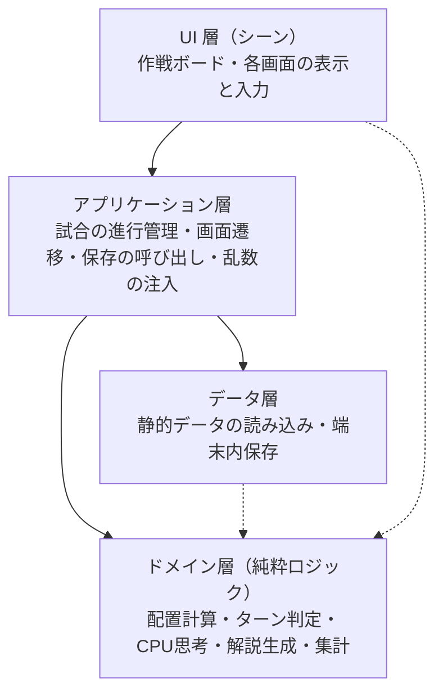

# アーキテクチャ概要 — soccer-game（仮称）

**更新日**: 2026-10-18

> 技術スタック選定・アーキテクチャパターン（レイヤー構成・責務）・データ永続化戦略・
> スケーラビリティ設計・技術的制約・依存関係管理を集約する。**採用する技術のバージョンの正本も本書**とする。
>
> パフォーマンス要件・セキュリティ要件・テスト戦略の数値目標・実測値は
> `non-functional-requirements.md` を正本とする。テストの書き方・カバレッジ方針の「型」、
> レイヤー間依存の一般論、コードレビュー観点の「型」、GDScript のコーディング規約は kit の `reference/rules/`
> （`testing` / `naming-and-placement` / `code-review` / `coding-gdscript`）を正本とする。本書にはプロジェクト固有の
> 選定理由・構成のみを書く。

## 選定の前提

技術選定は次の確定事項から導いた（いずれも `requirements-definition.md` が正本）。

- MVP の配布先は Android（Google Play）。Windows（Steam）は後続マイルストーンで、同じコードから書き出せること（§7 #9、§6.2）
- 判断もターン結果の表示も作戦ボード（縦向きのピッチを斜めから見た半3D。FR-24）。2026-10-23 に 3D 演出をやめた（下の注記）
- ルールの正しさ（判定例・決定性・対称性・偏りの検証）をテストで担保することが、プロダクトの価値の中核（FR-05、§7 #14）
- サーバーなし・外部通信なし（§7 #8）

### 比較した候補

| 候補 | Android・Windows への書き出し（Windows は後続マイルストーン） | 2D の UI と 3D の演出 | 利用料 | ルールのテストを CLI で回せるか | 判定 |
|---|---|---|---|---|---|
| **Godot 4 ＋ GDScript** | 両方に対応 | 1つのエンジンで扱える | なし（MIT） | gdUnit4 で可能 | **採用** |
| Tauri 2 ＋ Vue 3 ＋ TypeScript ＋ Three.js | 両方に対応（Android は WebView） | 3D は WebGL で手組み。選手のアニメーションの作り込みが重い。Android の WebView での 3D 性能は端末差が大きい | なし | Vitest で可能（フォーメーションラボの資産を活かせる） | 3D 演出が必須になった時点で不採用 |
| Flutter（Dart） | 両方に対応（最も成熟） | 2D は得意。3D は追加の仕組みが要る | なし | 可能 | 3D 演出との相性で不採用 |
| Unity（C#） | 両方に対応 | 3D の実績が最も豊富 | ライセンス条件の確認が要る（過去に変更されたことがある） | 可能 | 盤面と UI が中心の本作には重く、不採用 |

> 2D／3D の方針（判断は 2D、演出は 3D）を決める前は Tauri 2 ＋ Vue 3 ＋ TypeScript を推していた。
> 3D 演出が公開の必須条件になったことで、2D と 3D を1つのエンジンで扱える Godot を採用した。
>
> **2026-10-23**: 3D 演出をやめた（FR-24 を、作戦ボードの上で駒とボールを動かす表示に置き換えた）。選定は変えない。
> Godot は、2D の盤面と UI・Android と Windows への書き出し・ルールのテストを CLI で回せることで、引き続き要件に合う。
> 上の表の「2D の UI と 3D の演出」の列は、選定した時点の判断の記録として残す。

## テクノロジースタック

### 言語・ランタイム

| 技術 | バージョン | 選定理由 |
|---|---|---|
| Godot Engine（標準版。.NET 版ではない） | **4.7.2**（stable。パッチまで固定。2026-10-18 の開発環境の構築で決定。gdUnit4 6.2 系が 4.7 に対応したため） | 2D の UI と 3D の演出を1つのエンジンで扱える。Android へ書き出せ、後続マイルストーンの Windows へも同じコードで書き出せる。MIT ライセンスで利用料がかからない |
| GDScript | Godot に同梱 | Godot の標準言語で、Android への書き出しが正式にサポートされている（C# 版は Android への書き出しが実験的な扱いのため採用しない。Godot 4.7 の公式ドキュメント「C# platform support」で確認。同ドキュメントの記載は「4.2 以降 Android に書き出せるが、現時点では実験的」。確認したのは、採用する 4.7 系のドキュメントそのもの） |

### フレームワーク・ライブラリ

| 技術 | バージョン | 用途 | 選定理由 |
|---|---|---|---|
| Godot 標準の UI（Control ノード） | Godot に同梱 | 2D の作戦ボード・各画面 | 追加の依存なしでタッチを扱える（後続マイルストーンの Windows 版ではマウスも同じ仕組みで扱える） |
| Godot の Compatibility レンダラー | Godot に同梱 | 2D の描画 | 低価格帯の Android 端末まで幅広く動く。作戦ボードは 2D の描画で、遠近は座標の写し方で作るので、高度な描画機能を必要としない（Godot 4.7 公式ドキュメント「Choosing a renderer」の推奨条件に合致）。実機での性能を確認して不足があれば Mobile レンダラーを再検討する。**要確認**: 構築時、ソフトウェア描画（SwiftShader）のエミュレーターでは 3D 用のシェーダーが uniform の上限（`GL_MAX_FRAGMENT_UNIFORM_VECTORS` 261）を超えてリンクに失敗した。GPU の上限が小さい低価格帯の実機で同じことが起きないかを、基準端末で確かめる（NFR-02。3D の舞台はやめたが、文字も描かれなかったため確認は残す） |

### 開発ツール

| 技術 | バージョン | 用途 | 選定理由 |
|---|---|---|---|
| gdUnit4 | **6.2.2**（6.2 系は Godot 4.7 に対応。`addons/` に同梱。2026-10-18 に決定） | GDScript の単体テスト | CLI から実行でき、UI を伴わないドメインロジックのテストは画面なし（`--ignoreHeadlessMode`）で CI 実行できる。MIT ライセンス |
| Android SDK・JDK | JDK: OpenJDK 17。Android SDK: platform-tools、build-tools 36.0.0、platforms android-36、NDK 28.1.13356709、CMake 3.10.2.4988404（Godot 4.7 の公式ドキュメント「Exporting for Android」の要件と、対象 API 36 に合わせた。2026-10-18 に決定。入れ方は `repository-structure.md`「開発環境セットアップ」） | Android 向けの書き出し（Google Play 用の AAB） | Godot の Android 書き出しに必須 |
| Git | — | バージョン管理 | — |

> **選手の素材**: 作戦ボードの駒（ユニフォームを着たチェスのポーン。2026-11-06）とサッカーボールをコードで描き、エリア間の移動はコードで補間する
> （`Tween`）。外部の素材を使わないので、ライセンス管理の手間がなく、低価格帯の端末でも軽い（NFR-02・NFR-04）。
> 2026-10-17 に決めた 3D の選手の素材（カプセル＋チーム色＋背番号）は、3D 演出をやめたので使わない（2026-10-23）。
> 今後、外部の素材（フォント・音を含む）を使う場合はライセンスを台帳（`game/assets/LICENSES.md`）に記録する
> （依存関係管理を参照）。効果音は CC0 のフリー音源を使う（2026-10-30 シャビ決定。どの音かは台帳の「効果音」）。
>
> **フォント**: 日本語に Noto Sans JP、数字・英字の見出しに Barlow Condensed を、アプリに同梱する（どちらも SIL Open Font
> License 1.1）。Godot の既定のフォントは日本語を含まず、端末のフォントに頼ると機種によって字形と幅が変わり、盤面の配置が
> 崩れるため。サイズを抑えるため、画面で使う文字に絞ったサブセットにする（2026-10-17 決定。書体の選定は
> `docs/specs/2_basic-design/screen-design.md`「ビジュアルの方向性」）。
> - サブセットは、画面の固定文言と静的データ（`game/content/` の全ファイル）の全文言から生成し、文言が変わるたびに作り直す。
>   フォントに無い文字（表示できない文字）が残っていないかを自動で確かめる（スクリプトは `tools/`）
> - OFL 1.1 に従い、ライセンスの本文と著作権表示をアプリに同梱し、アプリ内のライセンス表示から読めるようにする。
>   サブセット化は改変にあたるため、台帳への記録の際に予約フォント名（Reserved Font Name）の有無を確かめ、ある場合は名前を変える

## アーキテクチャパターン

### レイヤー構成

実線は呼び出し、点線はドメインの型（値オブジェクト）への依存を表す。UI 層は表示のためにドメインの値を読み、
データ層は読み込んだデータをドメインの値オブジェクトへ変換するために、それぞれドメインの型に依存する。
ドメイン層はどの層にも依存しない。

#### UI 層（シーン）
- **責務**: 画面（S-01〜S-12）の表示、入力の受付、作戦ボードの描画（開示の動きを含む）
- **許可される操作**: アプリケーション層の呼び出し。ドメイン層が返す値（配置・判定結果・ターン記録）の表示
- **禁止される操作**: ルールの計算（人数差・カバー判定・選択可能な手の判定を UI 側で再実装しない）、データ層への直接アクセス
- **開示の動きの原則**: 開示の動きは**ターン記録（判定前・判定時の配置と、次のターン開始時の配置）から作る表示専用の表現**とする。判定モジュールを呼ばず、独自のシミュレーションで結果を変えない。駒はエリアごとに決めた位置に置き、エリアの人数と見た目が一致するようにする（単純化 SIM-06 との食い違いを生まないため）。2026-10-23 に 3D 演出の原則から置き換えた

#### アプリケーション層
- **責務**: 試合の状態遷移（試合準備 → 攻守ターン／トランジションターン → 得点 → 方式の選び直し → ハーフタイム → 結果）、ターンごとのドメイン呼び出し、保存のタイミング制御、乱数生成器の生成と注入
- **許可される操作**: ドメイン層・データ層の呼び出し
- **禁止される操作**: ルールの計算（ドメインに委ねる）、UI ノードの直接操作（シグナルで UI に通知する）

#### ドメイン層（純粋ロジック）
- **責務**: `functional-overview.md`「アルゴリズム設計」1〜10
- **許可される操作**: 引数で受け取った値（データ層が変換した静的データの値オブジェクトを含む）だけを使った計算
- **禁止される操作**: シーンツリー・ノード・ファイル・時刻・グローバルな乱数へのアクセス。乱数は引数で注入された生成器だけを使う。ノード非依存の書き方は kit の `coding-gdscript.md`「テスト対象のロジックは `Node` を継承しない」に従う
- **理由**: 判定の決定性・対称性と、自己対戦による偏りの検証（FR-02・FR-05）を、エンジンを起動したシーンなしで高速にテストするため
- **本節の禁止事項が、ドメイン層の禁止依存の正本**（`repository-structure.md`・NFR-13 はここを参照する）

#### データ層
- **責務**: 静的データ（陣形の座標・特徴タグ・方式の解説・噛み合わせルール・戦術原則・単純化カタログ・場面問題・調整値）の読み込みと、ドメインの値オブジェクトへの変換。端末内保存（中断データ・戦績・回答結果・設定）の読み書き
- **許可される操作**: Godot のリソース読み込み、`user://` 配下のファイル入出力
- **禁止される操作**: ルールの計算、UI の操作

> レイヤー間の依存禁止の一般論は kit の `reference/rules/naming-and-placement.md`「依存関係のルール」を
> 正本とする。ディレクトリへの割り当ては `repository-structure.md` で定める。

## データ永続化戦略

### ストレージ方式

| データ種別 | ストレージ | フォーマット | 理由 |
|---|---|---|---|
| 静的データ（陣形・方式・タグ・ルール・原則・単純化・場面問題） | アプリに同梱（`res://`） | JSON | フォーメーションラボから移植するデータを機械的に変換しやすい。差分レビューしやすい |
| 調整値（ターン数・CPU パラメータ等） | アプリに同梱（`res://`） | Godot の Resource（`.tres`） | コードに直接書かない（一覧の正本は `functional-overview.md`「確定事項」）。エディタ上で実行しながら調整できる（kit の `coding-gdscript.md`「調整対象の数値はコードに埋めない」） |
| 中断データ（試合の状態・ターン記録） | 端末内（`user://`） | JSON | ターンの確定時と進行段階が変わる時に上書きする（時点の正本は `functional-overview.md`「確定事項」の保存の時点）。強制終了でも直前に確定した状態を残すため、一時ファイルに書いてから置き換える |
| 戦績・回答結果 | 端末内（`user://`） | JSON | 件数が少なく、追記と全件読み込みで足りる |
| 設定（音量・ヒント表示・チュートリアル完了） | 端末内（`user://`） | Godot の ConfigFile | キーと値の単純な設定に適する |

### 保存データの形式のバージョン

端末内に保存するデータ（中断データ・戦績・回答結果・設定）は、**形式のバージョン番号を持たせる**。
アプリの更新で形式が変わった場合、読み込み時にバージョンを見て新しい形式へ変換する。これにより、
アプリを更新しても戦績や設定が失われないようにする（目標と測定方法は `non-functional-requirements.md`
NFR-26）。

> 保存データの破損・失敗時の扱いは `functional-overview.md`「エラーハンドリング」、
> 信頼性の目標と測定方法は `non-functional-requirements.md`「信頼性・データ整合性」を正本とする。

## スケーラビリティ設計

### データ増加への対応

- **想定データ量**: 戦績は1日数試合 × 数年で数千件程度。中断データは常に最大1件。場面問題は数十問
- **パフォーマンス劣化対策**: 戦績の一覧は新しい順に必要な件数だけ表示する。数千件で問題が出た場合は、集計値（通算成績）を別に保持する
- **アーカイブ戦略**: MVP では行わない（削除機能も持たない。`functional-overview.md`「確定事項」）

### 機能拡張性

- **陣形・方式の追加**: 陣形は座標データの追加、方式はドメイン層の動き方の規則の追加で対応する。追加後は判定例・対称性・偏りの自己対戦検証を通す
- **単純化項目の段階的な表現**（後続マイルストーン）: ドメイン層の配置計算・判定に規則を足す形で拡張する。UI は配置と判定結果を表示するだけなので影響を受けにくい
- **ローカル2人対戦**（後続マイルストーン）: CPU 思考をもう1人の利用者の入力に差し替える。ドメインは利用者・CPU を区別しない（攻撃側・守備側で扱う）ため変更不要
- **アカウント・クラウド保存**（後続マイルストーン）: データ層に保存先を追加する。外部通信の方針（§7 #8）の見直しが前提
- **Windows 版**（後続マイルストーン）: 画面は MVP から横向きだけで設計しているため、PC の横長の画面でも同じ配置を使う。
  追加するのは書き出しの設定・マウス操作の確認・PC の画面サイズでの表示の確認（要件定義書 §6.2）

## 技術的制約

### 環境要件
- **OS**: Android。最小 API レベル **24**（Android 7.0。Godot 4.7.2 の書き出しの既定値。書き出した APK で確認）、対象 API レベル **36**
  （Android 16。Google Play は 2026-08-31 から新しいアプリに API 36 を対象にすることを求めている）。2026-10-18 に確認
- **メモリ・ディスク容量**: 目標と測定方法は `non-functional-requirements.md`（NFR-04・NFR-24）
- **必要な外部依存**: なし（実行時にネットワークを使わない）

### パフォーマンス制約
- 開示の動きは低価格帯の Android 端末でも途切れずに動くこと（NFR-02）
- ドメインロジックの計算量は、自己対戦検証の実行時間の目標（NFR-15）を満たす範囲に保つ

### セキュリティ制約
- 個人情報を収集しない。外部通信をしない。広告・解析 SDK を組み込まない（全年齢対象のストアのポリシーにも関わる。要件定義書 §7 #18）
- 署名鍵（Android のアップロード鍵）をリポジトリに含めない

## 依存関係管理

| 依存 | 用途 | バージョン管理方針 |
|---|---|---|
| Godot Engine（エディタ・書き出しテンプレート） | 開発・書き出し | パッチまで固定（本書「テクノロジースタック」に記録）。更新は gdUnit4 の対応範囲を確認してから、全テストと実機確認を通して行う |
| gdUnit4 | テスト | `addons/` に同梱して固定 |
| 素材（テクスチャ・音・フォント） | UI | 調達元・ライセンス・バージョンを台帳（`game/assets/LICENSES.md`）に記録する |

> 依存の脆弱性検査・更新方針の一般論は kit の `reference/rules/dependencies.md` を正本とする。
