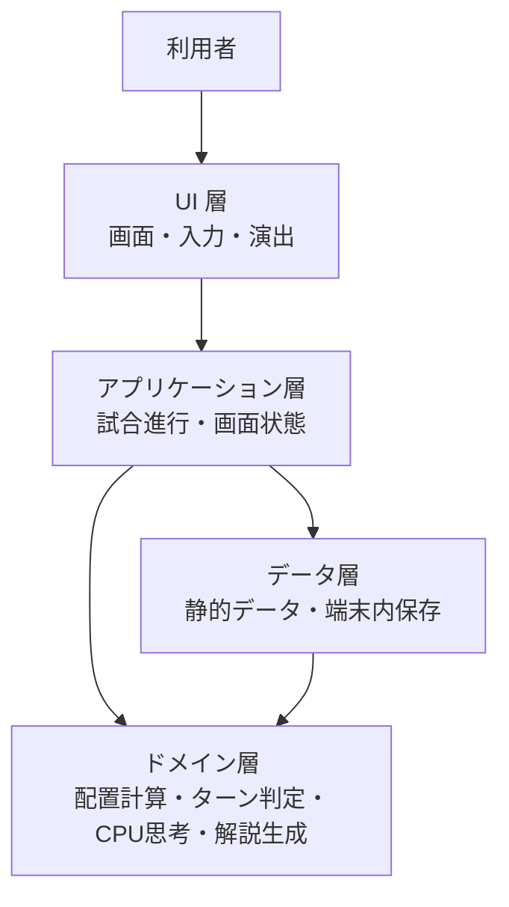
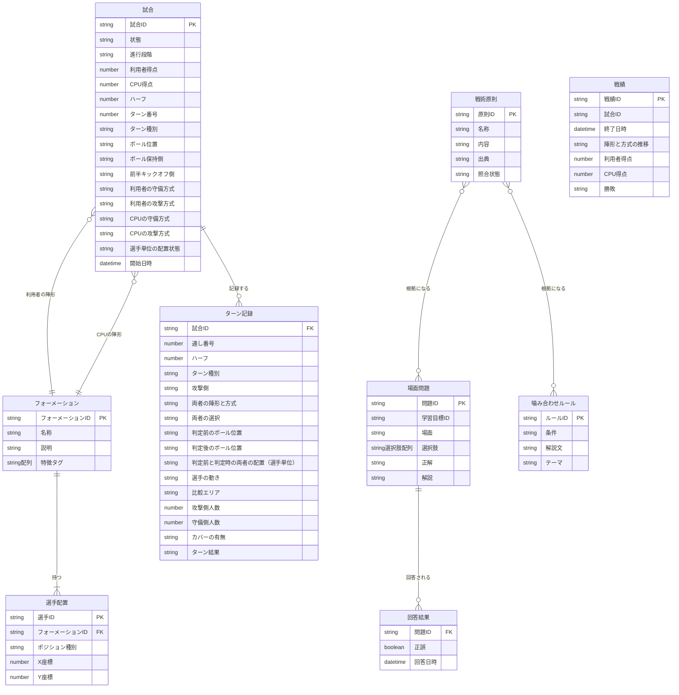
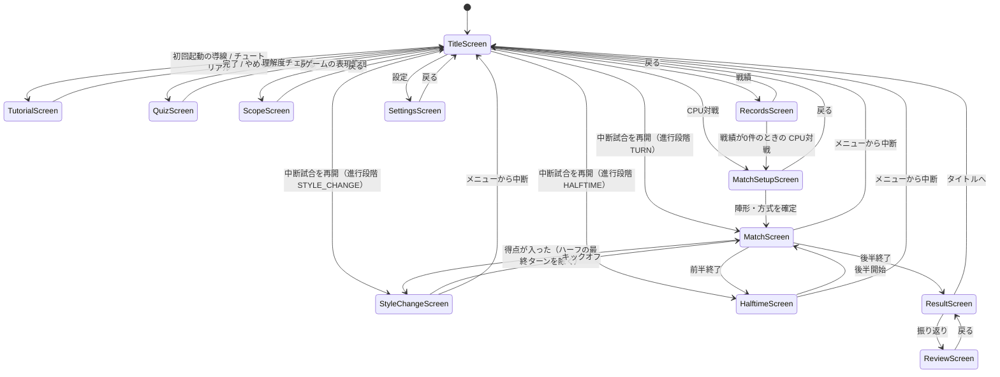
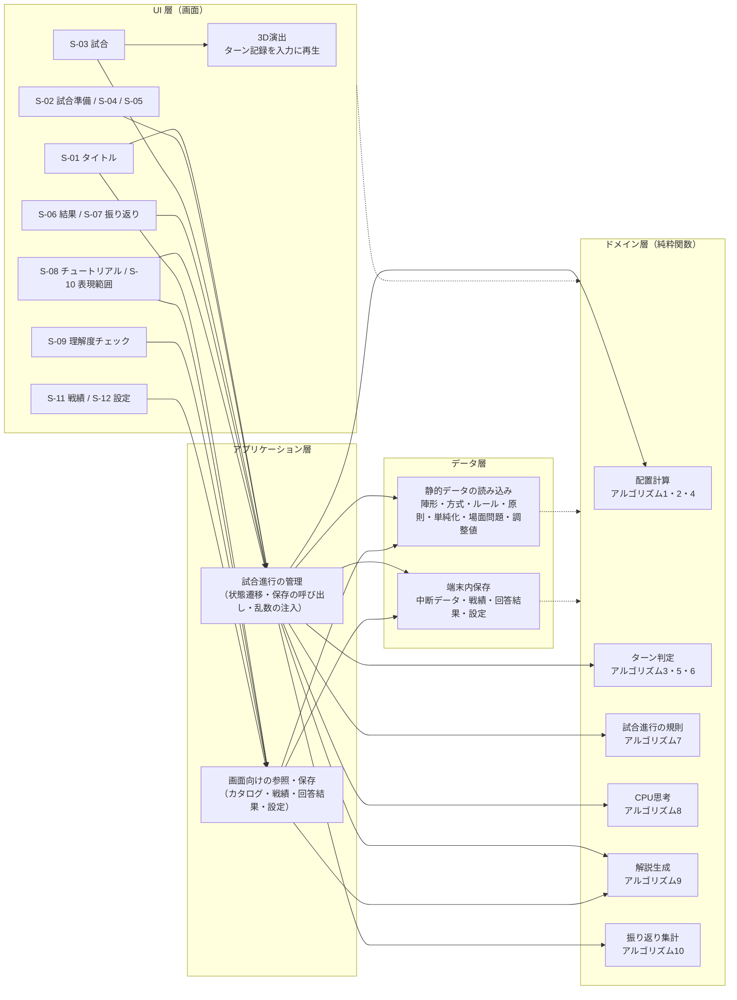

# 機能概要 — soccer-game（仮称）

**更新日**: 2026-10-17

> 本ドキュメントは、プロジェクトの意思決定としてぶれてはいけない重要点（データモデル・中核アルゴリズム・
> 戦術原則カタログ・単純化カタログ・画面/ユースケースの一覧・画面設計・エラーハンドリング）を集約する。
> 技術スタック・アーキテクチャパターンは `architecture-overview.md` を正本とする。
> 機能要件（FR）・学習目標（LG）は `requirements-definition.md` を正本とし、本書は ID で参照する。
>
> 本プロダクトはサーバーを持たないため、「API一覧」は該当なし、「モジュール構成図」は
> 画面 × ドメインモジュールの対応図とする。

## システム構成図



ゲームのルール（配置計算・ターン判定・トランジション・シュート・CPU 思考・解説生成）は、
**外部依存のない純粋関数としてドメイン層に置く**。判定の決定性・対称性（FR-05）をテストで
保証するためである。乱数を使う処理（CPU の選択・キックオフ側の決定）は、乱数生成を外から注入する。
各層の責務・許可/禁止の正本は `architecture-overview.md`「アーキテクチャパターン」とする。

## データモデル

> 本節は**概念モデル**（エンティティ・区分値・ドメイン上の制約・ER図）までを扱う。
> 本プロダクトは RDB を持たない。永続化は端末内の保存領域に限られ、件数も少ない
> （中断データ1件・戦績・理解度チェック結果・設定）。このため、論理データモデル書・テーブル定義書
> （`docs/specs/3_detail-design/db/`）の後続工程は**作成しない**。保存形式は基本設計
> （`docs/specs/2_basic-design/`）で定める。

### エンティティと区分値

- エンティティ:
  - **フォーメーション**（静的）: 選手配置の座標と特徴タグを持ち、15エリアの基本配置を導出する
  - **方式**（静的）: 4方式（ゾーン・マンツーマン・保持型・カウンター型）の名称と、解説の固定文（特徴・強み・弱み）
  - **試合**（端末内保存）: 進行中・中断中の試合の状態。進行段階（`MatchStage`）を持ち、中断した画面から再開できるようにする
  - **ターン記録**（試合に従属）: 各ターンの選択・配置・選手の動き・判定結果。振り返り（FR-18）と 3D 演出（FR-24）の入力。3D 演出はターン記録だけから生成するため、判定前後のボール位置と、動いた選手の移動元・移動先・理由（方式の動き・守備の手・ドリブルなど）を持つ
  - **戦績**（端末内保存）: 終了した試合の結果
  - **場面問題**（静的）／**回答結果**（端末内保存）: 理解度チェック（FR-22）
  - **設定**（端末内保存）: 音量・ヒント表示・チュートリアル完了フラグ（FR-12 の初回起動の導線の判定に使う）
  - **戦術原則**・**単純化項目**（静的）: 本書の各カタログの内容をアプリ内表示用に持つ
  - **噛み合わせルール**（静的）: 解説生成（FR-17）の規則。フォーメーションラボから移植
  - **チュートリアルの段階**（静的）: チュートリアル（FR-12）の各段階の説明文・盤面の初期状態・相手が出す手
- 関係: フォーメーション 1 ―― * 選手配置、試合 1 ―― * ターン記録、場面問題 1 ―― * 回答結果、
  戦術原則 * ―― * 噛み合わせルール／場面問題（解説の根拠として参照）
- 区分値（型名と取りうる値）:
  - `Lane`（レーン。各チーム自身の攻撃方向から見た左右） = `L2`（左大外） | `L1`（左ハーフスペース） | `C`（中央） | `R1`（右ハーフスペース） | `R2`（右大外）
  - `Zone`（ゾーン。各チーム自身から見た） = `D`（自陣） | `M`（中盤） | `A`（敵陣）
  - `DefenseStyle`（守備方式） = `ZONE`（ゾーン） | `MAN`（マンツーマン）
  - `AttackStyle`（攻撃方式） = `POSSESSION`（保持型） | `COUNTER`（カウンター型）
  - `TurnKind`（ターン種別） = `OPEN_PLAY`（攻守ターン） | `TRANSITION`（トランジションターン）
  - `PlayType`（攻撃の手） = `SHORT_PASS` | `DRIBBLE` | `LONG_BEHIND`（背後へのロングボール） | `SWITCH`（サイドチェンジ） | `SHOT`
  - `DefenseAction`（守備の手） = `PRESS` | `COVER`
  - `NegTransAction`（失った側の手） = `COUNTER_PRESS`（即時奪回） | `RETREAT`（リトリート）
  - `PosTransAction`（奪った側の手） = `COUNTER`（カウンター。運ぶ先を伴う） | `SECURE`（保持）
  - `TurnOutcome`（ターン結果） = `ADVANCE`（前進） | `STALL`（膠着） | `LOSS`（ロスト） | `GOAL`（得点） | `SAVE`（シュート阻止） | `REGAIN`（奪回成功） | `REGAIN_FAILED`（奪回失敗） | `NO_CONTEST`（判定なし。リトリート×保持で奪取側がそのまま保持）
  - `MatchStatus` = `IN_PROGRESS` | `FINISHED`（「中断中」は保存する状態ではなく、起動時に `IN_PROGRESS` の中断データが見つかったことで判断する。強制終了の瞬間には状態を書き込めないため）
  - `MatchStage`（進行段階。`IN_PROGRESS` の間の画面の位置） = `TURN`（試合画面で手の選択・演出） | `STYLE_CHANGE`（方式の選び直し） | `HALFTIME`（ハーフタイム）
  - `PrincipleStatus`（出典の照合状態） = `UNVERIFIED`（内容未照合） | `VERIFIED`（照合済み） | `NO_SOURCE`（出典未確定）

### ドメイン上の制約

- 1チームのフィールド選手は10人。GK はエリアの人数に数えない（GK の扱いは「シュート」「カバー判定」を参照）
- 各チームの15エリアの人数の合計は、常に10である（移動しても選手は増減しない）
- 選手配置は**選手単位**で状態を持つ（基本エリア・現在エリア・寄せによる固定の有無）。画面に出すのはエリアごとの人数だけだが、方式の動き方とプレスの持続を一意に計算するために選手単位で扱う
- 盤面の座標は、各チーム自身の攻撃方向から見た `(Lane, Zone)` で表す。相手チームの `(l, z)` は自チームから見て `(鏡像レーン, 鏡像ゾーン)`（`L2↔R2`, `L1↔R1`, `C↔C`, `D↔A`, `M↔M`）である
- 判定はすべて「ボール保持側（攻撃側）から見た座標」で行う。どちらのチームが利用者かに依存しない（FR-05 の対称性はこの制約から導かれる）
- 期間を表す語を2つ区別する（用語集「配置区間」「方式区間」）
  - **配置区間**: 固定（プレス・カバー・ドリブルで動いた選手）が有効な期間。キックオフ時、またはトランジションターンが終わって攻守ターンが始まる時に始まる（奪回成功 `REGAIN` で同じチームが保持し続ける場合も含む）。トランジションターンの間は前の配置区間が続く
  - **方式区間**: 方式が有効な期間。キックオフから次の得失点またはハーフ終了まで
- 陣形はハーフ単位、方式は方式区間単位で変わる。振り返り（FR-18）の「時間帯ごとの陣形・方式」は、ターン記録に両チームの陣形・方式を持たせて記録する

### ER図



> 戦績・設定・単純化項目・方式・チュートリアルの段階は他エンティティと関連を持たないため、ER図では戦績のみ示し、
> それ以外は省略する（設定: BGM音量・効果音音量・ヒント表示・チュートリアル完了フラグ。
> 単純化項目: 本書「単純化カタログ」。方式: 名称と解説の固定文。チュートリアルの段階: 説明文・盤面の初期状態・相手が出す手）。

### 確定事項（概念レベル）

- **日時の基準**: 端末のローカル時刻。戦績の並び順・回答日時に用いる（サーバーが無いため、端末間の整合は扱わない）
- **削除方針**: 中断データは、次の4つの時点で物理削除する。①新規試合開始時（利用者の確認後。戦績を記録できていない試合が残っている場合は、戦績が記録されないことの確認を含む。下記「試合終了から破棄までの順序」③）、②試合終了後に結果画面からタイトルへ戻る時（終了処理が済んでいる場合に限る。下記「試合終了から破棄までの順序」③）、③起動時に `FINISHED` の中断データが見つかった時、④読み込みに失敗した時（エラーハンドリング）。戦績・回答結果は削除しない（MVP では消去機能を持たない）
- **一意性**: 中断データは常に最大1件。戦績は試合IDごとに1件で、同じ試合IDの戦績がすでにあれば記録しない（終了処理をやり直しても二重に記録しないため）
- **試合終了から破棄までの順序**: ①後半終了時に戦績を記録し、その保存が成功してから、試合の状態を `FINISHED` にして中断データを上書き保存する（ターン記録を含む）。どちらかの保存に失敗した場合は中断データが `IN_PROGRESS` のまま残るので、起動時に「最終ターンまで終えた `IN_PROGRESS`」が見つかれば、再開ではなく終了処理（戦績の記録 → `FINISHED`）だけをやり直す → ②結果画面・振り返り画面は何度行き来してもターン記録を参照できる → ③結果画面からタイトルへ戻る時に、終了処理（戦績の記録と `FINISHED` での保存）が済んでいれば中断データ（ターン記録を含む）を削除する。済んでいなければ終了処理をやり直し、なお失敗した場合は削除せずに残す（戦績を失わないため）。残した試合は再開の対象にせず、次の起動時と、次に CPU 対戦を始める前に、もう一度やり直す。CPU 対戦の前のやり直しにも失敗した場合は、その試合の戦績が記録されないことを利用者に確認し、了承されたら新しい試合で上書きする。戦績には集計値だけを残す
- **起動時の扱い**: 起動時に中断データがあれば、`IN_PROGRESS` なら中断中の試合として再開を選べる。`FINISHED` なら戦績は記録済みのため、そのまま削除する
- **保存の時点**: 中断データは、①ターンの確定時、②試合準備を確定して試合を作成し `TURN` に入る時（`IN_PROGRESS` の作成時）、③進行段階が変わる時（得点やハーフ終了で `STYLE_CHANGE`・`HALFTIME` に入る時、方式・陣形の選び直しを確定して `TURN` に戻る時。選び直した陣形・方式も含めて保存する）、④試合中のメニューから中断してタイトルへ戻る時（直前の保存に失敗していた場合だけ）に上書き保存する
- **再開先**: 再開は進行段階（`MatchStage`）が示す画面から行う。`TURN` は試合画面（直前に確定したターンの次の手の選択から。演出の途中で中断した場合は演出を再生しない）、`STYLE_CHANGE` は方式の選び直し画面、`HALFTIME` はハーフタイム画面
- **フォーメーションの座標**: フォーメーションラボ（`soccer-sim` の `src/data/formations.ts`）から 4-4-2・4-3-3・4-2-3-1・3-5-2 の座標をそのまま移植する。座標系は幅・高さとも 0〜100、y が大きいほど相手ゴール側
- **設定値として外部化する値**（コードに直接書かない。本一覧を正本とし、他の文書はここを参照する）:

  | 設定値 | 初期値 | 備考 |
  |---|---|---|
  | 1ハーフのターン数 | 12 | 要件定義書 §7.1 #1 でテストプレイにより確定 |
  | 1ターンの 3D 演出の長さの上限 | 5秒 | FR-24。5秒を超えない範囲でテストプレイにより調整 |
  | 振り返りで得失点の直前に遡るターン数 | 3 | FR-18 |
  | CPU の選択の温度 τ | 1.0 | アルゴリズム8 |
  | CPU の選択の下限確率 floor | 0.1 | アルゴリズム8 |
  | 自己対戦検証の各組み合わせの試合数 | 20 | NFR-05〜07 |

## アルゴリズム設計（ドメインロジック）

本アプリの中核ロジック。すべて外部依存のない純粋関数として設計し、テスト設計の主対象とする。
以下、エリアは `ゾーン-レーン`（例: `M-L1` = 中盤・左ハーフスペース）で表し、特記がない限り
**ボール保持側（攻撃側）から見た座標**で書く。

### アルゴリズム1: 基本配置の導出

**目的**: フォーメーションの選手座標から、15エリアの人数（基本配置）を導出する。

**計算ロジック**:
- GK を除くフィールド選手10人について、座標 `(x, y)` からエリアを決める
- レーン: `d = |x − 50|` とし、`d ≤ 15` → `C`、`15 < d < 30` → ハーフスペース、`d ≥ 30` → 大外。`x < 50` なら左（`L1`/`L2`）、`x > 50` なら右（`R1`/`R2`）
- ゾーン: `y < 100/3` → `D`、`y < 200/3` → `M`、それ以外 → `A`

**計算結果（MVP の4陣形。列: L2 / L1 / C / R1 / R2）**:

| 陣形 | A（敵陣） | M（中盤） | D（自陣） |
|---|---|---|---|
| 4-4-2 | 0 0 2 0 0 | 1 0 2 0 1 | 1 0 2 0 1 |
| 4-3-3 | 1 0 1 0 1 | 0 1 1 1 0 | 1 0 2 0 1 |
| 4-2-3-1 | 0 0 1 0 0 | 1 0 3 0 1 | 1 0 2 0 1 |
| 3-5-2 | 0 0 2 0 0 | 1 0 3 0 1 | 0 1 1 1 0 |

**エッジケース（テスト対象）**:
- `d = 15` ちょうど（x=35/65）は `C`、`d = 30` ちょうど（x=20/80）は大外
- `x = 50` は `C`（左右の判定をしない）
- GK を数えない。各陣形の合計が10になる
- 4陣形すべてについて上表と一致する

### アルゴリズム2: 現在配置の算出（方式による動き方）

**目的**: ターン開始時点の両チームの選手配置を、基本配置・方式・ボール位置・固定された選手から算出する。

**計算ロジック**:
1. **配置区間の開始時のリセット**: キックオフ時と、トランジションターンが終わって攻守ターンが始まる時に、全選手を基本エリアに戻し、固定を解除する（トランジションターンの間はリセットしない）
2. **固定された選手**（プレス・カバー・ドリブルで動いた選手）は、配置区間が終わるまで固定先のエリアに留まり、以下の方式の動きの対象外とする
3. **ボール保持側（攻撃方式）**:
   - `POSSESSION`: 大外（`L2`/`R2`）の選手が1ゾーン前へ出る（`D→M`、`M→A`。`A` の選手はそのまま）
   - `COUNTER`: 基本エリアのまま
4. **ボール非保持側（守備方式）**:
   - `ZONE`: ボールが守備側から見て左右どちらかのハーフスペース／大外にあるとき、全選手が1レーンボールサイドへずれる。ボールサイドの大外にいる選手はそのまま。ボールが `C` レーンならずれない。ずれる基準は**ターン開始時のボール位置**
   - `MAN`: 次の規則でマークをつける
     - マーク対象: 守備側の `D`・`M` ゾーンにいる攻撃側の選手
     - マーカー: 固定されていない守備側の選手のうち、基本エリアが `D`・`M` ゾーンの選手（基本エリアが `A` の選手は基本エリアに残る）
     - 対象1人につきマーカー1人を、**対象と同じエリア**に置く
     - マーカーが足りなければ、守備側ゴールに近い対象から優先する（ゾーン `D` → `M`、同じゾーンでは `C` → ハーフスペース → 大外、同順位なら守備側自身から見て左を先）
     - 余ったマーカーは守備側の `D-C` に置く（カバー役）
     - 攻撃側の選手が動いたら（ドリブル）、マークを付け直す（マーカーがついていく）

**エッジケース（テスト対象）**:
- ゾーンで、ボールが `C` レーンならずれない。ボールサイドの大外の選手が2レーン分（元の大外＋ずれてきた選手）集まる
- マンツーマンで、マーカーがちょうど足りる／余る／足りない、の各場合
- 固定された選手が方式の動きに巻き込まれない
- 配置区間の開始時に固定が解除され、トランジションターンでは解除されない

### アルゴリズム3: 選択可能な手

**目的**: 局面とボール位置・現在配置から、両者が選べる手を決める（選べない手は選択不可として表示する。FR-03）。

**攻撃の手**（ボール位置を `B` とする）:

| 手 | 運ぶ先 `T` の条件 |
|---|---|
| `SHORT_PASS` | `B` の隣接8エリア（斜めを含む）で、味方が1人以上いる |
| `DRIBBLE` | `B` の前・左・右の隣接エリア（後ろへは運べない）。味方の有無は問わない |
| `LONG_BEHIND` | `B` が `D` ゾーンのとき、`A` ゾーンで同じか隣のレーン。味方が1人以上いる |
| `SWITCH` | `B` と同じゾーンで、レーンが3つ以上離れたエリア（例: `L2→R1`, `L2→R2`, `L1→R2`）。味方が1人以上いる |
| `SHOT` | `B` が `A` ゾーンの `C`・`L1`・`R1` のとき（運ぶ先なし） |

**守備の手**（制限するエリアを `T_d` とする）:

| 手 | 条件 |
|---|---|
| `PRESS` | `T_d` の上下左右の隣接エリアのどこかに、守備側の選手が1人以上いる |
| `COVER` | `T_d` が守備側の `D` ゾーン以外で、`T_d` か隣接エリアに守備側の選手が1人以上いる |

**トランジションの手**: 失った側は `COUNTER_PRESS`／`RETREAT` を常に選べる。奪った側は `SECURE` を
常に選べ、`COUNTER` はボール位置から奪った側の攻撃方向へ1〜2ゾーン前のエリア（レーン不問）で、
アルゴリズム6の配置で味方が1人以上いるエリアを運ぶ先に選べる。

### アルゴリズム4: 守備の手による移動

**目的**: プレス・カバーで動く選手を一意に決める。

**計算ロジック**:
- **`PRESS`**: `T_d` の上下左右の隣接エリアのうち、守備側の選手が1人以上いて、**余り（守備側人数 − 攻撃側人数）が最大**のエリアから1人を `T_d` へ動かし固定する。余りが同じなら、守備側から見て**前方（相手ゴール側）→ 横（中央寄りのレーン）→ 背後**の順に優先する（最終ラインを最後まで崩さない。チャレンジ＆カバー原則 TP-03）。横の左右も同率なら守備側自身から見て左を先
- **`COVER`**: `T_d` に守備側の選手がいればその1人を、いなければ `PRESS` と同じ規則で選んだ隣接エリアの1人を、`T_d` の**背後**（守備側ゴール方向へ1ゾーン）へ動かし固定する
- 固定されていない選手を優先して動かす。対象エリアに固定された選手しかいなければ、その選手を動かす（固定先を更新）

**エッジケース（テスト対象）**:
- 余りが負のエリアしかない場合も、守備側の選手がいれば動かす
- 同率の優先順（前方 → 横 → 背後、左右同率は守備側の左）
- マンツーマンでプレスに出たマーカーは固定され、マークは残りのマーカーで付け直す（そのため、マークしていた相手がフリーになるか、余りのカバー役が埋める）

### アルゴリズム5: 攻守ターンの判定

**目的**: 攻守ターンの結果を、動いた後の人数差とカバーの有無で決める（FR-05）。

**計算ロジック**:
1. アルゴリズム2で両チームの現在配置を出す
2. 守備の手を適用する（アルゴリズム4）
3. 攻撃の手を適用する。`DRIBBLE` はボールを持つ選手を `T` へ動かして固定する。守備側がマンツーマンならマークを付け直す
4. 比較エリアを決める。`SHOT` はボール位置 `B`、それ以外は運ぶ先 `T`
5. `diff = 攻撃側人数(比較エリア) − 守備側人数(比較エリア)` を求める
   - `SHOT`: `diff > 0` → `GOAL`、それ以外 → `SAVE`
   - それ以外の手: `diff > 0` → `ADVANCE`、`diff < 0` → `LOSS`、`diff = 0` → カバー判定
6. **カバー判定**（チャレンジ＆カバー原則 TP-03）: 比較エリアの背後（守備側ゴール方向へ1ゾーン）を `P` とする
   - 比較エリアが攻撃側の `A` ゾーン（`P` が無い）: `C`・`L1`・`R1` なら GK がカバーとみなして `STALL`、`L2`・`R2` なら GK のカバーが届かず `ADVANCE`
   - それ以外: `守備側人数(P) > 攻撃側人数(P)` なら `STALL`、そうでなければ `ADVANCE`
7. 結果の反映:
   - `ADVANCE`: ボールを `T` へ動かす。攻撃側が保持したまま次の攻守ターンへ（固定は維持）
   - `STALL`: ボールは `B` のまま、攻撃側が保持して次の攻守ターンへ（固定は維持）
   - `LOSS`: 守備側が `T` でボールを奪い、トランジションターンへ
   - `GOAL`: 攻撃側に1点。失点側のキックオフ（方式の選び直しを経て）
   - `SAVE`: 守備側が自陣 `D-C` でボールを持ち（GK がキャッチ）、トランジションターンへ

**計算式（まとめ）**:
```
diff = 攻撃側人数(比較エリア) − 守備側人数(比較エリア)   ※両者の手を適用した後の配置で数える
結果 = diff > 0 → 成功 / diff < 0 → ロスト / diff = 0 → 背後にカバーがいれば膠着、いなければ成功
```

**エッジケース（テスト対象）**: 次節「判定例」のすべて。加えて、
- 敵陣ゾーンの大外で同数 → 前進（GK のカバーが届かない）
- 敵陣ゾーンの中央・ハーフスペースで同数 → 膠着（GK がカバー）
- シュートは同数で阻止される（`diff > 0` のみ得点）

### アルゴリズム6: トランジションターンの判定

**目的**: ボール保持が入れ替わった直後の即時奪回／リトリートとカウンター／保持の結果を決める（FR-04）。

ボールを奪った側を「奪取側」、失った側を「喪失側」、奪ったエリアを `X` とする。配置は直前のターン
終了時点（ロスト・阻止の瞬間）のものを起点とする。

**計算ロジック**:
- 喪失側の配置: `COUNTER_PRESS` → 直前の配置のまま。`RETREAT` → 基本配置に戻り、守備方式で動く（アルゴリズム2。ボール位置は `X`）
- 奪取側の配置: `COUNTER` → 直前の配置から、カウンター型なら大外の選手が1ゾーン前へ出る（保持型は直前の配置のまま）。`SECURE` → 判定時は直前の配置のまま（即時奪回との比較に使う）。判定後に攻守ターンを始めるときは、配置区間のリセットで基本配置に戻る
- 組み合わせごとの判定:

| 喪失側 \ 奪取側 | `SECURE`（保持） | `COUNTER`（運ぶ先 `T`） |
|---|---|---|
| `COUNTER_PRESS` | `X` と上下左右の隣接エリアの人数合計を比べる。喪失側が上回れば `REGAIN`、同数以下は `REGAIN_FAILED`（奪取側が保持） | 比較エリア `T` でアルゴリズム5の手順5〜6を適用 |
| `RETREAT` | 判定なし（`NO_CONTEST`）。奪取側が `X` から攻守ターンを開始 | 比較エリア `T` でアルゴリズム5の手順5〜6を適用 |

- 結果の反映:
  - `REGAIN`: 喪失側が `X` で再び保持し、攻守ターンを開始（配置区間のリセット）
  - `REGAIN_FAILED`・`NO_CONTEST`: 奪取側が `X` で保持し、攻守ターンを開始（配置区間のリセット）。振り返りの集計では、`REGAIN_FAILED` は奪取側の判定の勝ちとして数え、`NO_CONTEST` は判定なしとして勝ち負けに含めない（両者が争わないことを選んだ結果であり、どちらかの判断の誤りではないため）
  - カウンターの `ADVANCE`: 奪取側が `T` で保持し、攻守ターンを開始（配置区間のリセット）
  - カウンターの `STALL`: 奪取側が `X` で保持し、攻守ターンを開始（配置区間のリセット）
  - カウンターの `LOSS`: 喪失側が `T` で奪い返し、再びトランジションターン

**エッジケース（テスト対象）**:
- 即時奪回の同数は奪回失敗
- カウンターの同数はカバー判定（敵陣の大外は前進、中央・HS は GK のカバーで膠着）
- 保持型で失うと、ボール周辺の人数が多い（即時奪回が成立しやすい）一方、自陣の大外が空く

### アルゴリズム7: キックオフと試合進行

- **キックオフ**: ボールは `M-C`、キックオフ側が保持する攻守ターンから始める。両チームとも配置区間をリセットし、新しい方式区間を始める
- **前半のキックオフ側**: 試合開始時にランダムに決める（乱数生成は注入。§7 #2）。後半は前半と反対側
- **得点後**: 失点側のキックオフ。その前に両者が方式を選び直す（FR-21）。ただしハーフの最終ターンの得点は、下記「ハーフの最終ターンの得点」に従う
- **ハーフ**: 攻守ターン・トランジションターンとも1ターンとして数え、設定値のターン数で前半・後半を終える。ハーフタイムに陣形・方式を選び直す（FR-08）
- **ハーフの最終ターンの得点**: 方式の選び直しを行わない。前半なら得点を反映してそのままハーフタイムへ（陣形・方式はハーフタイムで選び直せる。後半のキックオフ側は失点側ではなく、前半と反対側）。後半なら得点を反映してそのまま試合結果へ
- **試合終了**: 後半の最終ターン後の得点で勝敗を決める（同点は引き分け）

### アルゴリズム8: CPU の選択

**目的**: 読み合いが成立するように、状況に応じつつ偏りすぎない手を選ぶ（FR-11）。

**計算ロジック**:
- 選択可能な各手 `i` に評価値 `s_i` を付ける。評価値は「相手が何もしないと仮定した、手を適用した後の比較エリアでの人数差（CPU から見た値）」とする
  - 攻撃の手: `攻撃側人数(T) − 守備側人数(T)`（シュートは `B`）
  - 守備の手: 制限するエリアの脅威度 `攻撃側人数(T_d) − 守備側人数(T_d)`（脅威が大きいエリアほど守りに行く）
  - 即時奪回: `X` 周辺の人数差。カウンター: 運ぶ先の人数差。リトリート・保持: 0
- 選択確率: `p_i = floor / N + (1 − floor) × softmax(s_i / τ)`（`N` は選択肢数、`floor` と `τ` は設定値）
- 陣形・方式: 試合開始時とハーフタイムには陣形と方式を、得失点後には方式だけを、選べる組み合わせから一様ランダムに選ぶ（陣形はハーフタイム以外で変えられない。要件定義書 §7 #7）
- 乱数生成は注入し、テストでは固定シードで選択を再現する

**エッジケース（テスト対象）**:
- 選択不可の手を選ばない
- どの選択可能な手にも `floor / N` 以上の確率が残る
- 利用者の選択を参照しない（入力に利用者の当該ターンの手を含めない）

### アルゴリズム9: 解説の導出（FR-17）

- **陣形の解説**: フォーメーションラボから移植する「特徴タグ × 噛み合わせルール」で、陣形どうしの解説を導出する（タグの導出・ルール表・テーマによる間引きの仕組みは移植元の `formationTags.ts`・`matchupRules.ts`・`matchupGenerator.ts` を踏襲。4陣形に関係するタグ・ルールだけを移植する）
- **方式の解説**: 4方式それぞれの特徴・強み・弱みの固定文と、方式どうし（守備方式×相手の攻撃方式）の噛み合わせルール（例: ゾーン × サイドチェンジの多用 → 逆サイドが空く）を新規に作る
- すべてのルールは戦術原則カタログの原則 ID に紐づける（紐づかないルールは採用しない。§7 #14）
- 移植元の教訓を守る: 同一テーマから採用するルールは1件だけ。判定が意図と合わないときに閾値で辻褄を合わせない（ルール表を補う）

### アルゴリズム10: 振り返り集計（FR-18）

**目的**: ターン記録から、利用者から見たエリア別・局面別の勝ち／負け／膠着と、得失点の流れをまとめる。

**計算ロジック**:
- **局面**: 攻守ターンは、利用者が攻撃側なら「攻撃」、守備側なら「守備」。トランジションターンは、利用者が
  喪失側なら「ネガティブトランジション」、奪取側なら「ポジティブトランジション」
- **勝ち負けの数え方**（攻撃側／奪取側から見た値。相手側は勝ちと負けが入れ替わる）:

  | ターン結果 | 攻撃側・奪取側 | 守備側・喪失側 |
  |---|---|---|
  | `ADVANCE`・`GOAL` | 勝ち | 負け |
  | `LOSS`・`SAVE` | 負け | 勝ち |
  | `STALL` | 膠着 | 膠着 |
  | `REGAIN` | 負け | 勝ち |
  | `REGAIN_FAILED` | 勝ち | 負け |
  | `NO_CONTEST` | 数えない | 数えない |

- **エリア**: 比較エリア（即時奪回×保持では奪ったエリア `X`）を利用者の視点に変換して数える
- **得失点の流れ**: 得点のターンと、その直前の最大 N ターン（N は設定値「振り返りで得失点の直前に遡るターン数」）。
  同じハーフ内で、直前の得点より後のターンに限る
- **時間帯ごとの陣形・方式**: 両チームの陣形・方式が同じ連続したターンを1つの時間帯としてまとめる。ハーフの境では必ず区切る（前半と後半で陣形・方式が同じでも別の時間帯にする）

**エッジケース（テスト対象）**:
- `NO_CONTEST` だけの試合でも、集計が0件として返る（エラーにならない）
- ハーフの1ターン目の得点では、遡るターンが0件になる
- 続けて得点があった場合、前の得点より前のターンを含めない

### 判定例（テストケース）

FR-05 の受け入れ基準・NFR-14 が参照する判定例。通し ID（`JE-xx`）で参照する。いずれも**攻撃側から見た座標**で、
人数は「攻撃側 − 守備側」。

**JE-01: ゾーンのスライドで空いた中央へ通す**（LG-1・LG-2）
- 攻撃: 4-3-3 カウンター型（基本配置のまま）。守備: 4-4-2 ゾーン。ボール `M-L1`
- 守備側のスライド後（攻撃側から見て左へ1レーン）: A `1 2 0 1 0` / M `1 2 0 1 0` / D `0 2 0 0 0`
- 守備の手: `PRESS` を `M-L1` へ。隣接の余りは `M-L2`=+1、`A-L1`=+2、`D-L1`=+2 → 同率は前方優先で `D-L1`（守備側のFW）が寄せる
- 攻撃の手: `SHORT_PASS` で `M-C` へ → `M-C` は 1−0 = +1 → **`ADVANCE`**

**JE-02: マンツーマンのカバーがない外側で同数を抜ける**（LG-2）
- 攻撃: 4-3-3 カウンター型。守備: 4-4-2 マンツーマン。ボール `M-C`
- マーク: 対象は攻撃側の A3人＋M3人＝6人、マーカーは8人 → 余り2人が守備側 `D-C`（攻撃側から見て `A-C`）。守備側の配置: A `1 0 3 0 1` / M `0 1 1 1 0` / D `0 0 2 0 0`
- 守備の手: `PRESS` を `M-C` へ。隣接の余りは `A-C`=+2 が最大 → カバー役の1人が `M-C` へ寄せて固定。マークを付け直し、余りは1人に
- 攻撃の手: `SHORT_PASS` で `M-L1` へ → 1−1 = 0。背後 `A-L1` は守備0・攻撃0でカバーなし → **`ADVANCE`**
- 同じ状況で `SHORT_PASS` を `A-C` へ → 1−2 = −1 → **`LOSS`**

**JE-03: 読んでカバーを置けば同数は膠着**（LG-2。JE-02 と同じ場面で守備の手だけを変える）
- 攻撃: 4-3-3 カウンター型。守備: 4-4-2 マンツーマン。ボール `M-C`
- 守備の手: `COVER` を `M-L1` へ。`M-L1` のマーカーが背後 `A-L1` へ下がって固定。マークを付け直すと、
  余り2人のうち1人が `M-L1` の相手につき、余りは1人に（`A-C` は 2人）
- 攻撃の手: `SHORT_PASS` で `M-L1` へ → 1−1 = 0。背後 `A-L1` は守備1 > 攻撃0 でカバーあり → **`STALL`**
- JE-02 との違い: 同じパスでも、守備側が受け手の背後にカバーを置いていれば抜けない（チャレンジ＆カバー）

**JE-04: 敵陣中央の同数は GK がカバー**
- 攻撃: 4-4-2 カウンター型。守備: 4-4-2 ゾーン。ボール `M-C`（スライドなし）
- 守備側の配置: A `1 0 2 0 1` / M `1 0 2 0 1` / D `0 0 2 0 0`
- 守備の手: `COVER` を `M-R2` へ（`M-R2` の1人が背後 `A-R2` へ。`A-C` には影響しない）
- 攻撃の手: `SHORT_PASS` で `A-C` へ → 2−2 = 0。敵陣ゾーンの中央なので GK がカバー → **`STALL`**

**JE-05・JE-06: ゴール前の数的優位で得点／読まれて阻止**（シュート）
- 攻撃: 4-4-2 カウンター型。守備: 3-5-2 ゾーン。ボール `A-C`（スライドなし）
- 守備側の配置: A `0 1 1 1 0` / M `1 0 3 0 1` / D `0 0 2 0 0`
- JE-05: 守備の手 `PRESS` を `M-C` へ（読み違い）。隣接で守備者がいるのは `A-C`(−1)・`D-C`(0) → `D-C` の FW が寄せる。攻撃の手 `SHOT` → `A-C` は 2−1 = +1 → **`GOAL`**
- JE-06: 守備の手 `PRESS` を `A-C` へ。隣接の余りは `A-L1`・`A-R1`・`M-C` がいずれも +1 → 前方優先で `M-C` の MF が戻る。攻撃の手 `SHOT` → 2−2 = 0 → **`SAVE`**

**JE-07: 保持型の背後をカウンターで突く**（LG-3）
- 喪失側: 4-3-3 保持型（A `1 0 1 0 1` / M `1 1 1 1 1` / D `0 0 2 0 0`）。奪取側: 4-4-2 カウンター型・ゾーン。喪失側が `A-C` でロスト
- 奪取側から見て、ボールは `D-C`。カウンター型の飛び出しで奪取側の配置は A `1 0 2 0 1` / M `1 0 2 0 1` / D `0 0 2 0 0`
- 喪失側 `COUNTER_PRESS`、奪取側 `COUNTER` で `A-L2`（奪取側から見て）へ → 喪失側のその地点は 0人（SB が上がったまま） → 1−0 = +1 → **`ADVANCE`**
- 同じ場面で奪取側が `SECURE` の場合: `X` と隣接の合計は喪失側 2（`A-C` 1・`M-C` 1）、奪取側 4（`A-C` 2・`M-C` 2） → **`REGAIN_FAILED`**

**対称性の検証**（FR-05）: 上記すべての例について、利用者と CPU を入れ替えた（チームの陣形・方式・
選択・攻撃方向をそっくり入れ替えた）入力で、同じ結果が鏡写しに得られること。加えて、自己対戦
シミュレーション（後述）の全ターンで、入れ替えた入力の結果が一致することを確認する。

**陣形・方式の偏りの検証**（FR-02）: CPU 同士の自己対戦を、陣形×方式の全組み合わせ（16通り）の
総当たりで固定シード・各組み合わせ同数試合ずつ実施する。①他のすべての組み合わせに勝ち越す組み合わせが
存在しないこと、②どの組み合わせにも、勝ち越せる相手と負け越す相手がそれぞれ1つ以上あることを確認する
（FR-02「どの陣形・方式にも有利な相手と不利な相手がある」）。存在する場合は、ルール表や配置の規則を戦術原則に照らして見直す
（勝率を合わせるための数値調整はしない）。

## 戦術原則カタログ

すべてのルールの根拠となる戦術原則（§7 #14）。出典は公開された書籍・解説から選び、照合状態を持つ。
**`UNVERIFIED`（内容未照合）は、書誌情報と紹介文までを確認し、本文での記載箇所を照合していない状態**を
指す。本文を読んで照合したら `VERIFIED` にし、照合者と照合箇所を記録する。

| 原則ID | 原則 | 内容 | 対応するルール | 出典 | 照合状態 |
|---|---|---|---|---|---|
| TP-01 | 5レーン・ハーフスペース | ピッチを縦に5分割し、レーンの使い分けで守備のマークをずらす。中央と大外の間がハーフスペース | ピッチ分割、アルゴリズム1 | Jリーグ公式「『5レーン』とは何か？中村憲剛が語る『5レーン』のポジショニング、動き方とは。」（2021） | `UNVERIFIED` |
| TP-02 | 数的優位 | あるエリア・局面で人数が相手を上回ることが優位を生む | アルゴリズム5（人数差の判定）、シュート | ノーミルク佐藤『サッカーIQを高める サッカーシステム完全講座』かんき出版（2026） | `UNVERIFIED` |
| TP-03 | チャレンジ＆カバー | ボールに寄せる選手の背後を別の選手が埋める。カバーがいなければ1対1で抜かれた時点で前進を許す | アルゴリズム4（寄せる選手の優先順）、アルゴリズム5（カバー判定）、`COVER` | 岩政大樹『サッカー守備解剖図鑑』エクスナレッジ（2022） | `UNVERIFIED` |
| TP-04 | ゾーンディフェンスのスライド | 全員がボールに関わりながらボールサイドへスライドし圧縮する。逆サイドは手薄になる | アルゴリズム2（`ZONE`） | 松田浩・鈴木康浩『サッカー守備戦術の教科書 超ゾーンディフェンス論』カンゼン（2016） | `UNVERIFIED` |
| TP-05 | マンツーマンと余り | 相手1人に1人がつく。相手が動くとマーカーも動き、背後が空く。余った選手を最終ラインのカバーに回す | アルゴリズム2（`MAN`） | 未確定 | `NO_SOURCE` |
| TP-06 | 4局面とプレーモデル | 攻撃・ネガティブトランジション・守備・ポジティブトランジションの4局面が移り変わり、チームは局面ごとの振る舞いを定める | ターン種別、アルゴリズム6 | 小澤一郎『サッカー戦術の教科書 プレーモデルが試合を決める』マイナビ出版（2024） | `UNVERIFIED` |
| TP-07 | 即時奪回 | ボールを失った直後、ボール周辺の人数で即座に奪い返しに行く | `COUNTER_PRESS` | 候補: TP-06 の出典（即時奪回を扱っているかは未確認） | `UNVERIFIED` |
| TP-08 | カウンター | 奪った直後、相手の陣形が整う前に前方の空いたスペースへ素早く運ぶ | `COUNTER`、カウンター型の飛び出し | 候補: TP-06 の出典（カウンターを扱っているかは未確認） | `UNVERIFIED` |
| TP-09 | 幅と高さ（保持） | ボール保持時に幅と高さを取り、敵陣に人数をかける。その分、背後のリスクを負う | アルゴリズム2（`POSSESSION`） | 未確定 | `NO_SOURCE` |
| TP-10 | 陣形の噛み合わせ | 陣形どうしの組み合わせで、エリアごとのズレ・対面・余りが生じる | アルゴリズム1・2、解説の導出 | ノーミルク佐藤『サッカーIQを高める サッカーシステム完全講座』かんき出版（2026） | `UNVERIFIED` |

> 出典の確認に用いた公開ページ（書誌情報・紹介文）は `docs/ideas/learning-goals-and-tactical-principles.md`
> に記録する。`NO_SOURCE` の原則は `requirements-definition.md` §7.1 の未決事項として出典を探す。
> `NO_SOURCE`・`UNVERIFIED` の原則に紐づくルールは、出典の確定・照合までの間、**暫定採用**として扱う
> （要件定義書 §7 #14）。照合の結果、原則と食い違いが見つかったルールは見直す。

## 単純化カタログ

ゲームが意図的に表現していない戦術要素（FR-23）。アプリ内の「ゲームの表現範囲」画面・チュートリアル
末尾の表示は本カタログと一致させる。解説・振り返り・ヒントで該当場面が出たら「実戦では」を添える。

| ID | 単純化 | ゲームでの扱い | 実戦では |
|---|---|---|---|
| SIM-01 | 縦方向のライン調整 | ラインの上げ下げ・ライン間の距離を扱わない | 最終ラインの高さやライン間の距離が、背後のスペースや中盤の圧縮度を大きく左右する |
| SIM-02 | ハーフスペースの占有 | 保持型は大外の前進のみで表し、内側への移動は扱わない | 保持型のチームは SB やインサイドハーフがハーフスペースへ入り、相手のマークをずらす |
| SIM-03 | 質的優位 | 個の能力を扱わない（能力値なし） | スピード・技術・高さなど個の力で、同数や数的不利でも局面を打開できる |
| SIM-04 | オフサイド | 扱わない | 背後へのボールは最終ラインの高さとオフサイドの駆け引きで成否が決まる |
| SIM-05 | 体の向き・タイミング・パスの質 | 扱わない | 同じ人数でも、体の向きやパスのタイミングで奪える／抜けるが変わる |
| SIM-06 | エリア内の位置関係 | エリア単位の人数だけで表す | 同じエリア内でも、立ち位置の距離や角度でマークのしやすさが変わる |
| SIM-07 | ゾーンとマンツーマンの併用 | 二択にしている | 多くのチームはゾーンを基本にマンマークを組み合わせる（イタリアでは「ゾーナ・ミスタ」とも呼ばれる） |
| SIM-08 | 寄せの人数 | 1ターンに寄せる・下げるのは1人 | 複数人が連動してボールを囲い込むことが多い |
| SIM-09 | ボールを持たない選手の動き | 攻撃側の選手はドリブル以外で動かない（3人目の動き・裏への抜け出しを扱わない） | 受け手や3人目の動きでマークを外し、スペースを作る |
| SIM-10 | GK の役割 | ゴール前の最後のカバーとしてのみ扱う | GK はビルドアップへの参加や背後のスペースのカバーも担う |
| SIM-11 | セットプレー | コーナーキック・フリーキック・スローインを扱わない | 得点の一定割合はセットプレーから生まれる |
| SIM-12 | 方式の切り替え | 方式は得失点後とハーフタイムにだけ変えられる | 試合中も状況に応じて流動的に戦い方を変える |

## 妥当性の維持

本節を、ルール・解説文・場面問題を追加・変更するときのセルフレビュー用チェックリストの正本とする
（要件定義書 §7 #15）。

- [ ] 追加・変更したルール・解説文・場面問題が、戦術原則カタログの原則 ID に紐づいている
- [ ] 「常に〜」「必ず〜」など、実戦では成り立たない一般化をしていない
- [ ] 単純化に関わる場面で、単純化カタログの「実戦では」を添えている
- [ ] 判定例（JE-xx）・対称性・偏りの検証（NFR-05〜07・14）が通る
- [ ] 戦術原則カタログ・単純化カタログを変えた場合、アプリ内表示用の静的データ（`repository-structure.md`「game/content/」）も同じ変更で更新した

プレイテストで集めた「実戦と違うと感じた場面」は、原則カタログ・単純化カタログの見直しの入力にする。

## API一覧

**該当なし**: 本プロダクトはサーバーを持たず（`requirements-definition.md` §7 #8）、すべての処理を
端末内で完結させる。外部 API・バックエンド API を持たない。

## 画面設計

### 画面一覧

本表を画面 ID・画面名の正本とする（ワイヤーフレームとの対応の運用は `repository-structure.md`）。
ネイティブアプリのため URL ルートは持たない。

| 画面ID | 画面名 | 対応コンポーネント | 目的 | 主な要素 | 主なデータ参照 |
|---|---|---|---|---|---|
| S-01 | タイトル | `TitleScreen` | 各機能への入口 | CPU 対戦開始、中断試合の再開、チュートリアル、理解度チェック、ゲームの表現範囲、戦績、設定 | 中断データ |
| S-02 | 試合準備 | `MatchSetupScreen` | 陣形・方式の選択 | 4陣形のミニピッチ（基本配置の人数）、守備方式・攻撃方式の選択、解説の参照 | フォーメーション、解説 |
| S-03 | 試合 | `MatchScreen` | 試合の進行 | 2D 作戦ボード（15エリアの両者の人数・優劣記号）、スコア・ハーフ・残りターン、相手の陣形と方式、手の選択、ヒント、開示後の 3D 演出（スキップ可）、判定理由 | 試合、ターン記録、設定 |
| S-04 | 方式の選び直し | `StyleChangeScreen` | 得失点後の方式変更 | 直前の方式区間の噛み合わせ、守備方式・攻撃方式の選択、解説の参照 | 試合、解説 |
| S-05 | ハーフタイム | `HalftimeScreen` | 前半の振り返りと選び直し | 前半スコア、相手の陣形・方式、前半の噛み合わせ、陣形・方式の選択、解説の参照 | 試合、解説 |
| S-06 | 試合結果 | `ResultScreen` | 結果の表示 | 最終スコア、勝敗、振り返りへの導線、タイトルへの導線 | 試合 |
| S-07 | 振り返り | `ReviewScreen` | 判断の振り返り | エリア別・局面別の勝ち／負け／膠着の集計、得失点の直前ターンの選択・動き・判定理由、時間帯ごとの陣形・方式、「実戦では」の補足 | ターン記録 |
| S-08 | チュートリアル | `TutorialScreen` | ルールの体験 | 段階的な操作体験、最後にゲームの表現範囲 | 単純化カタログ |
| S-09 | 理解度チェック | `QuizScreen` | 学習目標ごとの理解の確認 | 場面（配置・ボール・方式）の図、選択肢、正誤・解説、学習目標ごとの正答状況 | 場面問題、回答結果 |
| S-10 | ゲームの表現範囲 | `ScopeScreen` | 単純化の確認 | 単純化カタログの一覧（ゲームでの扱い・実戦では） | 単純化カタログ |
| S-11 | 戦績 | `RecordsScreen` | 戦績の閲覧 | 試合一覧（新しい順）、通算の勝ち・負け・引き分け | 戦績 |
| S-12 | 設定 | `SettingsScreen` | 設定の変更 | BGM 音量、効果音音量、ヒント表示 ON/OFF | 設定 |

> 対応コンポーネント名は画面を識別するための論理名であり、実装上の命名・配置は
> `architecture-overview.md`・`repository-structure.md` で確定する技術スタックの規約に従う。

### 画面遷移図



> 試合中（S-03〜S-05）にアプリを終了した場合、またはメニューから「中断してタイトルへ」を選んだ場合は
> 中断扱いとなり、タイトルから、中断した画面へ再開する（FR-14、確定事項「再開先」）。メニューから中断するときは、
> 直前の保存に失敗していた場合だけ保存をやり直す（保存の時点④）。直前の保存に失敗していることは、中断の
> 確認ダイアログで前もって伝え、やり直しにも失敗したら短い通知で伝える。
>
> 試合中（S-03〜S-05）のメニューから開く設定は、設定画面（S-12）と同じ項目を試合画面の上に重ねて表示するもので、
> 画面遷移ではない。中断データ（再開できる試合、または戦績を記録できていない試合）がある状態で CPU 対戦を選ぶと
> （タイトル・戦績の0件の表示のどちらからでも）、確認ダイアログを出し、了承したときだけ試合準備へ進む（削除の時点①。
> 戦績を記録できていない試合は、先に終了処理をやり直し、それでも失敗したときだけ確認する。実際の上書きは試合の作成時）。

### 表示仕様

**表示項目**

| 項目 | 説明 | フォーマット |
|---|---|---|
| ピッチ | 15エリアの盤面 | 利用者の攻撃方向を画面の上にする（縦向きのみ）。各エリアに両チームの人数を表示する |
| エリアの人数 | 両チームの人数 | `自分−相手` の数字（例: `2−1`） |
| 優劣記号 | エリアの数的優位・同数・不利 | 優位 `▲`、同数 `＝`、不利 `▼`。色だけに頼らず記号と数字を併記する（FR-16） |
| 判定理由 | 開示時の結果の説明 | 「中盤・中央で 1対0。数的優位で前進」「中盤・左大外で 1対1。背後にカバーがいて膠着」の形式。比較エリア・人数・カバーの有無を必ず含める |
| 選手の動き | 方式・手で動いた選手 | スライド・マークの追従・寄せ・カバー・ドリブルを、移動元から移動先への矢印で示す |
| 相手の方式 | 相手の現在の陣形・守備方式・攻撃方式 | 試合画面の常設表示 |
| 「実戦では」 | 単純化に関わる補足 | 単純化カタログの該当 ID の「実戦では」の文 |
| 3D 演出 | 開示後のターン結果（FR-24） | 手の選択は 2D 作戦ボード。開示後に 3D ピッチで選手とボールが動く短い演出を再生し、終わったら 2D 作戦ボードに戻って判定理由を表示する。演出はターン記録（判定時の配置と結果）だけから生成し、各エリアの選手の人数は判定時の配置と一致させる。スキップできる |

**カラーコーディング**
- 利用者のチーム = 青、CPU = 赤（フォーメーションラボの色分けを踏襲）
- 優位・同数・不利の色分けは補助とし、意味は記号と数字で伝える

## エラーハンドリング

| エラー種別 | 処理 | ユーザーへの表示 |
|---|---|---|
| 中断データの読み込み失敗・破損（新しい版のアプリで保存された中断データを含む） | 中断データを破棄し、タイトルを表示する | 「中断していた試合を再開できませんでした。新しく試合を始めてください」 |
| 中断データの保存失敗 | 試合はそのまま続ける。次の保存の時点（確定事項「保存の時点」）で再度保存を試みる | 「試合の途中経過を保存できませんでした。このまま続けられますが、アプリを閉じると続きから再開できない場合があります」 |
| 戦績・回答結果・設定の保存失敗 | 処理は続ける（画面上の表示は保持） | 「保存できませんでした。端末の空き容量を確認してください」 |
| 戦績・回答結果・設定の読み込み失敗・破損 | 壊れたファイルを別名で退避してから、該当データを初期状態として扱う（設定は初期値）。退避したファイルは消さない | 「保存データを読み込めなかったため、初期状態で表示しています」 |
| 戦績・回答結果・設定が新しい版のアプリで保存されている | 初期状態で表示し、そのデータへは保存しない（新しい版のデータを上書きしないため） | 「このデータは新しい版のアプリで保存されています。アプリを更新してください」 |
| 設定値（ターン数・CPU パラメータ等）が不正 | 初期値を使う | 表示しない（開発時のテストで検知する） |
| 選択不可の手の指定 | 受け付けない（UI 上で選択できない。ドメイン層でも検証して拒否する） | 表示しない（選択不可として表示済み） |

## ユースケース一覧

| ID | ユースケース | アクター | 目的 | 関連画面 |
|---|---|---|---|---|
| UC-01 | CPU と試合をする | 利用者 | 陣形・方式を選び、毎ターンの読み合いで勝敗を競う | S-02, S-03, S-06 |
| UC-02 | 得失点後に方式を選び直す | 利用者 | 相手の戦い方や点差に応じて戦い方を変える | S-04 |
| UC-03 | ハーフタイムに修正する | 利用者 | 前半の噛み合わせを見て陣形・方式を選び直す | S-05 |
| UC-04 | 試合を振り返る | 利用者 | どのエリア・局面で優位に立てたか、崩されたかを理解する | S-06, S-07 |
| UC-05 | 中断した試合を再開する | 利用者 | 途中で閉じた試合を、中断した画面から続ける | S-01, S-03, S-04, S-05 |
| UC-06 | ルールを体験する | 利用者 | チュートリアルでルールと表現範囲を知る | S-08 |
| UC-07 | 理解度を確かめる | 利用者 | 学習目標ごとに理解できているかを場面問題で確かめる | S-09 |
| UC-08 | ゲームの表現範囲を確かめる | 利用者 | 単純化している戦術要素と実戦での扱いを知る | S-10 |
| UC-09 | 戦績を見る | 利用者 | 通算成績と過去の試合を確認する | S-11 |
| UC-10 | 設定を変える | 利用者 | 音量・ヒント表示を変える | S-12 |

詳細なシーケンス図は `docs/specs/2_basic-design/` で作成する。

## モジュール構成図

**簡略化**: サーバー・API を持たないため、「画面 × API × バックエンド」の代わりに
「画面 × アプリケーション × ドメイン × データ」の依存関係図とする。



**読み方**:
- **実線は呼び出し**、**点線はドメインの型（値オブジェクト）への依存**を表す。依存の向きの正本は `architecture-overview.md`「アーキテクチャパターン」
- UI はアプリケーション層だけを呼ぶ。表示のためにドメインの値（配置・判定結果・ターン記録）を読む（点線）。3D 演出は試合画面が渡すターン記録を入力に再生し、判定モジュールは呼ばない
- タイトル（S-01）は中断試合の再開と終了処理のやり直しのために、チュートリアル（S-08）はルールの体験のために、試合進行の管理（A1）を呼ぶ
- ドメイン層は他の層に依存しない。データ層は、読み込んだ静的データ・保存データをドメインの値オブジェクトへ変換するためにドメインの型に依存する（点線）
- 各層の物理配置は [リポジトリ構造定義書](repository-structure.md) を参照
