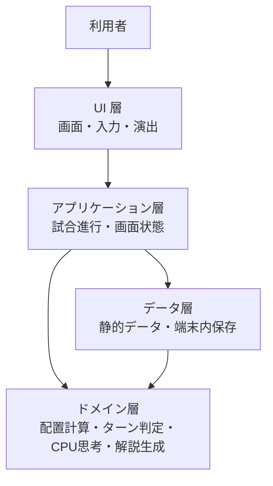
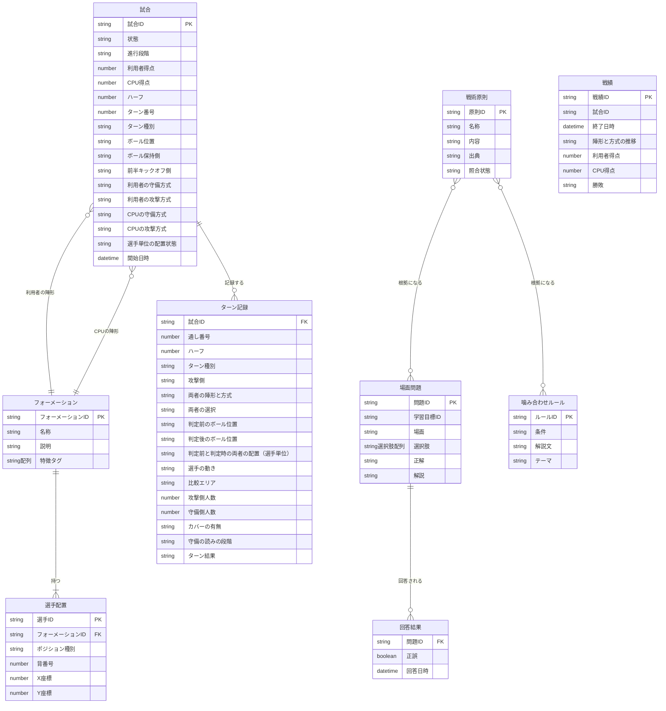
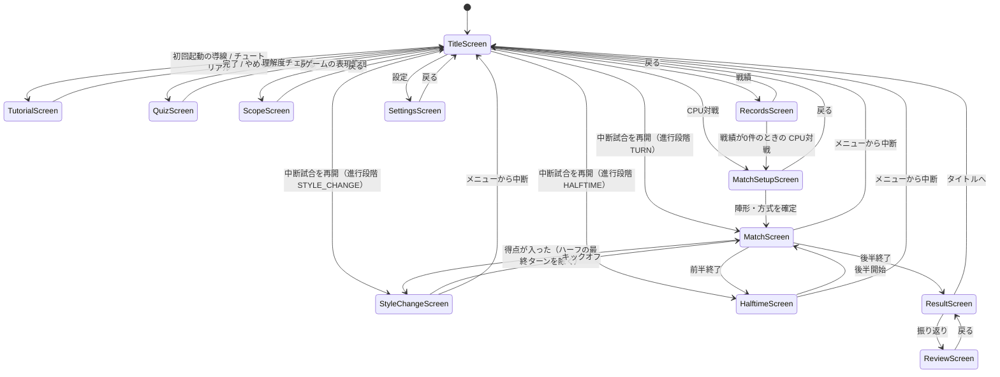
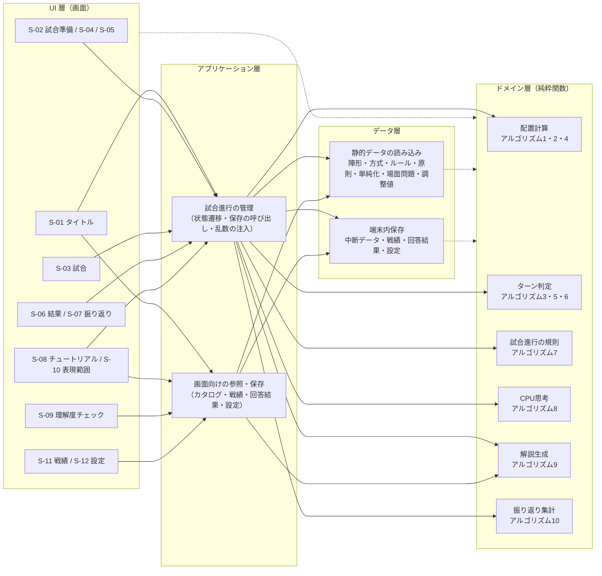

# 機能概要 — soccer-game（仮称）

**更新日**: 2026-10-18

> 本ドキュメントは、プロジェクトの意思決定としてぶれてはいけない重要点（データモデル・中核アルゴリズム・
> 戦術原則カタログ・単純化カタログ・画面/ユースケースの一覧・画面設計・エラーハンドリング）を集約する。
> 技術スタック・アーキテクチャパターンは `architecture-overview.md` を正本とする。
> 機能要件（FR）・学習目標（LG）は `requirements-definition.md` を正本とし、本書は ID で参照する。
>
> 本プロダクトはサーバーを持たないため、「API一覧」は該当なし、「モジュール構成図」は
> 画面 × ドメインモジュールの対応図とする。

## システム構成図



ゲームのルール（配置計算・ターン判定・トランジション・シュート・CPU 思考・解説生成）は、
**外部依存のない純粋関数としてドメイン層に置く**。判定の決定性・対称性（FR-05）をテストで
保証するためである。乱数を使う処理（CPU の選択・キックオフ側の決定）は、乱数生成を外から注入する。
各層の責務・許可/禁止の正本は `architecture-overview.md`「アーキテクチャパターン」とする。

## データモデル

> 本節は**概念モデル**（エンティティ・区分値・ドメイン上の制約・ER図）までを扱う。
> 本プロダクトは RDB を持たない。永続化は端末内の保存領域に限られ、件数も少ない
> （中断データ1件・戦績・理解度チェック結果・設定）。このため、論理データモデル書・テーブル定義書
> （`docs/specs/3_detail-design/db/`）の後続工程は**作成しない**。保存形式は基本設計
> （`docs/specs/2_basic-design/`）で定める。

### エンティティと区分値

- エンティティ:
  - **フォーメーション**（静的）: 選手配置の座標と特徴タグを持ち、30エリアの基本配置を導出する
  - **方式**（静的）: 4方式（ゾーン・マンツーマン・保持型・カウンター型）の名称と、解説の固定文（特徴・強み・弱み）
  - **試合**（端末内保存）: 進行中・中断中の試合の状態。進行段階（`MatchStage`）を持ち、中断した画面から再開できるようにする
  - **ターン記録**（試合に従属）: 各ターンの選択・配置・選手の動き・判定結果。振り返り（FR-18）と、開示の動き（FR-24）の入力。開示の動きはターン記録から作るため、判定前後のボール位置と、動いた選手の移動元・移動先・理由（方式の動き・守備の手・ドリブルなど）を持つ
  - **戦績**（端末内保存）: 終了した試合の結果
  - **場面問題**（静的）／**回答結果**（端末内保存）: 理解度チェック（FR-22）
  - **設定**（端末内保存）: 音量・ヒント表示・チュートリアル完了フラグ（FR-12 の初回起動の導線の判定に使う）
  - **戦術原則**・**単純化項目**（静的）: 本書の各カタログの内容をアプリ内表示用に持つ
  - **噛み合わせルール**（静的）: 解説生成（FR-17）の規則。フォーメーションラボから移植
  - **チュートリアルの段階**（静的）: チュートリアル（FR-12）の各段階の説明文・盤面の初期状態・相手が出す手
- 関係: フォーメーション 1 ―― * 選手配置、試合 1 ―― * ターン記録、場面問題 1 ―― * 回答結果、
  戦術原則 * ―― * 噛み合わせルール／場面問題（解説の根拠として参照）
- 区分値（型名と取りうる値）:
  - `Lane`（レーン。各チーム自身の攻撃方向から見た左右） = `L2`（左大外） | `L1`（左ハーフスペース） | `C`（中央） | `R1`（右ハーフスペース） | `R2`（右大外）
  - `Zone`（列。各チーム自身から見た。自陣ゴール側から） = `D1`（自陣ゴール前） | `D2`（自陣） | `M1`（中盤（自陣）） | `M2`（中盤（敵陣）） | `A1`（敵陣） | `A2`（敵陣ゴール前）。1〜3列目（`D1`〜`M1`）が自陣で、ハーフウェーラインは `M1` と `M2` の境（2026-10-25 に3つのゾーン `D`・`M`・`A` から6列にした。型名は `Zone` のまま）
  - `DefenseStyle`（守備方式） = `ZONE`（ゾーン） | `MAN`（マンツーマン）
  - `AttackStyle`（攻撃方式） = `POSSESSION`（保持型） | `COUNTER`（カウンター型）
  - `TurnKind`（ターン種別） = `OPEN_PLAY`（攻守ターン） | `TRANSITION`（トランジションターン）
  - `PlayType`（攻撃の手） = `SHORT_PASS` | `DRIBBLE` | `LONG_BEHIND`（背後へのロングボール） | `SWITCH`（サイドチェンジ） | `SHOT`
  - `DefenseAction`（守備の手） = `PRESS` | `COVER`
  - `NegTransAction`（失った側の手） = `COUNTER_PRESS`（即時奪回） | `RETREAT`（リトリート）
  - `PosTransAction`（奪った側の手） = `COUNTER`（カウンター。運ぶ先を伴う） | `SECURE`（保持）
  - `TurnOutcome`（ターン結果） = `ADVANCE`（前進） | `STALL`（膠着） | `LOSS`（ロスト） | `GOAL`（得点） | `SAVE`（シュート阻止） | `REGAIN`（奪回成功） | `REGAIN_FAILED`（奪回失敗） | `NO_CONTEST`（判定なし。リトリート×保持で奪取側がそのまま保持）
  - `MatchStatus` = `IN_PROGRESS` | `FINISHED`（「中断中」は保存する状態ではなく、起動時に `IN_PROGRESS` の中断データが見つかったことで判断する。強制終了の瞬間には状態を書き込めないため）
  - `MatchStage`（進行段階。`IN_PROGRESS` の間の画面の位置） = `TURN`（試合画面で手の選択・演出） | `STYLE_CHANGE`（方式の選び直し） | `HALFTIME`（ハーフタイム）
  - `PrincipleStatus`（出典の照合状態） = `UNVERIFIED`（内容未照合） | `VERIFIED`（照合済み） | `NO_SOURCE`（出典未確定）

### ドメイン上の制約

- 1チームのフィールド選手は10人。GK はエリアの人数に数えない（GK の扱いはアルゴリズム5のシュートの判定を参照）
- 各チームの30エリアの人数の合計は、常に10である（移動しても選手は増減しない）
- 選手配置は**選手単位**で状態を持つ（基本エリア・現在エリア・寄せによる固定の有無）。画面に出すのはエリアごとの人数だけだが、方式の動き方とプレスの持続を一意に計算するために選手単位で扱う
- 盤面の座標は、各チーム自身の攻撃方向から見た `(Lane, Zone)` で表す。相手チームの `(l, z)` は自チームから見て `(鏡像レーン, 鏡像の列)`（`L2↔R2`, `L1↔R1`, `C↔C`, `D1↔A2`, `D2↔A1`, `M1↔M2`）である
- 判定はすべて「ボール保持側（攻撃側）から見た座標」で行う。どちらのチームが利用者かに依存しない（FR-05 の対称性はこの制約から導かれる）
- 期間を表す語を2つ区別する（用語集「配置区間」「方式区間」）
  - **配置区間**: 固定（プレス・カバー・ドリブルで動いた選手）が有効な期間。キックオフ時、またはトランジションターンが終わって攻守ターンが始まる時に始まる（奪回成功 `REGAIN` で同じチームが保持し続ける場合も含む）。トランジションターンの間は前の配置区間が続く。配置区間の始まりで固定は解けるが、選手の位置は戻さない（キックオフを除く。キックオフではキックオフの位置に置く。2026-10-24。アルゴリズム2の「1ターン1マス」）
  - **方式区間**: 方式が有効な期間。キックオフから次の得失点またはハーフ終了まで
- 陣形はハーフ単位、方式は方式区間単位で変わる。振り返り（FR-18）の「時間帯ごとの陣形・方式」は、ターン記録に両チームの陣形・方式を持たせて記録する

### ER図



> 戦績・設定・単純化項目・方式・チュートリアルの段階は他エンティティと関連を持たないため、ER図では戦績のみ示し、
> それ以外は省略する（設定: BGM音量・効果音音量・ヒント表示・チュートリアル完了フラグ。
> 単純化項目: 本書「単純化カタログ」。方式: 名称と解説の固定文。チュートリアルの段階: 説明文・盤面の初期状態・相手が出す手）。

### 確定事項（概念レベル）

- **日時の基準**: 端末のローカル時刻。戦績の並び順・回答日時に用いる（サーバーが無いため、端末間の整合は扱わない）
- **削除方針**: 中断データは、次の4つの時点で物理削除する。①新規試合開始時（利用者の確認後。戦績を記録できていない試合が残っている場合は、戦績が記録されないことの確認を含む。下記「試合終了から破棄までの順序」③）、②試合終了後に結果画面からタイトルへ戻る時（終了処理が済んでいる場合に限る。下記「試合終了から破棄までの順序」③）、③起動時に `FINISHED` の中断データが見つかった時、④読み込みに失敗した時（エラーハンドリング）。戦績・回答結果は削除しない（MVP では消去機能を持たない）
- **一意性**: 中断データは常に最大1件。戦績は試合IDごとに1件で、同じ試合IDの戦績がすでにあれば記録しない（終了処理をやり直しても二重に記録しないため）
- **試合終了から破棄までの順序**: ①後半終了時に戦績を記録し、その保存が成功してから、試合の状態を `FINISHED` にして中断データを上書き保存する（ターン記録を含む）。どちらかの保存に失敗した場合は中断データが `IN_PROGRESS` のまま残るので、起動時に「最終ターンまで終えた `IN_PROGRESS`」が見つかれば、再開ではなく終了処理（戦績の記録 → `FINISHED`）だけをやり直す → ②結果画面・振り返り画面は何度行き来してもターン記録を参照できる → ③結果画面からタイトルへ戻る時に、終了処理（戦績の記録と `FINISHED` での保存）が済んでいれば中断データ（ターン記録を含む）を削除する。済んでいなければ終了処理をやり直し、なお失敗した場合は削除せずに残す（戦績を失わないため）。残した試合は再開の対象にせず、次の起動時と、次に CPU 対戦を始める前に、もう一度やり直す。CPU 対戦の前のやり直しにも失敗した場合は、その試合の戦績が記録されないことを利用者に確認し、了承されたら新しい試合で上書きする。戦績には集計値だけを残す
- **起動時の扱い**: 起動時に中断データがあれば、`IN_PROGRESS` なら中断中の試合として再開を選べる。`FINISHED` なら戦績は記録済みのため、そのまま削除する
- **保存の時点**: 中断データは、①ターンの確定時、②試合準備を確定して試合を作成し `TURN` に入る時（`IN_PROGRESS` の作成時）、③進行段階が変わる時（得点やハーフ終了で `STYLE_CHANGE`・`HALFTIME` に入る時、方式・陣形の選び直しを確定して `TURN` に戻る時。選び直した陣形・方式も含めて保存する）、④試合中のメニューから中断してタイトルへ戻る時（直前の保存に失敗していた場合だけ）に上書き保存する
- **再開先**: 再開は進行段階（`MatchStage`）が示す画面から行う。`TURN` は試合画面（直前に確定したターンの次の手の選択から。開示の途中で中断した場合は開示を出さない）、`STYLE_CHANGE` は方式の選び直し画面、`HALFTIME` はハーフタイム画面
- **フォーメーションの座標**: フォーメーションラボ（`soccer-sim` の `src/data/formations.ts`）から 4-4-2・4-3-3・4-2-3-1・3-5-2 の座標をそのまま移植する。座標系は幅・高さとも 0〜100、y が大きいほど相手ゴール側
- **設定値として外部化する値**（コードに直接書かない。本一覧を正本とし、他の文書はここを参照する）:

  | 設定値 | 初期値 | 備考 |
  |---|---|---|
  | 1ハーフのターン数 | 15 | 要件定義書 §7.1 #1 でテストプレイにより確定。2026-10-24 に 12 から変更（シャビのテストプレイで、ターン数が少なかったため） |
  | アディショナルタイムの最大ターン数 | 5 | アルゴリズム7「アディショナルタイム」。0 以上、1ハーフのターン数以下（0 ならアディショナルタイム無し）。2026-10-24 に追加 |
  | 振り返りで得失点の直前に遡るターン数 | 3 | FR-18 |
  | 開示で駒を動かす時間 | 0.6秒 | 表示仕様「選手の動き」。0 より大きく 2 秒以下（毎ターン見る動きなので、長いとテンポが落ちる）。2026-10-22 に追加 |
  | CPU の選択の温度 τ | 0.5 | アルゴリズム8。2026-10-22 に 1.0 から変更（CPU の手がランダムすぎて読めなかったため。CPU 同士の試合で測って決めた） |
  | CPU の選択の下限確率 floor | 0.05 | アルゴリズム8。2026-10-22 に 0.1 から変更 |
  | CPU の方式の癖の加点 style_bonus | 1.0 | アルゴリズム8。0 以上。2026-10-22 に追加 |
  | CPU の前へ運ぶ加点 forward_bonus | 0.75 | アルゴリズム8。0 以上。1列あたり。2026-10-24 に追加（CPU 同士の試合で測って決めた。同日 1.0 から変更）。2026-10-25 に盤面を6列にしたとき、距離あたりの強さを保つため 1ゾーンあたり 1.5 を1列あたり 0.75 にした |
  | CPU のシュートの加点 shot_bonus | 1.5 | アルゴリズム8。0 以上。2026-10-24 に追加（同日 0.75 から変更） |
  | CPU の守備の先読みの加点 anticipation_bonus | 1.0 | アルゴリズム8。0 以上。1列あたり。2026-10-24 に追加。2026-10-25 に6列で 2.0（1ゾーンあたり）を 1.0 にした |
  | 自己対戦検証の各組み合わせの試合数 | 20 | NFR-05〜07 |

## アルゴリズム設計（ドメインロジック）

本アプリの中核ロジック。すべて外部依存のない純粋関数として設計し、テスト設計の主対象とする。
以下、エリアは `列-レーン`（例: `M2-L1` = 中盤（敵陣）・左ハーフスペース）で表し、特記がない限り
**ボール保持側（攻撃側）から見た座標**で書く。

### アルゴリズム1: 基本配置の導出

**目的**: フォーメーションの選手座標から、30エリアの人数（基本配置）を導出する。

**計算ロジック**:
- GK を除くフィールド選手10人について、座標 `(x, y)` からエリアを決める
- レーン: `d = |x − 50|` とし、`d ≤ 15` → `C`、`15 < d < 30` → ハーフスペース、`d ≥ 30` → 大外。`x < 50` なら左（`L1`/`L2`）、`x > 50` なら右（`R1`/`R2`）
- 列: `y` を6等分する。`⌊y × 6 / 100⌋` 番目（0 から。100 は 5 に丸める）の列で、`0`=`D1`・`1`=`D2`・`2`=`M1`・`3`=`M2`・`4`=`A1`・`5`=`A2`。境界ちょうど（`y` = 100/6 の倍数）は前（相手ゴール側）の列
- 陣形の座標をそのまま6列に当てる（2026-10-25。シャビの判断）。陣形の段（DF・守備的MF・攻撃的MF・FW）の間に空いた列ができ、ライン間が盤面で見える
- **重なりを散らす**（2026-10-24。シャビの指摘「空きマスがあるのに、試合開始時の配置が同じマスに固まる」）: 上のエリアで、同じエリアに2人以上いる列は、その列の選手を1マス1人に置き直す
  - 左右の並び順（x。同じ x は陣形データの順）を保ったまま、別々のレーンへ左から置く
  - 置き方は、各レーンの中心（`L2`=10・`L1`=30・`C`=50・`R1`=70・`R2`=90。ピッチの幅を5等分した中心）と x の差の合計が最小のもの。同じなら、置いたレーンの中心の平均が x の平均に近い（左右の釣り合いが取れた）もの。それも同じなら左を先に詰めたもの
  - 重なりの無い列は置き直さない。列の人数がレーンの数（5）より多ければ、1マス1人にできないので置き直さない

**座標のエリア（散らす前。各列の中は L2 / L1 / C / R1 / R2。空いた列は「—」）**:

| 陣形 | A2 | A1 | M2 | M1 | D2 | D1 |
|---|---|---|---|---|---|---|
| 4-4-2 | 0 0 2 0 0 | — | 1 0 2 0 1 | — | 1 0 2 0 1 | — |
| 4-3-3 | 1 0 1 0 1 | — | 0 1 0 1 0 | 0 0 1 0 0 | 1 0 2 0 1 | — |
| 4-2-3-1 | 0 0 1 0 0 | — | 1 0 1 0 1 | 0 0 2 0 0 | 1 0 2 0 1 | — |
| 3-5-2 | 0 0 2 0 0 | — | 0 0 2 0 0 | 1 0 1 0 1 | 0 1 0 1 0 | 0 0 1 0 0 |

**計算結果（基本配置。MVP の4陣形。各列の中は L2 / L1 / C / R1 / R2。空いた列は「—」）**:

| 陣形 | A2 | A1 | M2 | M1 | D2 | D1 |
|---|---|---|---|---|---|---|
| 4-4-2 | 0 1 0 1 0 | — | 1 1 0 1 1 | — | 1 1 0 1 1 | — |
| 4-3-3 | 1 0 1 0 1 | — | 0 1 0 1 0 | 0 0 1 0 0 | 1 1 0 1 1 | — |
| 4-2-3-1 | 0 0 1 0 0 | — | 1 0 1 0 1 | 0 1 0 1 0 | 1 1 0 1 1 | — |
| 3-5-2 | 0 1 0 1 0 | — | 0 1 0 1 0 | 1 0 1 0 1 | 0 1 0 1 0 | 0 0 1 0 0 |

> 3-5-2 の中央の CB（y=15）は1列目（`D1`）、左右の CB（y=18）は2列目（`D2`）に入る。4-3-3 のアンカー（y=45）は3列目、
> 両脇の CM（y=50）は4列目に入り、中盤の3人が2列に分かれる（座標どおり）。

**エッジケース（テスト対象）**:
- `d = 15` ちょうど（x=35/65）は `C`、`d = 30` ちょうど（x=20/80）は大外
- `x = 50` は `C`（左右の判定をしない）
- `y` が列の境界ちょうど（例: y=50 は `M2`）は前の列。`y = 0` は `D1`、`y = 100` は `A2`
- GK を数えない。各陣形の合計が10になる
- 散らす: 中央の2人（x=40・60）は左右対称に `L1`・`R1`。中央にもっと寄った2人（x=45・55）は、差の合計も釣り合いも同じ置き方が左右に1つずつあり、左右対称にはならず左を先に詰めて `L1`・`C`（MVP の4陣形には当たらない）。同じ x の2人は陣形データの順で左から。左右の並び順は変えない。重なりの無い列は座標のエリアのまま。6人以上の列は置き直さない
- 4陣形すべてについて上の「計算結果」の表と一致する（どのエリアも1人以下）

### アルゴリズム2: 現在配置の算出（方式による動き方）

**目的**: ターン開始時点の両チームの選手配置を、基本配置・方式・ボール位置・固定された選手から算出する。

**1ターン1マス**（2026-10-24）: どの選手も、1ターンの間に動けるのは隣のエリアまで（列差・レーン差がどちらも1以内。斜めも1マス）。ターン開始の位置から判定時の位置まで、ターン開始の位置から次のターン開始の位置まで、のどちらも1マス以内にする。例外はキックオフ（試合開始・得点の後・後半の開始）で、全員をキックオフの位置（アルゴリズム7）に置く。選手の位置はターンをまたいで持ち越す（以前は毎ターン基本エリアから計算し直していて、スライドの左右の反転・トランジションの後のリセット・マークの付け替えで、選手が2マス以上一気に動いていた）

**計算ロジック**:
1. **起点と目標**: 各選手の起点は今いるエリア（前のターンから持ち越した位置）。手順2〜4の方式の動きは、基本エリアから出した「目指す位置（目標）」を決める。固定されていない選手は、起点から目標へ1マス近づく（列差・レーン差をそれぞれ1ずつ詰める。斜めを優先）。前のターンの手やトランジションの動きで動いた選手は、そのターン開始では動かない（ターン開始から次のターン開始までを1マス以内に保つ）。方式の動きが無いまま基本エリアから離れている選手は、基本エリアへ1マスずつ戻る
2. **固定された選手**（プレス・カバー・ドリブルで動いた選手）は、配置区間が終わるまで固定先のエリアに留まり、以下の方式の動きの対象外とする。配置区間の始まり（トランジションの後に攻守ターンが始まる時）に固定を解く。位置は戻さず、次のターン開始から目標へ1マスずつ近づく
3. **ボール保持側（攻撃方式）**:
   - `POSSESSION`: 大外（`L2`/`R2`）の選手の目標が1列前（例: `D2→M1`。いちばん前の `A2` の選手はそのまま）
   - `COUNTER`: 目標は基本エリアのまま
4. **ボール非保持側（守備方式）**:
   - `ZONE`: ボールが守備側から見て左右どちらかのハーフスペース／大外にあるとき、全選手の目標が1レーンボールサイドへずれる。ボールサイドの大外にいる選手はそのまま。ボールが `C` レーンならずれない。ずれる基準は**ターン開始時のボール位置**。ボールが左寄りから右寄りへ移ると目標は2レーン先になり、2ターンかけて着く
   - `MAN`: 次の規則でマークをつける
     - マーク対象: 守備側から見て1〜4列目（`D1`〜`M2`）にいる攻撃側の選手（攻撃側がその手順で動いた後の位置）
     - マーカー: 固定されていない守備側の選手のうち、基本エリアが1〜4列目の選手（基本エリアが5・6列目の選手は基本エリアに残る）
     - 2026-10-25 に、3つのゾーンのころの「`D`・`M` ゾーン」を6列で読み替えた（`D` = 1・2列目、`M` = 3・4列目）
     - 対象1人につきマーカー1人の目標を、**対象と同じエリア**にする。対象と同じエリアにすでにいるマーカーはそのまま残り、残りは今いるエリアが対象にいちばん近いマーカーを割り当てる（近さは列差＋レーン差。同じなら配置の選手の順）
     - マーカーが足りなければ、守備側ゴールに近い対象から優先する（列 `D1` → `D2` → `M1` → `M2`、同じ列では `C` → ハーフスペース → 大外、同順位なら守備側自身から見て左を先）
     - 余ったマーカーの目標は守備側の `D2-C`（カバー役。3つのゾーンのころの `D-C`）
     - 攻撃側の選手が動いたら（ドリブル）・守備の手で守備側が動いたら（プレス・カバー）、マークを付け直す。マーカーは、ターン開始の位置から新しい目標へ1マス近づく（1ターンの中で付け直しが2回あっても、ターン開始から1マス以内）

**エッジケース（テスト対象）**:
- ゾーンで、ボールが `C` レーンならずれない。ボールサイドの大外の選手が2レーン分（元の大外＋ずれてきた選手）集まる
- ゾーンのスライドの反転は2ターンかかる。マーカーは1マスずつ対象へ近づく
- マンツーマンで、マーカーがちょうど足りる／余る／足りない、の各場合（目標に落ち着いた後の配置で確かめる）
- 固定された選手が方式の動きに巻き込まれない
- 配置区間の開始時に固定が解除され、トランジションターンでは解除されない。解除された選手は1マスずつ戻る
- CPU 同士の試合のすべてのターンで、キックオフを除き、どの選手もターン開始から判定時・次のターン開始まで1マス以内

### アルゴリズム3: 選択可能な手

**目的**: 局面とボール位置・現在配置から、両者が選べる手を決める（選べない手は選択不可として表示する。FR-03）。

**攻撃の手**（ボール位置を `B` とする）:

| 手 | 運ぶ先 `T` の条件 |
|---|---|
| `SHORT_PASS` | `B` から2マス以内（列差・レーン差がどちらも2以内。斜めを含む。`B` 自身は除く）で、味方が1人以上いる（2026-10-25 に6列で、隣接8エリアから2マスへ広げた） |
| `DRIBBLE` | `B` の周り8エリア（斜め・後ろも。2026-10-24 に前・左・右から広げた）。味方の有無は問わない |
| `LONG_BEHIND` | `B` が自陣（1〜3列目）のとき、敵陣の奥の2列（`A1`・`A2`）で同じか隣のレーン。味方が1人以上いる |
| `SWITCH` | `B` と同じ列で、レーンが3つ以上離れたエリア（例: `L2→R1`, `L2→R2`, `L1→R2`）。味方が1人以上いる |
| `SHOT` | `B` が敵陣の奥の2列（`A1`・`A2`）の `C`・`L1`・`R1` のとき（運ぶ先なし） |

> 2026-10-25 の6列で、3つのゾーンのころの `D`（自陣）を1〜3列目、`A`（敵陣）を5・6列目に読み替えた。
> シュートを5・6列目からにしたのはシャビの判断（敵陣ゴール前だけだと遠すぎる）。

**守備の手**（制限するエリアを `T_d` とする）:

| 手 | 条件 |
|---|---|
| `PRESS` | `T_d` の上下左右の隣接エリアのどこかに、守備側の選手が1人以上いる |
| `COVER` | `T_d` が守備側の1列目（`D1`。背後が無い）以外で、`T_d`・横・背後のエリアに守備側の選手が1人以上いる（アルゴリズム4） |

**トランジションの手**: 失った側は `COUNTER_PRESS`／`RETREAT` を常に選べる。奪った側は `SECURE` を
常に選べ、`COUNTER` はボール位置から奪った側の攻撃方向へ1〜4列前のエリア（レーン不問。2026-10-25 に「1〜2ゾーン前」を6列で読み替えた）で、
アルゴリズム6の配置で味方が1人以上いるエリアを運ぶ先に選べる。

### アルゴリズム4: 守備の手による移動

**目的**: プレス・カバーで動く選手を一意に決める。

**計算ロジック**:
- **`PRESS`**: `T_d` の上下左右の隣接エリアのうち、守備側の選手が1人以上いて、**余り（守備側人数 − 攻撃側人数）が最大**のエリアから1人を `T_d` へ動かし固定する。余りが同じなら、守備側から見て**前方（相手ゴール側）→ 横（中央寄りのレーン）→ 背後**の順に優先する（最終ラインを最後まで崩さない。チャレンジ＆カバー原則 TP-03）。横の左右も同率なら守備側自身から見て左を先
- **`COVER`**: `T_d` に守備側の選手がいればその1人を、いなければ `PRESS` と同じ規則で選んだ隣接エリアの1人を、`T_d` の**背後**（守備側ゴール方向へ1列）へ動かし固定する。隣接エリアの候補から前方は除く（前方からだと背後まで2列下がることになり、1ターン1マスを超えるため。2026-10-24）。`T_d`・横・背後のどこにも守備側がいなければ、カバーは選べない
- 固定されていない選手を優先して動かす。対象エリアに固定された選手しかいなければ、その選手を動かす（固定先を更新）

**エッジケース（テスト対象）**:
- 余りが負のエリアしかない場合も、守備側の選手がいれば動かす
- 同率の優先順（前方 → 横 → 背後、左右同率は守備側の左）
- マンツーマンでプレスに出たマーカーは固定され、マークは残りのマーカーで付け直す（そのため、マークしていた相手がフリーになるか、余りのカバー役が埋める）

### アルゴリズム5: 攻守ターンの判定

**目的**: 攻守ターンの結果を、動いた後の人数差・守備の読み・カバーの有無で決める（FR-05）。

**計算ロジック**:
1. アルゴリズム2で両チームの現在配置を出す
2. 守備の手を適用する（アルゴリズム4）。守備側がマンツーマンならマークを付け直す（アルゴリズム4のエッジケース。プレス・カバーに出たマーカーは固定され、残りのマーカーで付け直す）
3. 攻撃の手を適用する。`DRIBBLE` はボールを持つ選手を `T` へ動かして固定する。守備側がマンツーマンならマークを付け直す
4. 比較エリアを決める。`SHOT` はボール位置 `B`、それ以外は運ぶ先 `T`
5. `diff = 攻撃側人数(比較エリア) − 守備側人数(比較エリア)` を求める。守備の手の制限するエリア `T_d` と比較エリアから、守備の**読み**の段階を決める
   - **ぴったり**: `T_d` が比較エリアと同じ
   - **隣**: `T_d` が比較エリアと同じ列で、レーンが1つ隣。ただし `T_d` がボール位置 `B` なら隣に数えない（持っている選手への寄せで、運ぶ先の読みではないため）
   - **外れ**: それ以外
   - `SHOT`: `diff > 0` → `GOAL`。`diff = 0` は、ぴったり読まれていれば `SAVE`、それ以外は `GOAL`。`diff < 0` → `SAVE`（隣の読みはシュートに効かない）
   - それ以外の手でぴったり読まれた: `diff ≥ 2` → `ADVANCE`、それ以外 → `LOSS`（読んで寄せた守備は、1人多いだけの攻撃なら奪える）
   - それ以外の手で隣を読まれた: `diff ≥ 1` → `ADVANCE`、それ以外 → `LOSS`（カバーの有無によらず、同数なら奪える）
   - それ以外の手で外れ: `diff > 0` → `ADVANCE`、`diff < 0` → `LOSS`、`diff = 0` → カバー判定
   - 2026-10-24 に隣の読みを追加（プレー中の入れ替わりを増やす作業）。ぴったり読むのは難しく、守備が奪えるのがまれで、プレー中の入れ替わりが 1試合 約2.3回だったため
6. **カバー判定**（チャレンジ＆カバー原則 TP-03）: 比較エリアの背後（守備側ゴール方向へ1列）を `P` とする
   - `守備側人数(P) > 攻撃側人数(P)` なら `STALL`、そうでなければ `ADVANCE`
   - 比較エリアが攻撃側の `A2`（敵陣ゴール前。`P` が無い）ならカバーなしで `ADVANCE`。`A1` の背後は `A2` で、カバーが効く。GK はカバーに数えない（ゴール前の守りはシュートの判定が担う）
   - 2026-10-24 に変更（ゲームバランスの見直し）: 以前は、読みの有無で結果を変えず、敵陣の `C`・`L1`・`R1` の同数を GK のカバーで `STALL` にし、シュートは `diff > 0` だけ得点にしていた。CPU 同士の試合で 1試合 約0.3点・攻守の入れ替わり 約3回と、点も入れ替わりも少なかったため
7. 結果の反映:
   - `ADVANCE`: ボールを `T` へ動かす。攻撃側が保持したまま次の攻守ターンへ（固定は維持）
   - `STALL`: ボールは `B` のまま、攻撃側が保持して次の攻守ターンへ（固定は維持）。`DRIBBLE` の `STALL` では、運んだ選手を `B` に戻し、固定も判定前の状態に戻す（運んだ選手だけが `T` に残り、ボールのエリアが空になるのを防ぐ。判定と判定時の配置は運んだ後のまま）
   - `LOSS`: 守備側が `T` でボールを奪い、トランジションターンへ
   - `GOAL`: 攻撃側に1点。失点側のキックオフ（方式の選び直しを経て）
   - `SAVE`: 守備側が自陣ゴール前 `D1-C`（攻撃側の視点で `A2-C`）でボールを持ち（GK がキャッチ）、トランジションターンへ

**計算式（まとめ）**:
```
diff = 攻撃側人数(比較エリア) − 守備側人数(比較エリア)   ※両者の手を適用した後の配置で数える
読み       = ぴったり（制限するエリア = 比較エリア）／隣（同じ列でレーンが1つ隣。ボール位置は除く）／外れ
シュート   = diff > 0 → 得点 / diff = 0 → ぴったり読まれていれば阻止、それ以外は得点 / diff < 0 → 阻止
それ以外   = ぴったり → diff ≥ 2 なら成功、それ以外はロスト
             隣       → diff ≥ 1 なら成功、それ以外はロスト
             外れ     → diff > 0 → 成功 / diff < 0 → ロスト / diff = 0 → 背後にカバーがいれば膠着、いなければ成功
```

**エッジケース（テスト対象）**: 次節「判定例」のすべて。加えて、
- ぴったり読まれた手: +1 はロスト、+2 は前進。外れの +1 は前進
- 隣を読まれた手: 同数はロスト（カバーがいなくても）、+1 は前進
- 隣の範囲: レーンが2つ離れたエリア・列が違うエリア（背後はカバーとして効く）・ボールのエリアへの寄せは外れ
- 敵陣ゴール前（`A2`）の同数（外れ）→ 前進（GK はカバーに数えない）
- シュートの同数: ぴったり読まれていれば阻止、隣の読み・外れなら得点
- ドリブルの膠着: 判定の人数は運んだ後の配置で数え、次のターンには運んだ選手が `B` に戻っている（判定前に固定されていれば、その固定のまま）

### アルゴリズム6: トランジションターンの判定

**目的**: ボール保持が入れ替わった直後の即時奪回／リトリートとカウンター／保持の結果を決める（FR-04）。

ボールを奪った側を「奪取側」、失った側を「喪失側」、奪ったエリアを `X` とする。配置は直前のターン
終了時点（ロスト・阻止の瞬間）のものを起点とする。

**計算ロジック**:
- 喪失側の配置: `COUNTER_PRESS` → 直前の配置のまま。`RETREAT` → 固定を解き、基本配置＋守備方式の目標（アルゴリズム2。ボール位置は `X`）へ1マス近づく（一気には戻れない。戻りきれない守備をカウンターが突ける。2026-10-24）
- 奪取側の配置: `COUNTER` → 直前の配置から、カウンター型なら大外の選手が1列前へ出る（保持型は直前の配置のまま）。`SECURE` → 判定時は直前の配置のまま（即時奪回との比較に使う）。判定後に攻守ターンを始めるときは、固定を解き、次のターン開始から目標へ1マスずつ近づく
- 組み合わせごとの判定:

| 喪失側 \ 奪取側 | `SECURE`（保持） | `COUNTER`（運ぶ先 `T`） |
|---|---|---|
| `COUNTER_PRESS` | `X` と上下左右の隣接エリアの人数合計を比べる。喪失側が上回れば `REGAIN`、同数以下は `REGAIN_FAILED`（奪取側が保持） | 比較エリア `T` でアルゴリズム5の手順5〜6を適用（喪失側の手は運ぶ先を持たないので、読まれていない扱い） |
| `RETREAT` | 判定なし（`NO_CONTEST`）。奪取側が `X` から攻守ターンを開始 | 比較エリア `T` でアルゴリズム5の手順5〜6を適用（読まれていない扱い） |

- 結果の反映:
  - `REGAIN`: 喪失側が `X` で再び保持し、攻守ターンを開始（配置区間の始まり。固定を解く）
  - `REGAIN_FAILED`・`NO_CONTEST`: 奪取側が `X` で保持し、攻守ターンを開始（配置区間の始まり。固定を解く）。振り返りの集計では、`REGAIN_FAILED` は奪取側の判定の勝ちとして数え、`NO_CONTEST` は判定なしとして勝ち負けに含めない（両者が争わないことを選んだ結果であり、どちらかの判断の誤りではないため）
  - カウンターの `ADVANCE`: 奪取側が `T` で保持し、攻守ターンを開始（配置区間の始まり。固定を解く）
  - カウンターの `STALL`: 奪取側が `X` で保持し、攻守ターンを開始（配置区間の始まり。固定を解く）
  - カウンターの `LOSS`: 喪失側が `T` で奪い返し、再びトランジションターン

**エッジケース（テスト対象）**:
- 即時奪回の同数は奪回失敗
- カウンターの同数はカバー判定（背後に守備側が多ければ膠着、敵陣ゴール前（`A2`）はカバーなしで前進）
- 保持型で失うと、ボール周辺の人数が多い（即時奪回が成立しやすい）一方、自陣の大外が空く

### アルゴリズム7: キックオフと試合進行

- **キックオフ**: ボールはキックオフ側の `M1-C`（3列目の中央。ハーフウェーラインのすぐ自陣側）、キックオフ側が保持する攻守ターンから始める。両チームとも全員をキックオフの位置に置いて固定を解き（1ターン1マスの例外。試合の仕切り直し）、新しい配置区間と方式区間を始める
  - **キックオフの位置**（2026-10-25。シャビの指摘「キックオフのときに、相手のフィールドにすでに自分のコマが配置されているのはおかしい」）: 陣形を自陣に縮めて置く。各選手の列は、基本エリアの列の番号（0〜5）を半分にして切り捨てた列（`D1`・`D2` → `D1`、`M1`・`M2` → `D2`、`A1`・`A2` → `M1`）、レーンは基本エリアのまま。縮めて同じエリアに重なった列は、アルゴリズム1と同じ規則で散らす（x の代わりに基本エリアのレーンの中心を使う）。両チームとも全員が自陣（1〜3列目）から始まる
  - キックオフで置いた選手は、そのターンの開始では動かない（置いた動きで1マスを使ったものとする）。次のターン開始から、1ターン1マスで基本エリア（＋方式の目標）へ上がる
  - キックオフの位置（MVP の4陣形。各列の中は L2 / L1 / C / R1 / R2。4〜6列目は0人）。4陣形では、縮めても同じエリアに重ならない（散らす規則は使われない）

    | 陣形 | M1 | D2 | D1 |
    |---|---|---|---|
    | 4-4-2 | 0 1 0 1 0 | 1 1 0 1 1 | 1 1 0 1 1 |
    | 4-3-3 | 1 0 1 0 1 | 0 1 1 1 0 | 1 1 0 1 1 |
    | 4-2-3-1 | 0 0 1 0 0 | 1 1 1 1 1 | 1 1 0 1 1 |
    | 3-5-2 | 0 1 0 1 0 | 1 1 1 1 1 | 0 1 1 1 0 |

  - エッジケース（テスト対象）: 4陣形のどれでも両チームの全員が1〜3列目にいる。どのエリアも1人以下（4陣形）。得点の後のキックオフも同じ位置。キックオフの次のターン開始で、基本エリアへ1マス上がる
- **前半のキックオフ側**: 試合開始時にランダムに決める（乱数生成は注入。§7 #2）。後半は前半と反対側
- **得点後**: 失点側のキックオフ。その前に両者が方式を選び直す（FR-21）。ただしハーフの最終ターンの得点は、下記「ハーフの最終ターンの得点」に従う
- **ハーフ**: 攻守ターン・トランジションターンとも1ターンとして数え、設定値のターン数で前半・後半を終える（攻撃が続いていれば、下記のアディショナルタイムの後）。ハーフタイムに陣形・方式を選び直す（FR-08）
- **アディショナルタイム**（2026-10-24）: 前半・後半とも、規定の最終ターンを終えた時点で攻撃が続いていれば（結果が前進・膠着・奪回失敗・判定なし）、その攻撃を続ける。シュートした（得点・シュート阻止）か、ボールを失った（ロスト・奪回成功）ターンでハーフを終える。最大で設定値「アディショナルタイムの最大ターン数」まで続け、使い切ったら攻撃が続いていてもハーフを終える。アディショナルタイムの中でボールを失っても、トランジションには入らない（次のターンが無いため。最終ターンの LOSS・SAVE と同じ）。本書で「ハーフの最終ターン」と書くときは、アディショナルタイムがあればその最後のターンを指す
- **ハーフの最終ターンの得点**: 方式の選び直しを行わない。前半なら得点を反映してそのままハーフタイムへ（陣形・方式はハーフタイムで選び直せる。後半のキックオフ側は失点側ではなく、前半と反対側）。後半なら得点を反映してそのまま試合結果へ
- **試合終了**: 後半の最終ターン後の得点で勝敗を決める（同点は引き分け）
- **ボールの保持者**: 各ターンの開始時（キックオフ・攻守ターン・トランジションターン）に、ボールのエリアに保持側の選手がいるようにする。ターン開始時の配置（アルゴリズム2の方式の動きの後。トランジションは起点の配置）で、ボールのエリアに保持側の選手がいなければ、ボールにいちばん近い保持側の選手を1人ボールのエリアに置いて固定する（近さは今いるエリアからの列差＋レーン差。同じなら配置の選手の順で先）。キックオフ・ドリブルの膠着でボールと選手が離れるのを防ぐ（2026-10-22。CPU 同士の試合で約7%のターンにボールのエリアが空だった）。置いた動きはターン記録に残す
  - 置ける選手は、そのターンの開始時の位置と今いるエリアのどちらからも、ボールのエリアが1マス以内の選手だけ（1ターン1マス。2026-10-24）。いなければ誰も置かず、ボールのエリアに保持側がいないまま進む（判定はこの状態も扱える。ドリブルはボールだけが進み、パスは運ぶ先の味方の人数で判定する）。キックオフは仕切り直しなので、距離を問わず置く
  - 計測（2026-10-24。CPU 同士 50試合・1200ターン）では、保持者を置けずにボールのエリアが空になったターンは0回
  - エッジケース（テスト対象）: 1マス以内の選手が置かれる、1マス以内にいなければ置かない、トランジションの開始時にも置かれる、同じ距離のときの順、既に保持側がいれば置かない、CPU 同士の試合（固定シード）のすべてのターン開始時に保持者がいる

### アルゴリズム8: CPU の選択

**目的**: 読み合いが成立するように、状況に応じつつ偏りすぎない手を選ぶ（FR-11）。

**計算ロジック**:
- 選択可能な各手 `i` に評価値 `s_i` を付ける。評価値は「相手が何もしないと仮定した、手を適用した後の比較エリアでの人数差（CPU から見た値）」とする
  - 攻撃の手: `攻撃側人数(T) − 守備側人数(T)`（シュートは `B`）
  - 守備の手: 制限するエリアの脅威度 `攻撃側人数(T_d) − 守備側人数(T_d)`（脅威が大きいエリアほど守りに行く）。守備の手を適用する前の配置で数える（適用後で数えると、プレス・カバー・マークの付け直しで手ごとに変わり方が異なり、エリアどうしの脅威の比較にならないため）
  - 即時奪回: `X` 周辺の人数差。カウンター: 運ぶ先の人数差。リトリート・保持: 0
- **方式の癖**: CPU の方式が好む手には、評価値に設定値 `style_bonus` を足す（相手の方式を見れば手の傾向を読めるようにするため。2026-10-22）。攻撃方式と守備方式のそれぞれで、次の手を好む
  | CPU の方式 | 好む手 |
  |---|---|
  | 攻撃方式 カウンター型 | 背後へのロングボール、前（ボールより列が前）へのドリブル、トランジションのカウンター |
  | 攻撃方式 保持型 | ショートパス、サイドチェンジ、トランジションの保持 |
  | 守備方式 マンツーマン | プレス、即時奪回 |
  | 守備方式 ゾーン | カバー、リトリート |
  - ヒント（FR-19）の人数差は加点を含めない（加点は CPU の選び方だけに使う）
- **局面の加点 `g_i`**（2026-10-24）: 人数差だけの評価では、CPU が横や後ろへのパスを繰り返し、シュートもほとんど打たなかった。守備も、攻撃の運ぶ先を読めたのは攻撃の手の約9%だった。そこで、次の加点を足す
  - 攻撃の手・カウンターで運ぶ先を持つ手（ゴールへ向かう加点）: `forward_bonus × (運ぶ先の列 − ボールの列)`（列は 0〜5 の番号。後ろへ運ぶ手は負、横は 0）
  - シュート: `shot_bonus`
  - 守備の手（守備の先読み）: `anticipation_bonus × (制限するエリアの列 − ボールの列)`。どちらも攻撃側から見た座標。攻撃が前へ運びたがるのを見越して、ボールより前のエリアを守りに行く（後ろは負）
  - 即時奪回・リトリート・保持: 0
  - 2026-10-25 に盤面を6列にしたとき、列の差が3つのゾーンのころの倍になるので、`forward_bonus`・`anticipation_bonus` を1列あたり半分にした（1.5 → 0.75、2.0 → 1.0）。距離あたりの強さを保つ読み替えで、調整ではない。以下の根拠の数値は、3つのゾーンのころのもの
- 選択確率: `p_i = floor / N + (1 − floor) × softmax((s_i + b_i + g_i) / τ)`（`b_i` は方式の癖の加点、`g_i` は局面の加点。`N` は選択肢数。運ぶ先を持つ手は運ぶ先ごとに1つと数える。`floor`・`τ`・`style_bonus`・`forward_bonus`・`shot_bonus`・`anticipation_bonus` は設定値）
- 設定値の根拠（2026-10-22。CPU 同士 60 試合）: τ=1.0・floor=0.1・加点なしでは、評価値が最高の手を選んだのは 55%、方式ごとの手の傾向の差は無かった。τ=0.5・floor=0.05・加点 1.0 で、評価値が最高の手は 70%、好む手の選択率（その方式／反対の方式）はカウンター型 27%／8%、保持型 70%／33%、マンツーマン 87%／16%、ゾーン 84%／13%
- ゴールへ向かう加点の根拠（2026-10-24。CPU 同士 100 試合・固定シード。アルゴリズム5の 2026-10-24 の規則と合わせて。当時の値で、いまの値は次の「守備の先読みの根拠」）: シュートの加点なし（前へ運ぶ加点 1.0）では 1試合 約1.4点。`forward_bonus` 1.0・`shot_bonus` 0.75 で 約2.5〜2.9点、攻守の入れ替わり 約6回（保持の平均 約4ターン）。シュートの加点を 1.0 にすると 約3.4点で、目標（2〜3点）を超える。点数と入れ替わりは連動する（シュートの成功率が9割を超え、保持1回あたりの得点が約0.45）ため、入れ替わりは目標（6〜10回）の下限に留まる。この入れ替わりは得点後のキックオフで渡った分を含む保持の回数で、プレー中の入れ替わり（ロスト・シュート阻止・奪回成功）は 1試合 約2.3回。計測はテスト（`match_balance_test`）として残す
- 守備の先読みの根拠（2026-10-24。CPU 同士・3シード × 50試合。アルゴリズム5の隣の読みと合わせて）: `anticipation_bonus` 2.0・`forward_bonus` 1.5・`shot_bonus` 1.5 で、1試合 約2.4点、プレー中の入れ替わり 約7.0回、保持の平均 約2.4ターン。先読みだけ（隣の読みなし）では、守備がぴったり読む割合が約24%で頭打ちになり、入れ替わりは約5.7回に留まった（`anticipation_bonus` 3.0・`forward_bonus` 1.75・`shot_bonus` 1.0。先読み 2.0 で攻撃の加点を据え置くと約4.8回・約1.9点）。先読みを入れると点数が下がるため、攻撃の加点も上げた（1.0／0.75 から 1.5／1.5）
- 試合の長さを変えたときの実測（2026-10-24。CPU 同士・3シード × 50試合。調整値は据え置き）: 1ハーフ 15ターン＋アディショナルタイム最大 5ターンで、1試合 約3.97点、プレー中の入れ替わり 約8.7回、保持の平均 約2.6ターン。点数の目標は、試合が長くなった分として 2〜3点から **3〜4.5点** に広げた（シャビの判断。点数を合わせる調整はしない）。入れ替わり 6〜10回・保持 2〜4ターンの目標は変えない
- 基本配置の散らし（アルゴリズム1）とドリブルの周り8エリア（アルゴリズム3）を入れたときの実測（2026-10-24。同じ条件）: 1試合 約4.50点、入れ替わり 約9.1回、保持の平均 約2.4ターン。最善手を選ぶ利用者役は 1試合 約2.82点。点数は、壊れていないかの目安として CPU 同士 3〜5.5点・利用者役 1〜3.5点に広げた（シャビの判断。多すぎるかは遊んで決め、調整はしない）
- 盤面を6列にしたときの実測（2026-10-25。同じ条件）: 1試合 約2.74点、プレー中の入れ替わり 約5.0回、保持の平均 約4.6ターン。最善手を選ぶ利用者役は 1試合 約1.36点。ゴールまでの距離が倍になり、点と入れ替わりが減って保持が長くなった。壊れていないかの目安を、CPU 同士 2〜5.5点・入れ替わり 4〜10回・保持 2〜6ターンに広げた（調整はしない。面白さはシャビが遊んで決める）
- 陣形・方式: 試合開始時とハーフタイムには陣形と方式を、得失点後には方式だけを、選べる組み合わせから一様ランダムに選ぶ（陣形はハーフタイム以外で変えられない。要件定義書 §7 #7）
- 乱数生成は注入し、テストでは固定シードで選択を再現する

**エッジケース（テスト対象）**:
- 選択不可の手を選ばない
- どの選択可能な手にも `floor / N` 以上の確率が残る
- 方式の癖: 好む手にだけ加点が入る（横・後ろへのドリブルはカウンター型でも対象外）。加点 0 なら評価値だけの確率と同じ
- ゴールへ向かう加点: 前へ2列は2倍、横は 0、後ろは負。加点 0 なら何も足さない
- 守備の先読み: ボールより前のエリアを制限する手ほど大きく、後ろは負。攻撃側の手には入らない
- 利用者の選択を参照しない（入力に利用者の当該ターンの手を含めない）

### アルゴリズム9: 解説の導出（FR-17）

- **陣形の解説**: フォーメーションラボから移植する「特徴タグ × 噛み合わせルール」で、陣形どうしの解説を導出する（タグの導出・ルール表・テーマによる間引きの仕組みは移植元の `formationTags.ts`・`matchupRules.ts`・`matchupGenerator.ts` を踏襲。4陣形に関係するタグ・ルールだけを移植する）
- **方式の解説**: 4方式それぞれの特徴・強み・弱みの固定文と、方式どうし（守備方式×相手の攻撃方式）の噛み合わせルール（例: ゾーン × サイドチェンジの多用 → 逆サイドが空く）を新規に作る
- すべてのルールは戦術原則カタログの原則 ID に紐づける（紐づかないルールは採用しない。§7 #14）
- 移植元の教訓を守る: 同一テーマから採用するルールは1件だけ。判定が意図と合わないときに閾値で辻褄を合わせない（ルール表を補う）

### アルゴリズム10: 振り返り集計（FR-18）

**目的**: ターン記録から、利用者から見たエリア別・局面別の勝ち／負け／膠着と、得失点の流れをまとめる。

**計算ロジック**:
- **局面**: 攻守ターンは、利用者が攻撃側なら「攻撃」、守備側なら「守備」。トランジションターンは、利用者が
  喪失側なら「ネガティブトランジション」、奪取側なら「ポジティブトランジション」
- **勝ち負けの数え方**（攻撃側／奪取側から見た値。相手側は勝ちと負けが入れ替わる）:

  | ターン結果 | 攻撃側・奪取側 | 守備側・喪失側 |
  |---|---|---|
  | `ADVANCE`・`GOAL` | 勝ち | 負け |
  | `LOSS`・`SAVE` | 負け | 勝ち |
  | `STALL` | 膠着 | 膠着 |
  | `REGAIN` | 負け | 勝ち |
  | `REGAIN_FAILED` | 勝ち | 負け |
  | `NO_CONTEST` | 数えない | 数えない |

- **エリア**: 比較エリア（即時奪回×保持では奪ったエリア `X`）を利用者の視点に変換して数える
- **得失点の流れ**: 得点のターンと、その直前の最大 N ターン（N は設定値「振り返りで得失点の直前に遡るターン数」）。
  同じハーフ内で、直前の得点より後のターンに限る
- **時間帯ごとの陣形・方式**: 両チームの陣形・方式が同じ連続したターンを1つの時間帯としてまとめる。ハーフの境では必ず区切る（前半と後半で陣形・方式が同じでも別の時間帯にする）

**エッジケース（テスト対象）**:
- `NO_CONTEST` だけの試合でも、集計が0件として返る（エラーにならない）
- ハーフの1ターン目の得点では、遡るターンが0件になる
- 続けて得点があった場合、前の得点より前のターンを含めない

### 判定例（テストケース）

FR-05 の受け入れ基準・NFR-14 が参照する判定例。通し ID（`JE-xx`）で参照する。いずれも**攻撃側から見た座標**で
（守備側の選手の位置も攻撃側から見たエリアで書く）、人数は「攻撃側 − 守備側」。配置は、同じボール位置で方式の動きが
落ち着いた後（1ターン1マスで、誰も動かなくなるまでターン開始を繰り返した後。2026-10-24）。
2026-10-25 に盤面を6列にしたとき、場面を組み直した。陣形の名前に頼らず、判定に関わる選手だけを置いた配置で示す
（陣形の全員を置くと、6列では判定に関わらない選手が増え、規則が読み取りにくいため）。攻撃側はカウンター型。

**JE-01: ゾーンのスライドで空いた中央へ通す**（LG-1・LG-2）
- 攻撃: ボール `M2-L1` に a1、`M2-C` に a2。守備（ゾーン）: 基本エリアは d1 が `M2-C`、d2 が `M2-L2`、d3 が `A1-C`
- スライド後（ボールが守備側から見て右のハーフスペースなので、全員が攻撃側から見て左へ1レーン。大外の d2 はそのまま）:
  d1 `M2-L1`・d2 `M2-L2`・d3 `A1-L1`。中央の `M2-C` が空く
- 守備の手: `PRESS` を `M2-L1`（ボールのエリア）へ。隣の余りは横の `M2-L2`（d2）が +1、背後の `A1-L1`（d3）が +1 → 同率は前方 → 横 → 背後の順で d2 が寄せる
- 攻撃の手: `SHORT_PASS` で `M2-C` へ → 1−0 = +1 → **`ADVANCE`**（ボールのエリアへの寄せは、隣の `M2-C` の読みに数えない）

**JE-02: マンツーマンのカバーがない外側で同数を抜ける**（LG-2）
- 攻撃: ボール `M2-C` に a1、`M2-L1` に a2、`A1-C` に a3。守備（マンツーマン）: 基本エリアは m1 `M2-C`・m2 `M2-L1`・m3 `A1-C`・m4 `A1-R1`・m5 `A1-L1`
- マーク: m1 が a1、m2 が a2、m3 が a3 につく。余りの m4・m5 は守備側の `D2-C`（攻撃側から見て `A1-C`）。`A1-C` に守備3人
- 守備の手: `PRESS` を `M2-C` へ。隣の余りは背後の `A1-C` の +2 が最大 → m3 が `M2-C` へ寄せて固定。マークを付け直しても誰も動かず、`A1-C` は守備2人
- 攻撃の手: `SHORT_PASS` で `M2-L1` へ → 1−1 = 0。`M2-C` へのプレスはボールのエリアへの寄せなので、隣の読みに数えない。背後の `A1-L1` は守備0・攻撃0でカバーなし → **`ADVANCE`**
- 同じ状況で `SHORT_PASS` を `A1-C` へ → 1−2 = −1 → **`LOSS`**

**JE-03: 読んでカバーを置けば同数は奪える**（LG-2。JE-02 と同じ場面で守備の手だけを変える）
- 守備の手: `COVER` を `M2-L1` へ。`M2-L1` のマーカー m2 が背後の `A1-L1` へ下がって固定。マークを付け直すと、余りの m4 が `M2-L1` の a2 につく
- 攻撃の手: `SHORT_PASS` で `M2-L1` へ → 1−1 = 0。守備がパスの先 `M2-L1` をぴったり読んでいる → **`LOSS`**
- JE-02 との違い: 同じパスでも、守備側が受け手のエリアを読んでいれば奪われる（2026-10-24 までは、背後のカバーで `STALL`）

**JE-04: 敵陣ゴール前の同数は、読まれていなければ前進**
- 攻撃: ボール `A1-C` に a1、`A2-C` に a2・a3。守備（ゾーン）: `A2-C` に d1・d2、`A1-R2` に d3（ボールが中央なのでスライドなし）
- 守備の手: `COVER` を `A1-R2` へ（d3 が背後の `A2-R2` へ下がる。`A2-C` には影響しない）
- 攻撃の手: `SHORT_PASS` で `A2-C` へ → 2−2 = 0。読まれておらず、`A2` は背後が盤外で、GK はカバーに数えない → **`ADVANCE`**（2026-10-24 までは GK のカバーで `STALL`）

**JE-05・JE-06: ゴール前の数的優位で得点／読まれて阻止**（シュート）
- 攻撃: ボール `A1-C` に a1・a2。守備（ゾーン）: `A1-C` に d1、`A2-C` に d2、`M2-C` に d3
- JE-05: 守備の手 `PRESS` を `M2-C` へ（読み違い）。`M2-C` の隣で守備者がいるのは `A1-C`（d1。余り −1）だけ → d1 がシュートのエリアを離れて寄せる。攻撃の手 `SHOT` → `A1-C` は 2−0 = +2 → **`GOAL`**
- JE-06: 守備の手 `PRESS` を `A1-C` へ。隣の余りは `M2-C`（d3。守備側から見て前方）と `A2-C`（d2。背後）がどちらも +1 → 前方優先で d3 が戻る。攻撃の手 `SHOT` → 2−2 = 0。守備がボール位置 `A1-C` を読んでいる → **`SAVE`**（ぴったり読まれていない同数のシュートは `GOAL`。隣の読みはシュートに効かない）

**JE-07: 保持型の背後をカウンターで突く**（LG-3）
- 奪取側（カウンター型・ゾーン）から見た座標で書く。ボール `X` = `D2-C`（喪失側が攻撃中に、喪失側から見て `A1-C` でロスト）
- 奪取側: `D2-C` に w1・w2、`M1-C` に w4、大外の `M1-L2` に w3・`M2-L2` に w5
- 喪失側（保持型）: `D2-C` に l2、`M1-C` に l3。右サイドバック l1（基本エリアは奪取側から見て `A1-L2`）は `M2-L2` まで上がっている
- 喪失側 `COUNTER_PRESS`、奪取側 `COUNTER` で `A1-L2` へ → カウンター型の飛び出しで大外の w3・w5 が1列前へ（w5 が `A1-L2` に入る）。喪失側のその地点は、サイドバックが上がったまま 0人 → 1−0 = +1 → **`ADVANCE`**
- 同じ場面で奪取側が `SECURE` の場合: `X` と上下左右の合計は奪取側 3（`D2-C` 2・`M1-C` 1）、喪失側 2（`D2-C` 1・`M1-C` 1） → **`REGAIN_FAILED`**

**JE-08: 隣を読めば同数は奪える**（2026-10-24。陣形によらない最小の場面）
- 攻撃: ボール `M2-L1` に a1、`M2-C` に1人。守備: `M2-C` に1人、`M2-R2` に寄せ役が1人。`M2-C` の背後 `A1-C` には誰もいない
- 守備の手: `PRESS` を `M2-R1` へ（`M2-R2` の寄せ役が寄せる。`M2-C` の人数は変わらない）
- 攻撃の手: `SHORT_PASS` で `M2-C` へ → 1−1 = 0。`M2-R1` は `M2-C` の隣（同じ列でレーンが1つ隣）→ **`LOSS`**
- 同じ場面で、寄せ役が `A1-R2` にいて `PRESS` を `M2-R2` へ（2つ離れていて外れ）なら、カバーのいない同数で **`ADVANCE`**。`M2-C` に攻撃側が2人いれば、隣を読まれても +1 で **`ADVANCE`**
- 寄せ役が `A1-R1` にいて `PRESS` を背後の `A1-C` へ（列が違うので隣の読みではない）なら、背後のカバーとして同数を **`STALL`** にする

**対称性の検証**（FR-05）: 上記すべての例について、利用者と CPU を入れ替えた（チームの陣形・方式・
選択・攻撃方向をそっくり入れ替えた）入力で、同じ結果が鏡写しに得られること。加えて、自己対戦
シミュレーション（後述）の全ターンで、入れ替えた入力の結果が一致することを確認する。

**陣形・方式の偏りの検証**（FR-02）: CPU 同士の自己対戦を、陣形×方式の全組み合わせ（16通り）の
総当たりで固定シード・各組み合わせ同数試合ずつ実施する。①他のすべての組み合わせに勝ち越す組み合わせが
存在しないこと、②どの組み合わせにも、勝ち越せる相手と負け越す相手がそれぞれ1つ以上あることを確認する
（FR-02「どの陣形・方式にも有利な相手と不利な相手がある」）。存在する場合は、ルール表や配置の規則を戦術原則に照らして見直す
（勝率を合わせるための数値調整はしない）。

## 戦術原則カタログ

すべてのルールの根拠となる戦術原則（§7 #14）。出典は公開された書籍・解説から選び、照合状態を持つ。
**`UNVERIFIED`（内容未照合）は、書誌情報と紹介文までを確認し、本文での記載箇所を照合していない状態**を
指す。本文を読んで照合したら `VERIFIED` にし、照合者と照合箇所を記録する。

| 原則ID | 原則 | 内容 | 対応するルール | 出典 | 照合状態 |
|---|---|---|---|---|---|
| TP-01 | 5レーン・ハーフスペース | ピッチを縦に5分割し、レーンの使い分けで守備のマークをずらす。中央と大外の間がハーフスペース | ピッチ分割、アルゴリズム1 | Jリーグ公式「『5レーン』とは何か？中村憲剛が語る『5レーン』のポジショニング、動き方とは。」（2021） | `UNVERIFIED` |
| TP-02 | 数的優位 | あるエリア・局面で人数が相手を上回ることが優位を生む | アルゴリズム5（人数差の判定）、シュート | ノーミルク佐藤『サッカーIQを高める サッカーシステム完全講座』かんき出版（2026） | `UNVERIFIED` |
| TP-03 | チャレンジ＆カバー | ボールに寄せる選手の背後を別の選手が埋める。カバーがいなければ1対1で抜かれた時点で前進を許す | アルゴリズム4（寄せる選手の優先順）、アルゴリズム5（カバー判定）、`COVER` | 岩政大樹『サッカー守備解剖図鑑』エクスナレッジ（2022） | `UNVERIFIED` |
| TP-04 | ゾーンディフェンスのスライド | 全員がボールに関わりながらボールサイドへスライドし圧縮する。逆サイドは手薄になる | アルゴリズム2（`ZONE`） | 松田浩・鈴木康浩『サッカー守備戦術の教科書 超ゾーンディフェンス論』カンゼン（2016） | `UNVERIFIED` |
| TP-05 | マンツーマンと余り | 相手1人に1人がつく。相手が動くとマーカーも動き、背後が空く。余った選手を最終ラインのカバーに回す | アルゴリズム2（`MAN`） | 未確定 | `NO_SOURCE` |
| TP-06 | 4局面とプレーモデル | 攻撃・ネガティブトランジション・守備・ポジティブトランジションの4局面が移り変わり、チームは局面ごとの振る舞いを定める | ターン種別、アルゴリズム6 | 小澤一郎『サッカー戦術の教科書 プレーモデルが試合を決める』マイナビ出版（2024） | `UNVERIFIED` |
| TP-07 | 即時奪回 | ボールを失った直後、ボール周辺の人数で即座に奪い返しに行く | `COUNTER_PRESS` | 候補: TP-06 の出典（即時奪回を扱っているかは未確認） | `UNVERIFIED` |
| TP-08 | カウンター | 奪った直後、相手の陣形が整う前に前方の空いたスペースへ素早く運ぶ | `COUNTER`、カウンター型の飛び出し | 候補: TP-06 の出典（カウンターを扱っているかは未確認） | `UNVERIFIED` |
| TP-09 | 幅と高さ（保持） | ボール保持時に幅と高さを取り、敵陣に人数をかける。その分、背後のリスクを負う | アルゴリズム2（`POSSESSION`） | 未確定 | `NO_SOURCE` |
| TP-10 | 陣形の噛み合わせ | 陣形どうしの組み合わせで、エリアごとのズレ・対面・余りが生じる | アルゴリズム1・2、解説の導出 | ノーミルク佐藤『サッカーIQを高める サッカーシステム完全講座』かんき出版（2026） | `UNVERIFIED` |

> 出典の確認に用いた公開ページ（書誌情報・紹介文）は `docs/ideas/learning-goals-and-tactical-principles.md`
> に記録する。`NO_SOURCE` の原則は `requirements-definition.md` §7.1 の未決事項として出典を探す。
> `NO_SOURCE`・`UNVERIFIED` の原則に紐づくルールは、出典の確定・照合までの間、**暫定採用**として扱う
> （要件定義書 §7 #14）。照合の結果、原則と食い違いが見つかったルールは見直す。

## 単純化カタログ

ゲームが意図的に表現していない戦術要素（FR-23）。アプリ内の「ゲームの表現範囲」画面・チュートリアル
末尾の表示は本カタログと一致させる。解説・振り返り・ヒントで該当場面が出たら「実戦では」を添える。

| ID | 単純化 | ゲームでの扱い | 実戦では |
|---|---|---|---|
| SIM-01 | 縦方向のライン調整 | ラインの上げ下げ・ライン間の距離を扱わない | 最終ラインの高さやライン間の距離が、背後のスペースや中盤の圧縮度を大きく左右する |
| SIM-02 | ハーフスペースの占有 | 保持型は大外の前進のみで表し、内側への移動は扱わない | 保持型のチームは SB やインサイドハーフがハーフスペースへ入り、相手のマークをずらす |
| SIM-03 | 質的優位 | 個の能力を扱わない（能力値なし） | スピード・技術・高さなど個の力で、同数や数的不利でも局面を打開できる |
| SIM-04 | オフサイド | 扱わない | 背後へのボールは最終ラインの高さとオフサイドの駆け引きで成否が決まる |
| SIM-05 | 体の向き・タイミング・パスの質 | 扱わない | 同じ人数でも、体の向きやパスのタイミングで奪える／抜けるが変わる |
| SIM-06 | エリア内の位置関係 | エリア単位の人数だけで表す | 同じエリア内でも、立ち位置の距離や角度でマークのしやすさが変わる |
| SIM-07 | ゾーンとマンツーマンの併用 | 二択にしている | 多くのチームはゾーンを基本にマンマークを組み合わせる（イタリアでは「ゾーナ・ミスタ」とも呼ばれる） |
| SIM-08 | 寄せの人数 | 1ターンに寄せる・下げるのは1人 | 複数人が連動してボールを囲い込むことが多い |
| SIM-09 | ボールを持たない選手の動き | 攻撃側の選手はドリブル以外で動かない（3人目の動き・裏への抜け出しを扱わない） | 受け手や3人目の動きでマークを外し、スペースを作る |
| SIM-10 | GK の役割 | 人数に数えず、シュートの判定（同数のシュートを、読んでいれば止める）にだけ表す（2026-10-24 に、敵陣の同数を止める GK のカバーをやめた） | GK はシュートを止めるだけでなく、ビルドアップへの参加や背後のスペースのカバーも担う |
| SIM-11 | セットプレー | コーナーキック・フリーキック・スローインを扱わない | 得点の一定割合はセットプレーから生まれる |
| SIM-12 | 方式の切り替え | 方式は得失点後とハーフタイムにだけ変えられる | 試合中も状況に応じて流動的に戦い方を変える |

## 妥当性の維持

本節を、ルール・解説文・場面問題を追加・変更するときのセルフレビュー用チェックリストの正本とする
（要件定義書 §7 #15）。

- [ ] 追加・変更したルール・解説文・場面問題が、戦術原則カタログの原則 ID に紐づいている
- [ ] 「常に〜」「必ず〜」など、実戦では成り立たない一般化をしていない
- [ ] 単純化に関わる場面で、単純化カタログの「実戦では」を添えている
- [ ] 判定例（JE-xx）・対称性・偏りの検証（NFR-05〜07・14）が通る
- [ ] 戦術原則カタログ・単純化カタログを変えた場合、アプリ内表示用の静的データ（`repository-structure.md`「game/content/」）も同じ変更で更新した

プレイテストで集めた「実戦と違うと感じた場面」は、原則カタログ・単純化カタログの見直しの入力にする。

## API一覧

**該当なし**: 本プロダクトはサーバーを持たず（`requirements-definition.md` §7 #8）、すべての処理を
端末内で完結させる。外部 API・バックエンド API を持たない。

## 画面設計

### 画面一覧

本表を画面 ID・画面名の正本とする（ワイヤーフレームとの対応の運用は `repository-structure.md`）。
ネイティブアプリのため URL ルートは持たない。

| 画面ID | 画面名 | 対応コンポーネント | 目的 | 主な要素 | 主なデータ参照 |
|---|---|---|---|---|---|
| S-01 | タイトル | `TitleScreen` | 各機能への入口 | CPU 対戦開始、中断試合の再開、チュートリアル、理解度チェック、ゲームの表現範囲、戦績、設定 | 中断データ |
| S-02 | 試合準備 | `MatchSetupScreen` | 陣形・方式の選択 | 4陣形のミニピッチ（基本配置の人数）、守備方式・攻撃方式の選択、解説の参照 | フォーメーション、解説 |
| S-03 | 試合 | `MatchScreen` | 試合の進行 | 2D 作戦ボード（30エリアの両者の人数）、スコア・ハーフ・残りターン、相手の陣形と方式、手の選択、ヒント、開示後の駒とボールの動き、判定理由 | 試合、ターン記録、設定 |
| S-04 | 方式の選び直し | `StyleChangeScreen` | 得失点後の方式変更 | 直前の方式区間の噛み合わせ、守備方式・攻撃方式の選択、解説の参照 | 試合、解説 |
| S-05 | ハーフタイム | `HalftimeScreen` | 前半の振り返りと選び直し | 前半スコア、相手の陣形・方式、前半の噛み合わせ、陣形・方式の選択、解説の参照 | 試合、解説 |
| S-06 | 試合結果 | `ResultScreen` | 結果の表示 | 最終スコア、勝敗、振り返りへの導線、タイトルへの導線 | 試合 |
| S-07 | 振り返り | `ReviewScreen` | 判断の振り返り | エリア別・局面別の勝ち／負け／膠着の集計、得失点の直前ターンの選択・動き・判定理由、時間帯ごとの陣形・方式、「実戦では」の補足 | ターン記録 |
| S-08 | チュートリアル | `TutorialScreen` | ルールの体験 | 段階的な操作体験、最後にゲームの表現範囲 | 単純化カタログ |
| S-09 | 理解度チェック | `QuizScreen` | 学習目標ごとの理解の確認 | 場面（配置・ボール・方式）の図、選択肢、正誤・解説、学習目標ごとの正答状況 | 場面問題、回答結果 |
| S-10 | ゲームの表現範囲 | `ScopeScreen` | 単純化の確認 | 単純化カタログの一覧（ゲームでの扱い・実戦では） | 単純化カタログ |
| S-11 | 戦績 | `RecordsScreen` | 戦績の閲覧 | 試合一覧（新しい順）、通算の勝ち・負け・引き分け | 戦績 |
| S-12 | 設定 | `SettingsScreen` | 設定の変更 | BGM 音量、効果音音量、ヒント表示 ON/OFF | 設定 |

> 対応コンポーネント名は画面を識別するための論理名であり、実装上の命名・配置は
> `architecture-overview.md`・`repository-structure.md` で確定する技術スタックの規約に従う。

### 画面遷移図



> 試合中（S-03〜S-05）にアプリを終了した場合、またはメニューから「中断してタイトルへ」を選んだ場合は
> 中断扱いとなり、タイトルから、中断した画面へ再開する（FR-14、確定事項「再開先」）。メニューから中断するときは、
> 直前の保存に失敗していた場合だけ保存をやり直す（保存の時点④）。直前の保存に失敗していることは、中断の
> 確認ダイアログで前もって伝え、やり直しにも失敗したら短い通知で伝える。
>
> 試合中（S-03〜S-05）のメニューから開く設定は、設定画面（S-12）と同じ項目を試合画面の上に重ねて表示するもので、
> 画面遷移ではない。中断データ（再開できる試合、または戦績を記録できていない試合）がある状態で CPU 対戦を選ぶと
> （タイトル・戦績の0件の表示のどちらからでも）、確認ダイアログを出し、了承したときだけ試合準備へ進む（削除の時点①。
> 戦績を記録できていない試合は、先に終了処理をやり直し、それでも失敗したときだけ確認する。実際の上書きは試合の作成時）。

### 表示仕様

**表示項目**

| 項目 | 説明 | フォーマット |
|---|---|---|
| ピッチ | 30エリアの盤面 | 実際のピッチ（芝・白線・ペナルティエリア・ゴール）を縦に置き、利用者の攻撃方向を画面の上にする（上が相手のゴール）。斜めから見た半3Dで描く（奥 = 上を狭く。6列の奥の行も押せる高さを保つため、縦は詰めない。2026-10-25）。レーンは左右に並び、左が利用者から見て左のサイドになる。30エリアの境界は薄い線で示し、レーンの名前を添える（2026-10-23 に、横に置いて右へ攻める向きから変えた。前に進むことと上へ動くことを一致させ、開示の動きを読みやすくするため） |
| エリアの人数 | 両チームの人数 | 各エリアに、その人数ぶんの選手の駒（番号なし）を置く。駒はチェスのような立体の駒で、利用者はポーンのような丸い頭、相手はビショップのようなとがった頭とし、色だけでなく形でも区別する。利用者はエリアの左半分、相手は右半分に、それぞれ 2列×2段で並べる（5人以上は駒3つと「+N」の札）。チームを文字で示すとき（陣形・方式の帯など）も ●・◆ を使う。人数を数字で書くときは `自分 対 相手`（例: `1対0`）とし、判定理由・比較エリアの札・読み上げ用のラベルで示す。ミニピッチ（試合準備・ハーフタイム・理解度チェックの小さな盤面）は、場所が狭いため `自分−相手`（例: `1−0`）の数字と優劣記号で示す |
| 数的優位・同数・不利 | エリアの数的優位・同数・不利（FR-16） | 試合の作戦ボードでは、エリアの中の ● と ◆ の数で示す（記号は付けない。すべてのエリアに記号を出すと盤面の情報が多すぎて読めなかったため。2026-10-22）。形で区別するので、色だけに頼らない（NFR-20）。ミニピッチは、優位 `▲`、同数 `＝`、不利 `▼` の記号で示す |
| ヒントの札 | 選べるエリアの判断材料（FR-19） | ヒント表示が ON のときだけ、手を選んだ後に、選べる各エリアの下端に人数差とカバーの有無の札を出す（例: `+1`、`±0 カバーあり`）。差がある札は目立つ色、差が ±0 の札は控えめな色にする。選んだエリアの札には人数も添える（`+1  1対0`）。ヒントが OFF のときは札を出さず、人数は駒で示す |
| 決定前のプレビュー | 選んだ手で動く自分の選手 | 手（と運ぶ先・制限するエリア）を選ぶと、「決定」の前に、相手が何もしないと仮定してその手を適用したときの自分の選手の動きを、作戦ボードに重ねる（移動先に中抜きの ○、動く選手の駒から ○ へ点線の矢印）。計算は判定と同じ（アルゴリズム4〜6）。相手の駒は動かさない（同時手番のため、相手の手は決定まで見えない）。プレス・カバーでは、運ぶ先を選ぶ間に、誰が動くか・どのエリアを選べるかの一言を添える |
| 判定理由 | 開示時の結果の説明 | 「中盤（敵陣）・中央で 1対0。数的優位で前進」「中盤（敵陣）・左大外で 1対1。背後にカバーがいて膠着」の形式。比較エリア・人数・カバーの有無を必ず含める。守備が読んで止めた（ロスト・シュート阻止）ときは、人数ではなく読みを原因にする（攻撃側から見て「中盤（敵陣）・中央で 1対0。読まれてロスト」、守備側から見て「読み切ってロスト」。隣を読まれたときは「隣を読まれてロスト」「隣を読んでロスト」。攻撃側が少なければ、読まれていなくても止まるので、原因は人数のまま）。シュートはカバー判定をしないので、同数の得点は「敵陣・中央で 1対1。同数で読まれず得点」（守備側から見て「同数で読めず得点」）。隣の読みはシュートに効かないので、隣を読まれた同数の得点は「隣を読まれたが同数で得点」（守備側から見て「隣を読んだが同数で得点」） |
| 選手の動き | 手で動いた選手 | 作戦ボードでは、寄せ・カバー・ドリブルを、移動元から移動先への矢印で示す。方式の動き（スライド・マークの追従・保持型の前進・リトリート）と、保持者の動き（膠着したドリブルの戻り・ボールのエリアへの保持者の配置）は矢印にしない（ターン記録には残り、振り返りの材料になる）。開示では、判定前の配置から次のターン開始時の配置へ、位置が変わった両チームの全選手の駒を短く動かす（手の動きと方式の動きを区別しない。チーム全体がボールに合わせて動くことを、矢印を増やさずに見せる。2026-10-22） |
| 相手の方式 | 相手の現在の陣形・守備方式・攻撃方式 | 試合画面の常設表示 |
| 「実戦では」 | 単純化に関わる補足 | 単純化カタログの該当 ID の「実戦では」の文 |
| ターン結果の表示 | 開示後のターン結果（FR-24） | 手の選択も結果も作戦ボードで見せる。開示では、判定前の配置から次のターン開始時の配置へ駒とボールが動き（上の「選手の動き」）、動きの矢印と判定理由（中継の解説テロップ風）を表示する。動いている間も次のターンへ進める。2026-10-23 に、3D 演出（3D のピッチで選手が動く再生）から置き換えた |

**カラーコーディング**
- 利用者のチーム = 水色、CPU = オレンジ。緑のピッチの上でも、色覚の特性によらず見分けやすい組み合わせにするため（フォーメーションラボの青・赤から変更。2026-10-17）。色に加えて駒の形（丸い頭・とがった頭）でも区別する
- 優位・同数・不利の色分けは補助とし、意味は記号と数字で伝える
- 画面全体は夜のスタジアムを思わせる暗い地とし、強調は中継の画面グラフィック風の黄色で行う。色の値とコントラスト（NFR-21）の確認は詳細設計の画面共通の決めごとで行う

## エラーハンドリング

| エラー種別 | 処理 | ユーザーへの表示 |
|---|---|---|
| 中断データの読み込み失敗・破損（新しい版のアプリで保存された中断データを含む） | 中断データを破棄し、タイトルを表示する | 「中断していた試合を再開できませんでした。新しく試合を始めてください」 |
| 中断データの保存失敗 | 試合はそのまま続ける。次の保存の時点（確定事項「保存の時点」）で再度保存を試みる | 「試合の途中経過を保存できませんでした。このまま続けられますが、アプリを閉じると続きから再開できない場合があります」 |
| 戦績・回答結果・設定の保存失敗 | 処理は続ける（画面上の表示は保持） | 「保存できませんでした。端末の空き容量を確認してください」 |
| 戦績・回答結果・設定の読み込み失敗・破損 | 壊れたファイルを別名で退避してから、該当データを初期状態として扱う（設定は初期値）。退避したファイルは消さない | 「保存データを読み込めなかったため、初期状態で表示しています」 |
| 戦績・回答結果・設定が新しい版のアプリで保存されている | 初期状態で表示し、そのデータへは保存しない（新しい版のデータを上書きしないため） | 「このデータは新しい版のアプリで保存されています。アプリを更新してください」 |
| 設定値（ターン数・CPU パラメータ等）が不正 | 初期値を使う | 表示しない（開発時のテストで検知する） |
| 選択不可の手の指定 | 受け付けない（UI 上で選択できない。ドメイン層でも検証して拒否する） | 表示しない（選択不可として表示済み） |

## ユースケース一覧

| ID | ユースケース | アクター | 目的 | 関連画面 |
|---|---|---|---|---|
| UC-01 | CPU と試合をする | 利用者 | 陣形・方式を選び、毎ターンの読み合いで勝敗を競う | S-02, S-03, S-06 |
| UC-02 | 得失点後に方式を選び直す | 利用者 | 相手の戦い方や点差に応じて戦い方を変える | S-04 |
| UC-03 | ハーフタイムに修正する | 利用者 | 前半の噛み合わせを見て陣形・方式を選び直す | S-05 |
| UC-04 | 試合を振り返る | 利用者 | どのエリア・局面で優位に立てたか、崩されたかを理解する | S-06, S-07 |
| UC-05 | 中断した試合を再開する | 利用者 | 途中で閉じた試合を、中断した画面から続ける | S-01, S-03, S-04, S-05 |
| UC-06 | ルールを体験する | 利用者 | チュートリアルでルールと表現範囲を知る | S-08 |
| UC-07 | 理解度を確かめる | 利用者 | 学習目標ごとに理解できているかを場面問題で確かめる | S-09 |
| UC-08 | ゲームの表現範囲を確かめる | 利用者 | 単純化している戦術要素と実戦での扱いを知る | S-10 |
| UC-09 | 戦績を見る | 利用者 | 通算成績と過去の試合を確認する | S-11 |
| UC-10 | 設定を変える | 利用者 | 音量・ヒント表示を変える | S-12 |

詳細なシーケンス図は `docs/specs/2_basic-design/` で作成する。

## モジュール構成図

**簡略化**: サーバー・API を持たないため、「画面 × API × バックエンド」の代わりに
「画面 × アプリケーション × ドメイン × データ」の依存関係図とする。



**読み方**:
- **実線は呼び出し**、**点線はドメインの型（値オブジェクト）への依存**を表す。依存の向きの正本は `architecture-overview.md`「アーキテクチャパターン」
- UI はアプリケーション層だけを呼ぶ。表示のためにドメインの値（配置・判定結果・ターン記録）を読む（点線）。開示の動きは試合画面が受け取る開示の値（ターン記録を利用者の視点に変換したもの）から作り、判定モジュールは呼ばない
- タイトル（S-01）は中断試合の再開と終了処理のやり直しのために、チュートリアル（S-08）はルールの体験のために、試合進行の管理（A1）を呼ぶ
- ドメイン層は他の層に依存しない。データ層は、読み込んだ静的データ・保存データをドメインの値オブジェクトへ変換するためにドメインの型に依存する（点線）
- 各層の物理配置は [リポジトリ構造定義書](repository-structure.md) を参照
