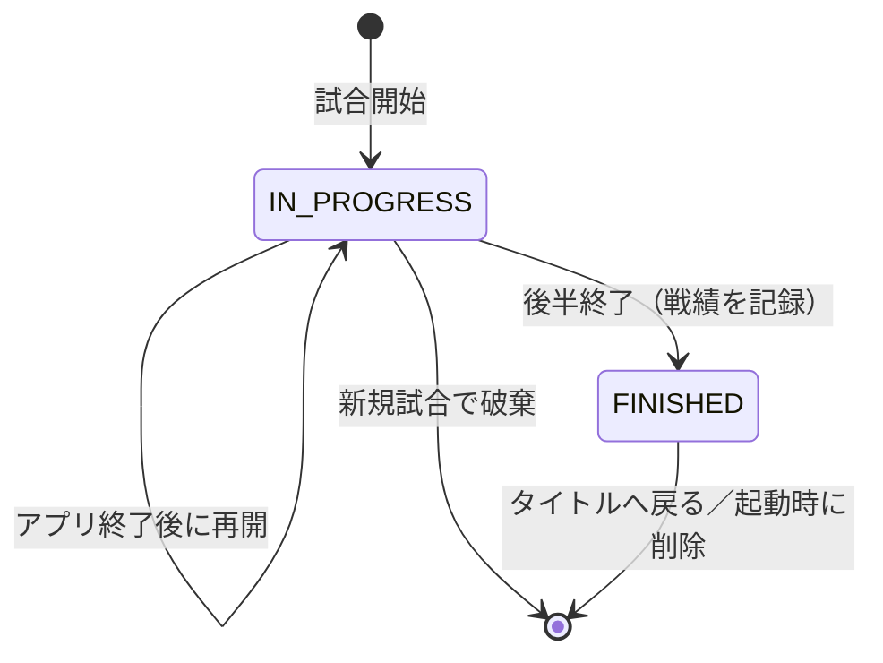

# 用語集 — soccer-game（仮称）

> プロジェクト内で使用される用語の定義を管理する。他の全ドキュメントはここで定義した用語を用いる。
> アプリ内で利用者に見せる戦術原則・単純化の説明文は、本書ではなく `functional-overview.md` の
> 各カタログを正本とする（本書は開発者向けのユビキタス言語）。

**更新日**: 2026-10-17

## ドメイン用語

### ピッチと配置

| 用語（英語表記） | 定義 | 説明・補足 | 関連用語 |
|---|---|---|---|
| レーン (Lane) | ピッチを縦に5分割した列 | 左大外（`L2`）・左ハーフスペース（`L1`）・中央（`C`）・右ハーフスペース（`R1`）・右大外（`R2`）。左右は各チーム自身の攻撃方向から見る | ゾーン / エリア / ハーフスペース |
| 大外 (Wide lane) | 両端のレーン | GK のカバーが届かないため、敵陣ゾーンで同数なら攻撃成功になる | レーン / カバー判定 |
| ハーフスペース (Half-space) | 中央と大外の間のレーン | 座標では中央から 15 より遠く 30 より近い範囲 | レーン / 5レーン |
| ゾーン (Zone) | ピッチを横に3分割した帯 | 自陣（`D`）・中盤（`M`）・敵陣（`A`）。各チーム自身から見る | レーン / エリア |
| エリア (Area) | レーンとゾーンの交差で決まる区画 | 5×3＝15エリア。表記は `ゾーン-レーン`（例: `M-L1`） | レーン / ゾーン |
| 基本配置 (Base layout) | 陣形の選手座標から導いた、15エリアごとの人数 | GK を含めない10人。配置区間の開始時に全選手がここへ戻る | 陣形 / 現在配置 |
| 現在配置 (Current layout) | 方式と手で動いた後の、ターン時点の15エリアごとの人数 | 判定・噛み合わせ表示はこの値で行う | 基本配置 / 方式 |
| 固定 (Pinned) | プレス・カバー・ドリブルで動いた選手が、配置区間が終わるまでそのエリアに留まること | 固定された選手は方式の動き（スライド・マーク）の対象外 | 配置区間 / プレス |
| 陣形 (Formation) | チームの選手配置のパターン | MVP は 4-4-2・4-3-3・4-2-3-1・3-5-2。座標はフォーメーションラボから移植 | 基本配置 |

### 戦い方

| 用語（英語表記） | 定義 | 説明・補足 | 関連用語 |
|---|---|---|---|
| 方式 (Style) | 守備方式と攻撃方式の総称 | 試合開始時・得失点後・ハーフタイムに選ぶ。方式区間の間は変わらない | 守備方式 / 攻撃方式 / 方式区間 |
| 守備方式 (Defense style) | ボールを持っていないときの動き方 | ゾーン（`ZONE`）・マンツーマン（`MAN`） | ゾーンディフェンス / マンツーマンディフェンス |
| ゾーンディフェンス (Zone defense) | ボールサイドへ1レーンずつスライドして圧縮する守備方式 | 逆サイドが薄くなる | スライド / 守備方式 |
| スライド (Slide) | ゾーンの守備側全員が、ボールのあるサイドへ1レーンずれること | ボールが中央レーンならずれない | ゾーンディフェンス |
| マンツーマンディフェンス (Man-to-man defense) | 自陣・中盤の相手に、同じエリアでマーカーをつける守備方式 | 余ったマーカーは自陣中央のカバー役になる | マーカー / カバー役 |
| マーカー (Marker) | マンツーマンで相手につく守備側の選手 | 基本エリアが自陣・中盤の選手がなる | マンツーマンディフェンス |
| カバー役（リベロ） (Spare man) | マンツーマンで余り、自陣中央に残る選手 | 同数時のカバー判定で効く | マンツーマンディフェンス / カバー判定 |
| 攻撃方式 (Attack style) | ボールを持っているときの配置と、トランジションでの振る舞い | 保持型（`POSSESSION`）・カウンター型（`COUNTER`） | 保持型 / カウンター型 |
| 保持型 (Possession) | 大外の選手が1ゾーン前へ出て、幅と高さを取る攻撃方式 | 即時奪回に強く、自陣が薄い | 攻撃方式 |
| カウンター型 (Counter-attacking) | 基本配置で構え、カウンターを選んだ瞬間に大外の選手が1ゾーン前へ飛び出す攻撃方式 | 背後が堅く、崩しの人数は少ない | 攻撃方式 / カウンター |
| 噛み合わせ (Matchup) | 両チームの陣形と方式を重ねたときに生じる、エリアごとの数的優位・不利の分布 | 試合画面で常時表示する（FR-16） | 数的優位 |

### 試合の進行

| 用語（英語表記） | 定義 | 説明・補足 | 関連用語 |
|---|---|---|---|
| 局面 (Phase) | 攻撃・ネガティブトランジション・守備・ポジティブトランジションの4つ | 攻撃・守備は攻守ターン、トランジションはトランジションターンで扱う | ターン種別 |
| ネガティブトランジション (Negative transition) | ボールを失った直後の局面 | 即時奪回かリトリートを選ぶ | 即時奪回 / リトリート |
| ポジティブトランジション (Positive transition) | ボールを奪った直後の局面 | カウンターか保持を選ぶ | カウンター / 保持 |
| 同時手番 (Simultaneous move) | 両者が相手の選択を見ずに同時に選び、同時に開示する手番方式 | 手・陣形・方式のすべてで用いる | — |
| 手 (Action) | 1ターンに選ぶ行動 | 攻撃の手・守備の手・トランジションの手がある | — |
| ショートパス (Short pass) | 斜めを含む隣接8エリアの味方へ渡す攻撃の手 | — | 攻撃の手 |
| ドリブル (Dribble) | ボールを持つ選手が前・左・右の隣接エリアへ運ぶ攻撃の手 | 運んだ選手は固定される | 固定 |
| 背後へのロングボール (Long ball behind) | 自陣から敵陣の、同じか隣のレーンの味方へ送る攻撃の手 | — | 攻撃の手 |
| サイドチェンジ (Switch of play) | 同じゾーンで3レーン以上離れた味方へ送る攻撃の手 | ゾーンのスライドの裏を突く | スライド |
| シュート (Shot) | 敵陣の中央・ハーフスペースから打つ攻撃の手 | 人数が上回れば得点 | 得点 / 阻止 |
| プレス（チャレンジ） (Press) | 隣接エリアから1人を選んだエリアへ寄せる守備の手 | 寄せた元のエリアは配置区間の間 −1 のまま | 固定 / チャレンジ＆カバー |
| カバー (Cover) | 選んだエリアの背後へ1人下げる守備の手 | — | カバー判定 |
| 即時奪回 (Counter-press) | ボール周辺の人数で奪い返しに行く、失った側の手 | 同数は奪回失敗 | ネガティブトランジション |
| リトリート (Retreat) | 基本配置に戻って守備方式で構える、失った側の手 | — | ネガティブトランジション |
| カウンター (Counter) | 1〜2ゾーン前のエリアへ一気に運ぶ、奪った側の手 | — | ポジティブトランジション |
| 保持（トランジション） (Secure) | 落ち着かせて基本配置から攻撃を始める、奪った側の手 | 攻撃方式の「保持型」とは別の概念 | ポジティブトランジション / 保持型 |
| 配置区間 (Layout segment) | 固定が有効な期間。キックオフ時、またはトランジションターンが終わって攻守ターンが始まる時に始まる（奪回成功で同じチームが保持し続ける場合も含む） | 開始時に配置がリセットされ、固定が解除される。トランジションターンの間は前の配置区間が続く | 固定 / 基本配置 |
| 方式区間 (Style segment) | 方式が有効な期間。キックオフから次の得失点またはハーフ終了まで | 方式の選び直しは方式区間の切れ目で行う（得失点による切れ目は FR-21、ハーフ終了は FR-08） | 方式 |
| キックオフ (Kick-off) | 中盤中央から攻撃を始める再開 | 前半はランダム、後半は反対側、得点後は失点側 | — |
| ハーフタイム (Half-time) | 前半と後半の間。陣形と方式を選び直せる | — | 方式 |

### 判定

| 用語（英語表記） | 定義 | 説明・補足 | 関連用語 |
|---|---|---|---|
| ターン判定 (Turn resolution) | 両者の手・陣形・方式から、ターンの結果を人数差とカバーの有無で確定する処理 | 乱数を使わない。チームを入れ替えると結果が鏡写しになる | 比較エリア / カバー判定 |
| 比較エリア (Contested area) | 人数を比べるエリア | シュートはボール位置、それ以外は運ぶ先 | ターン判定 |
| 数的優位 (Numerical superiority) | あるエリアで、自チームの人数が相手を上回っている状態 | 優位 `▲`・同数 `＝`・不利 `▼` で表示する | 噛み合わせ |
| カバー判定 (Cover check) | 同数のとき、比較エリアの背後に余っている守備者がいるかで、膠着か攻撃成功かを決めること | 敵陣ゾーンの中央・ハーフスペースは GK がカバーとみなす | チャレンジ＆カバー |
| チャレンジ＆カバー (Challenge and cover) | ボールに寄せる選手の背後を、別の選手が埋める守備原則 | カバー判定とプレスの優先順の根拠（原則 TP-03） | カバー判定 / プレス |
| 膠着 (Stall) | ボールが動かず、攻撃側が保持したまま次のターンへ進む結果 | — | ターン結果 |

### 学習と妥当性

| 用語（英語表記） | 定義 | 説明・補足 | 関連用語 |
|---|---|---|---|
| 学習目標 (Learning goal) | 遊び終えた選手ができるようになっていること | LG-1〜LG-4。正本は要件定義書 §1.4 | 場面問題 |
| 場面問題 (Scenario question) | 配置・ボール・方式の場面を示し、判断を問う問題 | 理解度チェック（FR-22）とプレイテストで同じ問題セットを使う | 学習目標 |
| 戦術原則 (Tactical principle) | ルールの根拠となる、公開された戦術理論の原則 | TP-01〜。正本は `functional-overview.md`「戦術原則カタログ」 | 照合状態 |
| 照合状態 (Verification status) | 戦術原則の出典を本文で確かめたかどうか | 下記「ステータス・状態」 | 戦術原則 |
| 単純化 (Simplification) | ゲームが意図的に表現していない戦術要素 | SIM-01〜。正本は `functional-overview.md`「単純化カタログ」。アプリでは「実戦では」を添える | — |
| 実戦では (In real matches) | 単純化に関わる場面で添える、実際の試合での扱いの説明 | — | 単純化 |
| 自己対戦検証 (Self-play verification) | CPU 同士の総当たりで、決定性・対称性・偏りのなさを検証すること | NFR-05〜07 | — |
| プレイテスト (Playtest) | 公開前に、育成年代・アマチュアの選手に遊んでもらう検証 | 学習効果の測定と「実戦と違うと感じた場面」の収集 | 場面問題 |
| フォーメーションラボ (Formation Lab) | 先行プロダクト（リポジトリ `soccer-sim`） | 陣形の座標・特徴タグ・噛み合わせルール・教訓の移植元 | — |

## 技術用語

| 用語 | 定義 | 本プロジェクトでの用途 | 備考 |
|---|---|---|---|
| Godot Engine | オープンソースのゲームエンジン | 2D の UI・3D の演出・Android と Windows への書き出し | 4.6 系（`architecture-overview.md`） |
| GDScript | Godot の標準スクリプト言語 | すべての実装 | 静的型付けを必須にする（kit `coding-gdscript.md`） |
| gdUnit4 | Godot 用の単体テストフレームワーク | ドメインロジックのテスト・自己対戦検証 | 6.1 系 |
| Compatibility レンダラー | Godot の描画方式のうち、低価格帯の端末まで動くもの | 2D・3D の描画 | — |
| Resource（`.tres`） | Godot のデータ形式 | 調整値（`game/config/`） | — |
| SteamPipe | Steam へビルドを登録する仕組み | Windows 版の配布 | アプリに Steamworks SDK は組み込まない |
| draw.io | 図の作成ツール | 基本設計のワイヤーフレーム | 1画面1ページ（`repository-structure.md`） |
| Mermaid | テキストで図を書く記法 | `docs/specs/1_requirements/` の図 | — |

## 略語・頭字語

| 略語 | 正式名称 | 意味 | 本プロジェクトでの使用 |
|---|---|---|---|
| FR | Functional Requirement | 機能要件 | 要件定義書の FR-01〜 |
| NFR | Non-Functional Requirement | 非機能要件 | 非機能要件定義書の NFR-01〜 |
| LG | Learning Goal | 学習目標 | 要件定義書の LG-1〜4 |
| TP | Tactical Principle | 戦術原則 | 戦術原則カタログの TP-01〜 |
| SIM | Simplification | 単純化 | 単純化カタログの SIM-01〜 |
| UC | Use Case | ユースケース | 機能概要の UC-01〜 |
| S-xx | Screen | 画面 ID | 機能概要の画面一覧 S-01〜S-12 |
| HS | Half-space | ハーフスペース | 配置表・判定例 |
| CB / SB / SH / WB / FW / MF / GK | センターバック / サイドバック / サイドハーフ / ウイングバック / フォワード / ミッドフィルダー / ゴールキーパー | ポジション | 判定例・解説 |
| ネガトラ / ポジトラ | ネガティブトランジション / ポジティブトランジション | 局面の略称 | 解説・会話 |
| AAB | Android App Bundle | Google Play へ登録する Android アプリの形式 | Android の書き出し |
| MVP | Minimum Viable Product | 最初に公開する最小の製品 | 要件定義書の対象範囲 |

## アーキテクチャ用語

| 用語（英語表記） | 定義 | 本プロジェクトでの適用 | 関連コンポーネント |
|---|---|---|---|
| ドメイン層 (Domain layer) | ルールを実装する純粋ロジックの層 | Node を継承せず、乱数は注入する | `game/domain/` |
| アプリケーション層 (Application layer) | 試合の状態遷移とドメイン呼び出しを担う層 | 保存のタイミング・乱数生成器の注入 | `game/application/` |
| データ層 (Data layer) | 静的データの読み込みと端末内保存を担う層 | JSON・`.tres`・`user://` | `game/data/` |
| UI 層 (UI layer) | 画面・2D 作戦ボード・3D 演出を担う層 | ルールを計算しない | `game/ui/` |
| 2D 作戦ボード (2D tactics board) | 真上から見たピッチで手を選ぶ画面表現 | 人数と優劣記号を表示 | `game/ui/board2d/` |
| 3D 演出 (3D replay) | 開示後のターン結果を 3D のピッチで見せる短い演出 | ターン記録から生成する再生専用の表現。結果を変えない | `game/ui/replay3d/` |
| 乱数の注入 (RNG injection) | 乱数生成器を外から引数で渡すこと | CPU の選択とキックオフ側の決定だけで使う。テストは固定シード | `game/application/` |

## ステータス・状態

### 試合の状態（`MatchStatus`）

| ステータス | 意味 | 遷移条件 | 次の状態 |
|---|---|---|---|
| `IN_PROGRESS` | 試合が進行中。アプリを閉じた（強制終了を含む）あとに中断データとして残っていれば「中断中の試合」として扱う。ただし最終ターンまで終えていれば、再開ではなく終了処理だけをやり直す | 後半の最終ターン終了／新規試合の開始で破棄 | `FINISHED` ／（削除） |
| `FINISHED` | 試合終了。戦績は記録済み。結果画面・振り返りのためにターン記録を保持している | 結果画面からタイトルへ戻る／起動時に見つかった | （削除） |

> 「中断中」は保存する状態ではない。強制終了の瞬間には状態を書き込めないため、起動時に `IN_PROGRESS` の
> 中断データが見つかったことをもって中断中と判断する（`functional-overview.md`「確定事項」）。

### ターンの種別（`TurnKind`）

| ステータス | 意味 | 遷移条件 | 次の状態 |
|---|---|---|---|
| `OPEN_PLAY` | 攻守ターン（攻撃側と守備側が手を選ぶ） | `ADVANCE`・`STALL` ／ `LOSS`・`SAVE` ／ `GOAL` | `OPEN_PLAY` ／ `TRANSITION` ／ キックオフ（`OPEN_PLAY`） |
| `TRANSITION` | トランジションターン（失った側と奪った側が手を選ぶ） | カウンターの `LOSS` ／ それ以外 | `TRANSITION` ／ `OPEN_PLAY` |

### 出典の照合状態（`PrincipleStatus`）

| ステータス | 意味 | 遷移条件 | 次の状態 |
|---|---|---|---|
| `NO_SOURCE` | 出典が見つかっていない | 出典候補を見つける | `UNVERIFIED` |
| `UNVERIFIED` | 出典候補の書誌情報と紹介文まで確認し、本文は照合していない（候補の本がその原則を扱っているか未確認の段階を含む） | 本文を読んで原則の記載箇所を確かめる（照合者・箇所を記録）／照合の結果、記載が無いと分かった | `VERIFIED` ／ `NO_SOURCE` |
| `VERIFIED` | 本文で照合済み | — | — |

## データモデル用語

エンティティの定義・属性の正本は `functional-overview.md`「データモデル」（ER図を含む）。ここでは名称と
役割だけを示す。

| エンティティ | 役割 | 保存先 |
|---|---|---|
| フォーメーション・選手配置 | 陣形の座標と特徴タグ | 静的データ（`content/formations.json`） |
| 試合 | 進行中・中断中の試合の状態 | 端末内（中断データ） |
| ターン記録 | 各ターンの選択・配置・判定結果。振り返りと 3D 演出の入力 | 端末内（中断データに含む） |
| 戦績 | 終了した試合の結果 | 端末内 |
| 場面問題・回答結果 | 理解度チェックの問題と回答 | 問題は静的データ、回答は端末内 |
| 設定 | 音量・ヒント表示 | 端末内 |
| 戦術原則・単純化項目・噛み合わせルール | 解説・カタログ表示の根拠 | 静的データ |

## エラー・例外

処理内容とユーザーへの表示の正本は `functional-overview.md`「エラーハンドリング」。

| エラー | 発生条件 | 対処方法 | 例 |
|---|---|---|---|
| 中断データの読み込み失敗 | 中断データの破損・改変 | 中断データを破棄してタイトルへ | — |
| 保存失敗 | 端末の空き容量不足など | 処理を続け、次の機会に再保存 | — |
| 保存データの読み込み失敗 | 戦績・回答結果・設定の破損 | 初期状態として扱う | — |
| 不正な調整値 | `.tres` の値が範囲外 | 初期値を使う | — |
| 選択不可の手 | ドメイン層への不正な入力 | 拒否する（UI では選べない） | — |

## 計算・アルゴリズム

定義の正本は `functional-overview.md`「アルゴリズム設計（ドメインロジック）」。

| アルゴリズム | 要点／計算式 | 実装箇所 |
|---|---|---|
| 基本配置の導出（1） | `d = \|x − 50\|` で中央（≤15）・HS（<30）・大外、`y` を3等分してゾーン。GK を除く | `game/domain/layout/` |
| 現在配置の算出（2） | 配置区間のリセット → 固定の維持 → 攻撃方式・守備方式の動き | `game/domain/layout/` |
| 選択可能な手（3） | 局面・ボール位置・現在配置から手の条件を判定 | `game/domain/judge/` |
| 守備の手による移動（4） | 余り最大の隣接エリアから1人。同率は前方 → 横 → 背後 | `game/domain/layout/` |
| 攻守ターンの判定（5） | `diff = 攻撃側人数 − 守備側人数` 正: 成功 ／ 負: ロスト ／ 0: カバー判定 | `game/domain/judge/` |
| トランジションの判定（6） | 即時奪回は周辺の人数合計、カウンターは運ぶ先で手順5を適用 | `game/domain/judge/` |
| 試合進行（7） | キックオフ・ハーフ・試合終了 | `game/domain/match/` |
| CPU の選択（8） | `p_i = floor/N + (1−floor)·softmax(s_i/τ)` | `game/domain/cpu/` |
| 解説の導出（9） | 特徴タグ × 噛み合わせルール。同一テーマは1件 | `game/domain/commentary/` |
