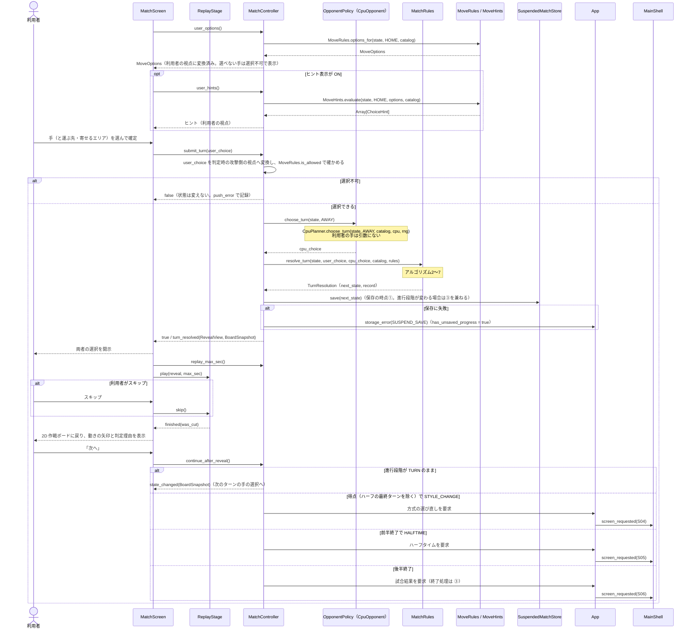
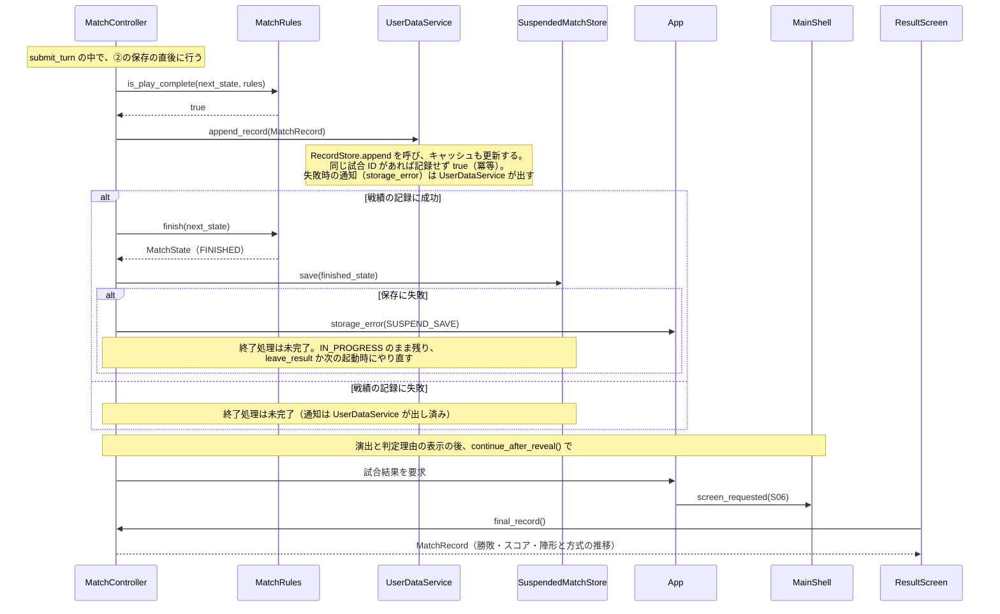
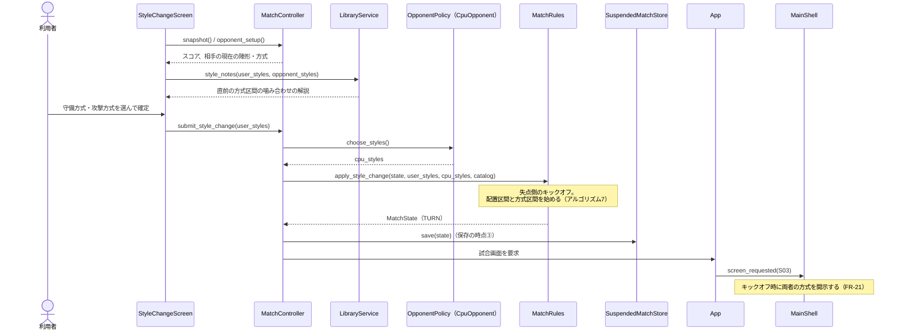
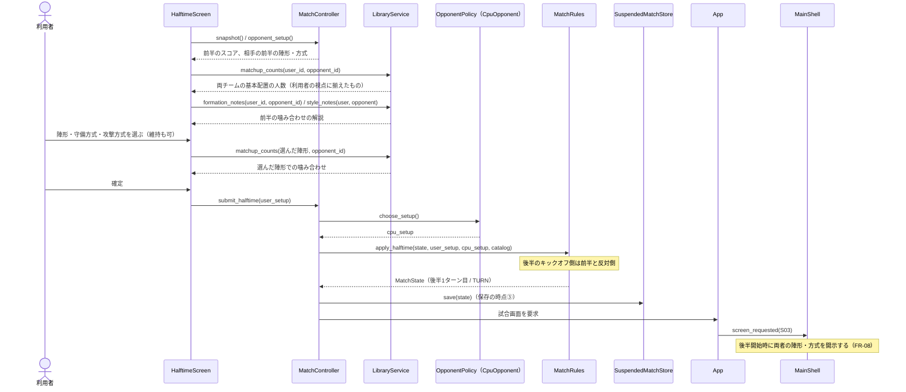
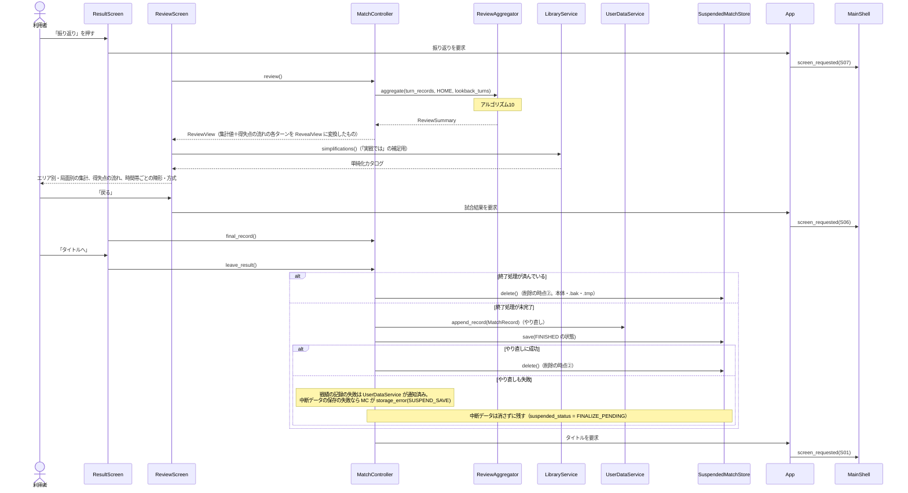
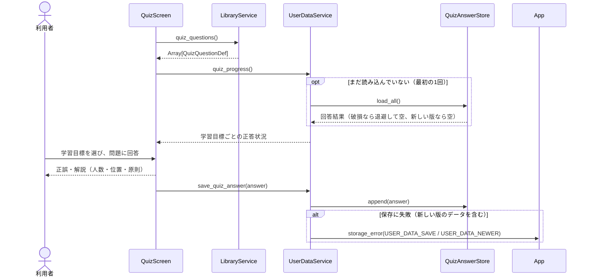
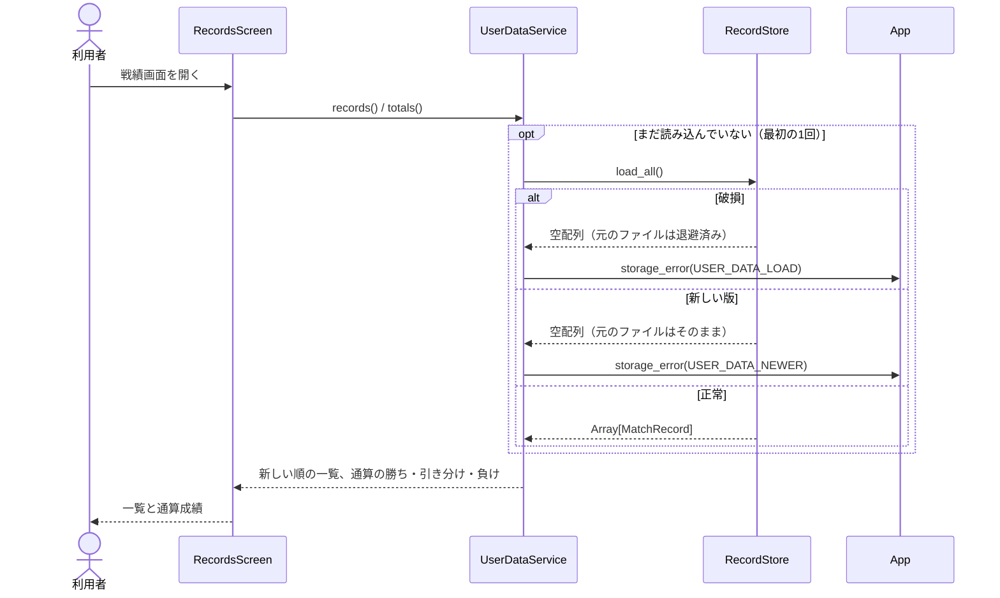
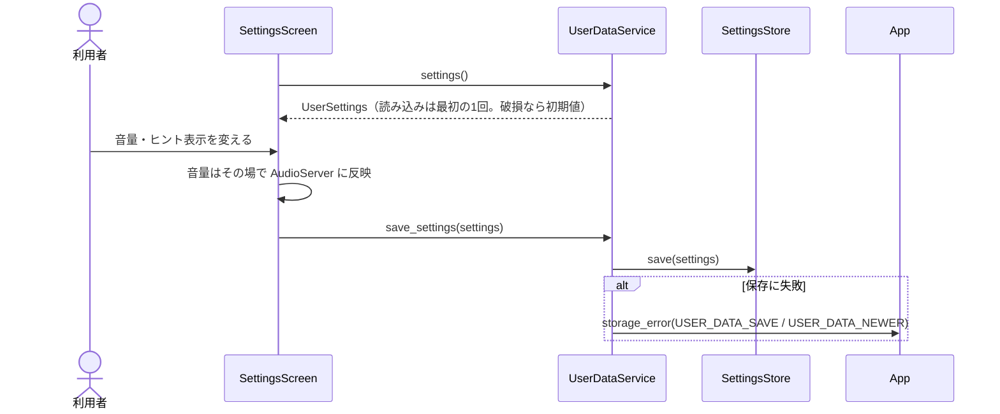

# ユースケース図 — soccer-game（仮称）

**更新日**: 2026-10-17

> 本書は、各ユースケースの層をまたぐ呼び出しの順序（シーケンス図）を置く。
> 次の事項は本書に書かず、正本を参照する。
>
> | 事項 | 正本 |
> |---|---|
> | ユースケースの ID・アクター・目的・関連画面 | `functional-overview.md`「ユースケース一覧」 |
> | 画面一覧・画面遷移 | `functional-overview.md`「画面設計」 |
> | 保存の時点・再開先・終了処理の順序・削除の時点 | `functional-overview.md`「確定事項」 |
> | 判定・集計の規則 | `functional-overview.md`「アルゴリズム設計」 |
> | エラー時の処理と表示する文言 | `functional-overview.md`「エラーハンドリング」 |
> | クラスとメソッドの形 | `component-design.md` |
>
> 参加者（participant）の名前は `component-design.md` のクラス名に揃える。層は次のように表す。
>
> | 層 | 参加者 |
> |---|---|
> | UI 層 | `MainShell`・各画面（`TitleScreen` など）・`ReplayStage` |
> | アプリケーション層 | `App`・`MatchController`・`OpponentPolicy`・`LibraryService`・`UserDataService` |
> | ドメイン層 | `MatchRules`・`MoveRules`・`MoveHints`・`ReviewAggregator` など |
> | データ層 | `SuspendedMatchStore`・`RecordStore`・`QuizAnswerStore`・`SettingsStore` |
>
> 静的データ（`ContentCatalog`）と調整値は起動時に読み込み済みとし、各図では読み込みを省く。
> 画面遷移は、どの図でも「`App.screen_requested` を `MainShell` が受けて画面を入れ替える」流れで行う
> （`component-design.md` §5.1）。図では `App` から `MainShell` への矢印1本で表す。
> 画面に渡す値はすべて利用者の視点に揃っている（`component-design.md` §1.2）。座標の変換は `MatchController` が行う。

## UC-01: CPU と試合をする

1つの図にすると長くなるため、①試合の開始、②1ターン、③試合の終了 に分ける。

### ① 試合の開始

```mermaid
sequenceDiagram
    actor User as 利用者
    participant Title as TitleScreen
    participant Setup as MatchSetupScreen
    participant MS as MatchScreen
    participant App as App
    participant MC as MatchController
    participant Lib as LibraryService
    participant Opp as OpponentPolicy（CpuOpponent）
    participant Rules as MatchRules
    participant Store as SuspendedMatchStore
    participant Shell as MainShell

    Title->>MC: suspended_status()
    MC-->>Title: NONE / RESUMABLE / FINALIZE_PENDING
    User->>Title: 「CPU対戦」を押す
    alt RESUMABLE（中断中の試合がある）
        Title-->>User: 確認ダイアログ（中断中の試合は、新しい試合で上書きされる）
        User->>Title: 了承
    else FINALIZE_PENDING（戦績を記録できていない試合が残っている）
        Title->>MC: retry_pending_finalize()
        alt やり直しに失敗
            Title-->>User: 確認ダイアログ（前の試合の戦績は記録されない）
            User->>Title: 了承
        end
    end
    Title->>App: 試合準備を要求
    App->>Shell: screen_requested(S02)
    Setup->>Lib: formations() / base_counts() / formation_notes() / style_notes()
    Lib-->>Setup: 陣形・ミニピッチの人数・解説
    alt 「戻る」
        User->>Setup: 戻る
        Setup->>App: タイトルを要求（中断データは残ったまま）
        App->>Shell: screen_requested(S01)
    else 確定
        User->>Setup: 陣形・守備方式・攻撃方式を選んで確定
        Setup->>MC: start_match(user_setup)
        MC->>Opp: choose_setup()
        Note over Opp: CpuPlanner.choose_setup(catalog, rng)<br/>利用者の選択は渡さない
        Opp-->>MC: cpu_setup
        MC->>MC: rng で前半のキックオフ側を決める
        MC->>Rules: create_match(match_id, user_setup, cpu_setup, kickoff_side, catalog)
        Rules-->>MC: MatchState（IN_PROGRESS / TURN）
        MC->>Store: save(state)（保存の時点②。既存の中断データはここで上書きされる＝削除の時点①）
        alt 保存に失敗
            MC->>App: storage_error(SUSPEND_SAVE)
        end
        MC->>App: 試合画面を要求
        App->>Shell: screen_requested(S03)
        MS->>MC: snapshot()
        MC-->>MS: BoardSnapshot
        Note over MS: 試合画面で両者の陣形・方式を開示する
    end
```

**フロー説明**:
1. タイトルは開くたびに `suspended_status()` を呼び、中断中の試合があるかを確かめる（再開カードの有無もこれで決める）
2. 中断中の試合があれば、上書きの確認を出す（FR-01）。了承しても、この時点では中断データを消さない。試合準備から
   「戻る」を選べば、中断中の試合はそのまま残る。戦績を記録できていない試合（`FINALIZE_PENDING`）が残っていれば、
   先に終了処理をやり直し、それでも失敗したときだけ、戦績が記録されないことを確認する（`component-design.md` §3.2）
3. 試合準備画面は `LibraryService` から陣形・基本配置の人数・解説を取って表示する。相手は未定なので、解説は単独の
   陣形・方式の解説（`formation_notes` の相手 ID を空にする）
4. `start_match` は CPU の陣形・方式を `OpponentPolicy` から得る。`choose_setup` は利用者の選択を引数に取らない（FR-01・FR-11）
5. 前半のキックオフ側は `App` が注入した乱数で決め、`MatchRules.create_match` に渡す（アルゴリズム7）
6. 試合を作ったら保存する（保存の時点②）。中断データは1ファイルなので、この保存で前の中断データが置き換わる
   （削除の時点①）。保存に失敗しても試合は続ける
7. 試合画面は開いたときに `snapshot()` を呼んで描く（シグナルの届く順序に頼らない）

### ② 1ターン（攻守ターン・トランジションターン共通）



**フロー説明**:
1. 選べる手は `MoveRules.options_for` で求める（アルゴリズム3）。UI は選べるかどうかを自分で計算しない
2. ヒントは設定が ON のときだけ取得する（FR-19）。ヒントと CPU の評価値は同じ `MoveHints` から出る
3. 利用者がタップしたエリアは利用者の視点なので、`MatchController` が攻撃側の視点へ変換してから確かめる。
   選択不可なら `false` を返して状態を変えない（`component-design.md` §3.2「選択不可の手」）
4. CPU の手は利用者が確定した後に求めるが、`choose_turn` は利用者の手を受け取らない（FR-11）
5. `resolve_turn` は配置の算出・守備の手・攻撃の手・判定・局面の遷移・得点・ハーフの終了までを1回で行い、
   次の状態とターン記録を返す
6. **演出の前に保存する**（保存の時点①）。演出中に強制終了しても、再開時は演出を再生せず次の手の選択から始まる
   （確定事項「再開先」）
7. 開示は `RevealView`（ターン記録を利用者の視点に変換したもの）で行う。演出の上限は `replay_max_sec()` から得る
   （UI は調整値を直接読まない）。上限に達したら打ち切る（FR-24）
8. 画面の切り替えは、利用者が判定理由を確認して「次へ」を押し、`continue_after_reveal()` が呼ばれてから行う。
   保存はすでに済んでいるので、ここで強制終了しても再開先は保存された進行段階の画面になる

### ③ 試合の終了



**フロー説明**:
1. 後半の最終ターンを解決した直後（②の保存の後）に、終了処理を行う（確定事項「試合終了から破棄までの順序」）
2. 戦績の記録 → `FINISHED` にして上書き保存 の順で行う。どちらかに失敗しても結果画面は表示し、終了処理は
   未完了として覚えておく（UC-04 の `leave_result` がやり直す）
3. 結果画面は開くたびに `final_record()` を呼んで表示する（振り返りから戻ったときも同じ）。メモリ上の試合から作るので、
   保存の失敗は結果の表示に影響しない

## UC-02: 得失点後に方式を選び直す



**フロー説明**:
1. 方式の選び直し画面は、相手の現在の陣形・方式と、直前の方式区間の噛み合わせの解説を表示する
2. CPU の方式は `choose_styles` で一様ランダムに選ぶ（アルゴリズム8）。利用者の選択は渡さない
3. 選び直しを確定したら保存し（保存の時点③）、キックオフから試合画面に戻る
4. ハーフの最終ターンの得点では、この画面を通らない（アルゴリズム7）

## UC-03: ハーフタイムに修正する



**フロー説明**:
1. ハーフタイム画面は、前半のスコア・相手の陣形と方式・前半の噛み合わせを表示する（FR-08）
2. 噛み合わせのミニピッチは `matchup_counts` を使う（相手の人数は鏡像に変換済み。UI は変換しない）
3. 陣形・方式の選び直しは、試合準備（UC-01 ①）と同じ部品で行う
4. 確定したら保存し（保存の時点③）、後半のキックオフから試合画面に戻る

## UC-04: 試合を振り返る



**フロー説明**:
1. 振り返りは、メモリ上のターン記録を `ReviewAggregator` で集計して表示する（アルゴリズム10）。遡るターン数は設定値
2. 結果画面と振り返り画面は何度行き来してもよい（ターン記録は結果画面を離れるまで残る）
3. 結果画面からタイトルへ戻るときは、終了処理が済んでいる場合に限って中断データを削除する（削除の時点②）。
   未完了ならやり直し、なお失敗したら削除しない（戦績を失わないため。確定事項「試合終了から破棄までの順序」③）

## UC-05: 中断した試合を再開する

起動時の後始末と、タイトルからの再開に分かれる。

```mermaid
sequenceDiagram
    actor User as 利用者
    participant Shell as MainShell
    participant MC as MatchController
    participant Store as SuspendedMatchStore
    participant Rules as MatchRules
    participant UD as UserDataService
    participant App as App
    participant Title as TitleScreen

    Shell->>MC: inspect_suspended()
    MC->>Store: load()
    alt ファイルがない
        Store-->>MC: NONE
    else 読み込めない・破損・新しい版（.bak も使えない）
        Store-->>MC: CORRUPTED
        MC->>Store: delete()（削除の時点④）
        MC->>App: storage_error(SUSPEND_LOAD)（MainShell が保持し、タイトルを開いてから表示）
    else FINISHED
        Store-->>MC: OK（FINISHED）
        MC->>Store: delete()（削除の時点③）
    else IN_PROGRESS
        Store-->>MC: OK（IN_PROGRESS）
        MC->>Rules: is_play_complete(state, rules)
        alt true（最終ターンまで終えている）
            Note over MC,UD: UC-01 ③の終了処理だけをやり直す
            MC->>UD: append_record(MatchRecord)（失敗時の通知は UserDataService が出す）
            alt 戦績の記録に成功
                MC->>Rules: finish(state)
                MC->>Store: save(finished_state)
                MC->>Store: delete()（FINISHED になったので削除の時点③）
                Note over MC: FINALIZED（再開の対象にしない）
            else 失敗
                Note over MC: FINALIZE_FAILED（中断データは残す。suspended_status = FINALIZE_PENDING）
            end
        else false（途中）
            Note over MC: RESUMABLE
        end
    end
    MC-->>Shell: StartupResult
    Shell->>Title: タイトルを開く
    Title->>MC: suspended_status()
    MC-->>Title: RESUMABLE なら再開カードを出す（FINALIZE_PENDING は再開の対象にしない）
    User->>Title: 「中断した試合を再開」
    Title->>MC: resume()
    MC->>Store: load()（毎回読み直す）
    alt TURN
        MC->>App: 試合画面を要求（次の手の選択から。演出は再生しない）
        App->>Shell: screen_requested(S03)
    else STYLE_CHANGE
        MC->>App: 方式の選び直しを要求
        App->>Shell: screen_requested(S04)
    else HALFTIME
        MC->>App: ハーフタイムを要求
        App->>Shell: screen_requested(S05)
    end
```

**フロー説明**:
1. 起動時に `MainShell` が `inspect_suspended()` を1回だけ呼ぶ（確定事項「起動時の扱い」）。タイトルの再開カードの
   有無は、タイトルを開くたびに `suspended_status()` で確かめる
2. 破損していれば削除して知らせる（エラーハンドリング「中断データの読み込み失敗・破損」。削除の時点④）。
   `.bak` から読めた場合は正常として扱う（`component-design.md` §4.3）
3. 最終ターンまで終えた `IN_PROGRESS` は、再開ではなく終了処理だけをやり直す。手順は UC-01③・UC-04 と同じ
   「戦績の記録 → `FINISHED` で保存 → 削除」（確定事項「試合終了から破棄までの順序」）。やり直しに失敗した場合は
   再開の対象にはせず、中断データを残す（`FINALIZE_PENDING`。次の CPU 対戦の前か、次の起動時にもう一度やり直す。UC-01①）
4. 再開先は進行段階が示す画面（確定事項「再開先」）。`resume()` は毎回保存データから読み直す。乱数生成器は
   起動時に作ったものをそのまま使う（`component-design.md` §3.2「乱数」）

## UC-06: ルールを体験する

```mermaid
sequenceDiagram
    actor User as 利用者
    participant Title as TitleScreen
    participant Tut as TutorialScreen
    participant Lib as LibraryService
    participant App as App
    participant TC as MatchController（チュートリアル用）
    participant Scripted as ScriptedOpponent
    participant Rules as MatchRules
    participant UD as UserDataService
    participant Shell as MainShell

    Title->>UD: settings()
    UD-->>Title: tutorial_completed
    opt 未完了（初回起動）
        Title-->>User: チュートリアルへの導線を強調表示
    end
    User->>Title: 「チュートリアル」を押す
    Title->>App: チュートリアルを要求
    App->>Shell: screen_requested(S08)
    Tut->>Lib: tutorial_steps()
    Lib-->>Tut: Array[TutorialStepDef]
    Tut->>App: new_tutorial_controller()
    App-->>Tut: チュートリアル用の MatchController（保存しない・画面遷移を要求しない）
    loop 各段階
        Tut->>TC: start_tutorial_step(step)
        Tut-->>User: 説明文と盤面
        User->>Tut: 手を選ぶ
        Tut->>TC: submit_turn(user_choice)
        TC->>Scripted: choose_turn(state, AWAY)
        Scripted-->>TC: 段階が決めた手
        TC->>Rules: resolve_turn(...)
        Rules-->>TC: TurnResolution
        TC-->>Tut: turn_resolved(RevealView, BoardSnapshot)
        Tut-->>User: 演出と判定理由
    end
    Tut->>Lib: simplifications()
    Lib-->>Tut: 単純化カタログ
    Tut-->>User: ゲームの表現範囲（FR-23）
    User->>Tut: 「完了」
    Tut->>UD: mark_tutorial_completed()
    Tut->>App: タイトルを要求（チュートリアル用の MatchController は捨てる）
    App->>Shell: screen_requested(S01)
```

**フロー説明**:
1. 初回起動の判定は、設定のチュートリアル完了フラグで行う（FR-12）
2. チュートリアルは、本番と同じ `MatchController`・`MatchRules` の**クラス**で判定する（ルールを体験する画面だけ
   別の判定を持たない）。ただし**インスタンスは本番と別**にする。`App.new_tutorial_controller()` が、保存先を
   持たず、相手を `ScriptedOpponent` にしたインスタンスを作る。本番の `App.match_controller` の状態（中断中の試合を
   含む）には一切触れない
3. 段階の進行は `TutorialScreen` が決める。チュートリアル用のインスタンスは、保存・画面遷移の要求・試合の終了処理を
   行わない
4. 最後に単純化カタログの全項目を表示し、完了フラグを保存する。保存に失敗しても完了の表示は行う
   （次回も初回の導線が出るだけ）。「やめる」の場合は完了フラグを変えずにタイトルへ戻る

## UC-07: 理解度を確かめる



**フロー説明**:
1. 問題は静的データ、回答結果は端末内に保存する（FR-22）。正誤の判定は問題の正解との一致だけで、ルールの計算は伴わない
2. 回答結果の読み込みは最初の1回だけ行い、結果を `UserDataService` が持つ。破損していたら退避してから初期状態
   （未回答）として表示し、`storage_error(USER_DATA_LOAD)` を1回だけ出す。新しい版のデータなら、表示は初期状態に
   して、上書きしない（`component-design.md` §4.3）

## UC-08: ゲームの表現範囲を確かめる

```mermaid
sequenceDiagram
    actor User as 利用者
    participant Title as TitleScreen
    participant Scope as ScopeScreen
    participant Lib as LibraryService
    participant App as App
    participant Shell as MainShell

    User->>Title: 「ゲームの表現範囲」を押す
    Title->>App: 表現範囲を要求
    App->>Shell: screen_requested(S10)
    Scope->>Lib: simplifications()
    Lib-->>Scope: 単純化カタログ（SIM-01〜）
    Scope-->>User: 単純化・ゲームでの扱い・実戦では の一覧
```

**フロー説明**:
1. 表示内容は単純化カタログの静的データそのもの。チュートリアル末尾（UC-06）と同じデータを使う（FR-23）

## UC-09: 戦績を見る



**フロー説明**:
1. 一覧は新しい順に並べる。並び替えと通算の集計は `UserDataService` が行い、読み込みは最初の1回だけにする
2. 破損していれば元のファイルを退避してから初期状態（0件）として表示する。新しい版のデータなら、初期状態を表示し、
   上書きしない（エラーハンドリング）

## UC-10: 設定を変える



**フロー説明**:
1. 音量は変えた時点で再生中の音に反映する（音の出力は UI 層の責務）
2. 保存は値を変えるたびに行う。失敗しても画面上の値は保持する（エラーハンドリング「戦績・回答結果・設定の保存失敗」）
3. ヒント表示の設定は、試合画面が手の選択のたびに `UserDataService.settings()` を読んで反映する（メモリ上の値を
   返すだけで、ファイルは読み直さない）
