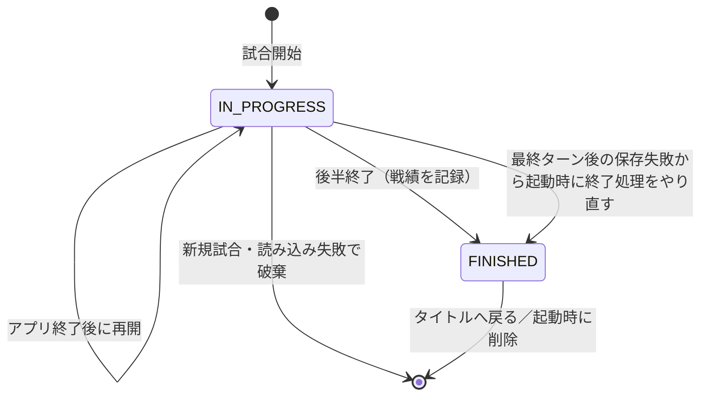

# 用語集 — soccer-game（仮称）

**更新日**: 2026-10-17

> プロジェクト内で使用される用語の定義を管理する。他の全ドキュメントはここで定義した用語を用いる。
> アプリ内で利用者に見せる戦術原則・単純化の説明文は、本書ではなく `functional-overview.md` の
> 各カタログを正本とする（本書は開発者向けのユビキタス言語）。
> 計算式・エラー時の処理・バージョンなど、別の文書に正本がある事実は本書に書き下さず、参照だけを置く。

## ドメイン用語

### 人と立場

| 用語（英語表記） | 定義 | 説明・補足 | 関連用語 |
|---|---|---|---|
| 利用者 (User) | このゲームを遊ぶ人 | 主な対象は、実際にサッカーをプレーしている選手（要件定義書 §2.1） | 選手 |
| 選手 (Player) | ゲーム内のピッチ上の人（各チームのフィールド選手10人と GK） | 能力値を持たない。文書では、遊ぶ人を「利用者」と呼んで区別する | 利用者 / 基本エリア |
| 攻撃側／守備側 (Attacking / Defending side) | 攻守ターンでボールを持っているチーム／持っていないチーム | 判定は攻撃側から見た座標で行う | 攻守ターン |
| 奪取側／喪失側 (Winning / Losing side) | トランジションターンで、直前にボールを奪ったチーム／失ったチーム | — | トランジションターン |

### ピッチと配置

| 用語（英語表記） | 定義 | 説明・補足 | 関連用語 |
|---|---|---|---|
| レーン (Lane) | ピッチを縦に5分割した帯 | 左大外（`L2`）・左ハーフスペース（`L1`）・中央（`C`）・右ハーフスペース（`R1`）・右大外（`R2`）。左右は各チーム自身の攻撃方向から見る | 列 / エリア / ハーフスペース |
| 大外 (Wide lane) | 両端のレーン | ゴールから遠く、シュートを打てない（シュートはペナルティエリアから） | レーン |
| ペナルティエリア (Penalty area) | 敵陣ゴール前の列（6列目）の、中央と左右のハーフスペースの3マス（`A2-L1`・`A2-C`・`A2-R1`） | シュートはここからだけ打てる。作戦ボードの白線もこの3マスに合わせて描く（2026-10-25） | シュート |
| ハーフスペース (Half-space) | 中央と大外の間のレーン | 例: `M2-L1`（中盤（敵陣）・左ハーフスペース） | レーン |
| 列 (Row) | ピッチを横に6分割した帯（コードでは `Zone`） | 自陣ゴール側から、自陣ゴール前（`D1`）・自陣（`D2`）・中盤（自陣）（`M1`）・中盤（敵陣）（`M2`）・敵陣（`A1`）・敵陣ゴール前（`A2`）。1〜3列目が自陣で、ハーフウェーラインは `M1` と `M2` の境。各チーム自身から見る（相手から見ると `D1`↔`A2`・`D2`↔`A1`・`M1`↔`M2`）。2026-10-25 に3つのゾーン（`D`・`M`・`A`）から6列にした | レーン / エリア |
| エリア (Area) | レーンと列の交差で決まる区画 | 5×6＝30エリア。表記は `列-レーン`（例: `M2-L1`） | レーン / 列 |
| 陣形（フォーメーション） (Formation) | チームの選手配置のパターン | MVP は 4-4-2・4-3-3・4-2-3-1・3-5-2。座標はフォーメーションラボから移植。文書では「陣形」と「フォーメーション」を同じ意味で使う | 基本配置 |
| 基本エリア (Base area) | 陣形の座標から決まる、各選手の元のエリア（同じエリアに重なる列は1マス1人に散らす。2026-10-24） | 方式の動きが無ければ1ターンに1マスずつ基本エリアへ戻る（2026-10-24）。キックオフでは、陣形を自陣に縮めたキックオフの位置に置き、そこから基本エリアへ上がる（2026-10-25） | 基本配置 / キックオフの位置 |
| キックオフの位置 (Kick-off position) | キックオフで選手を置くエリア。基本エリアの列を半分にした列（1〜3列目）で、レーンは基本エリアのまま（重なれば散らす） | 両チームとも全員が自陣から始まる（2026-10-25） | 基本エリア / キックオフ |
| 基本配置 (Base layout) | 基本エリアを30エリアごとの人数にまとめたもの | GK を含めない10人 | 陣形 / 現在配置 |
| 現在配置 (Current layout) | 方式と手で動いた後の、ターン時点の30エリアごとの人数 | 判定・噛み合わせ表示はこの値で行う | 基本配置 / 方式 |
| 余り (Surplus) | あるエリアで、守備側の人数が攻撃側の人数を上回っている分 | プレスで寄せる選手の選び方と、カバー判定に使う | プレス / カバー判定 |
| 固定 (Pinned) | プレス・カバー・ドリブル・スルーパスの受け手の走り込みで動いた選手が、配置区間が終わるまでそのエリアに留まること | 固定された選手は方式の動き（スライド・マーク）の対象外 | 配置区間 / プレス |
| 1ターン1マス (One area per turn) | 選手が1ターンに動けるのは、隣のエリア（列差・レーン差がどちらも1以内。斜めを含む周り8エリア）までという規則 | 方式の動きは目標へ1マスずつ近づく。キックオフだけは全員をキックオフの位置に置く（2026-10-24。2026-10-25 にキックオフの位置を自陣へ縮めた） | 基本エリア / 配置区間 |

### 戦い方

| 用語（英語表記） | 定義 | 説明・補足 | 関連用語 |
|---|---|---|---|
| 方式（戦い方） (Style) | 守備方式と攻撃方式の総称 | 試合開始時・得失点後（ハーフの最終ターンの得点を除く）・ハーフタイムに選ぶ。方式区間の間は変わらない。文書では「方式」と「戦い方」を同じ意味で使う | 守備方式 / 攻撃方式 / 方式区間 |
| 守備方式 (Defense style) | ボールを持っていないときの動き方 | ゾーン（`ZONE`）・マンツーマン（`MAN`） | ゾーンディフェンス / マンツーマンディフェンス |
| ゾーンディフェンス (Zone defense) | ボールサイドへ1レーンずつスライドして圧縮する守備方式 | 逆サイドが薄くなる | スライド / 守備方式 |
| スライド (Slide) | ゾーンの守備側全員が、ボールのあるサイドへ1レーンずれること | ボールが中央レーンならずれない | ゾーンディフェンス |
| マンツーマンディフェンス (Man-to-man defense) | 守備側から見て1〜4列目（自陣ゴール前〜中盤（敵陣））にいる相手に、同じエリアでマーカーをつける守備方式 | 余ったマーカーは自陣（2列目）の中央（`D2-C`）のカバー役になる | マーカー / カバー役 |
| マーカー (Marker) | マンツーマンで相手につく守備側の選手 | 基本エリアが1〜4列目の選手がなる | マンツーマンディフェンス |
| カバー役（リベロ） (Spare man) | マンツーマンで余り、自陣（2列目）の中央に残る選手 | 同数時のカバー判定で効く | マンツーマンディフェンス / カバー判定 |
| 攻撃方式 (Attack style) | ボールを持っているときの配置と、トランジションでの振る舞い | 保持型（`POSSESSION`）・カウンター型（`COUNTER`） | 保持型 / カウンター型 |
| 保持型 (Possession) | 大外の選手が1列前へ出て、幅と高さを取る攻撃方式 | 即時奪回に強く、自陣が薄い | 攻撃方式 |
| カウンター型 (Counter-attacking) | 基本配置で構え、カウンターを選んだ瞬間に大外の選手が1列前へ飛び出す攻撃方式 | 背後が堅く、崩しの人数は少ない | 攻撃方式 / カウンター |
| 噛み合わせ (Matchup) | 両チームの陣形と方式を重ねたときに生じる、エリアごとの数的優位・不利の分布 | 試合画面で常時表示する（FR-16） | 数的優位 |

### 試合の進行

| 用語（英語表記） | 定義 | 説明・補足 | 関連用語 |
|---|---|---|---|
| 局面 (Phase) | 攻撃・ネガティブトランジション・守備・ポジティブトランジションの4つ | 攻撃・守備は攻守ターン、トランジションはトランジションターンで扱う | 攻守ターン / トランジションターン |
| ネガティブトランジション（ネガトラ） (Negative transition) | ボールを失った直後の局面 | 即時奪回かリトリートを選ぶ | 即時奪回 / リトリート |
| ポジティブトランジション（ポジトラ） (Positive transition) | ボールを奪った直後の局面 | カウンターか保持を選ぶ | カウンター / 保持 |
| 攻守ターン (Open-play turn) | 攻撃側が攻撃の手を、守備側が守備の手を選ぶターン（`OPEN_PLAY`） | — | ターン判定 |
| トランジションターン (Transition turn) | ボールの保持が入れ替わった直後に、喪失側と奪取側がトランジションの手を選ぶターン（`TRANSITION`） | — | 奪取側／喪失側 |
| 同時手番 (Simultaneous move) | 両者が相手の選択を見ずに同時に選び、同時に開示する手番方式 | 手・陣形・方式のすべてで用いる | — |
| 手 (Action) | 1ターンに選ぶ行動 | 攻撃の手・守備の手・トランジションの手がある | — |
| ショートパス (Short pass) | 2マス以内（列差・レーン差がどちらも2以内。斜めを含む）の味方へ渡す攻撃の手 | 2026-10-25 の6列で、届く範囲を1マスから2マスにした | 攻撃の手 |
| ドリブル (Dribble) | ボールを持つ選手が周り8エリア（斜め・後ろも）へ運ぶ攻撃の手 | 運んだ選手は固定される | 固定 |
| スルーパス (Through pass) | 1〜2列前・レーン差1以内のエリアへ出し、そのエリアの1マス以内にいる味方（ボールのエリア以外）を走り込ませる攻撃の手 | 空いたエリアにも出せる。人数に関係なく、守備にぴったり読まれるか、守備の選手が運ぶ先へ入ってくれば奪われ、そうでなければ通る。走り込んだ受け手は固定される（2026-10-25。入ってきたら奪われるのは 2026-10-28） | 読み / 固定 / オフサイド |
| ロングパス (Long pass) | 手のボタンの枠の名前。背後へのロングボールとサイドチェンジのうち、ゲームが局面でいちばん有利な方を選ぶ | ショートパスの枠も同じく、ショートパスとスルーパスのどちらかをゲームが選ぶ（2026-11-03） | 画面に出す手 |
| バックパス (Back pass) | ボールより1〜2列後ろ（レーン差2以内）の味方へ戻す攻撃の手 | 判定せず必ず通る。守備は読めない。代償は前に進めず1ターンを使うこと。ペナルティエリアではシュートに枠を譲って出ない（2026-11-03） | 画面に出す手 |
| 画面に出す手 (Move menu) | ルール上選べる手から、枠ごとに手と行き先を1つずつゲームが選んだ手。利用者は手のボタンを押すだけで、行き先は選ばない | 攻撃は ① ショートパス ② ロングパス ③ ドリブル ④ シュートかバックパス、守備は ① パスコースを切る ② 背後を埋める ③ ドリブルのコースを切る ④ シュートコースを塞ぐ。自分の手の行き先だけを見せる（2026-11-03） | 読み |
| オフサイド (Offside) | 前へのパス（スルーパス・前へのショートパス・背後へのロングボール・味方へのカウンター）の受け手が、パスの時点でオフサイドラインより前の列にいること | 人数・読みに関係なく、守備側のボールで守備側の攻守ターンから再開する（トランジションなし）。スルーパスとカウンターの飛び出しは走り込む前の位置で判定する。自陣の受け手はオフサイドにならない（2026-10-25。カウンターは 2026-11-06 に追加） | オフサイドライン |
| オフサイドライン (Offside line) | 守備側のいちばん自陣ゴールに近い選手の列（ボールがそれより前なら、ボールの列） | 攻守ターンでは、ターン開始の配置と守備の手を出した後の配置の両方で見る（どちらかで前ならオフサイド。2026-11-06）。最終ラインの選手をプレスで前へ寄せると上がる（オフサイドトラップ）。カバーで下げても、ターン開始でオフサイドの受け手は救われない。トランジションでは奪った時点の配置で見る。GK は盤面にいないので、フィールドの最後の選手が実際のサッカーの「後ろから2人目」に当たる（2026-10-25） | オフサイド |
| 背後へのロングボール (Long ball behind) | 自陣（1〜3列目）から、敵陣の奥の2列（5・6列目）の、同じか隣のレーンの味方へ送る攻撃の手 | — | 攻撃の手 |
| サイドチェンジ (Switch of play) | 同じ列で3レーン以上離れた味方へ送る攻撃の手 | ゾーンのスライドの裏を突く | スライド |
| シュート (Shot) | ペナルティエリア（6列目の中央・ハーフスペースの3マス）から打つ攻撃の手（2026-10-25 に5・6列目から絞った） | 人数が上回れば得点。同数は、守備にぴったり読まれていなければ得点（隣の読みは効かない。2026-10-24） | 得点 / 阻止 |
| プレス（チャレンジ） (Press) | 隣接エリアから1人を選んだエリアへ寄せる守備の手。画面では「パスコースを切る」（相手のショートパスの行き先へ寄せる。2026-11-03） | 寄せた元のエリアは配置区間の間 −1 のまま | 固定 / チャレンジ＆カバー |
| カバー (Cover) | 選んだエリアの背後へ1人下げる守備の手。画面では「背後を埋める」（相手のロングパスの行き先の背後へ下げる。2026-11-03） | 選んだエリアが守備側のゴール前（1列目）なら、背後が無いので選べない | カバー判定 |
| ドリブルのコースを切る (Cut the dribbling lane) | 相手のドリブルの行き先を読み、隣のエリアから1人寄せる守備の手 | 切ったエリアへのドリブルは人数に関係なくそこで奪う。パスや別の方向へのドリブルは読みにならない（2026-11-05 に、ボールのエリアへ寄せる「ボールに寄せる」から変えた） | 読み / プレス |
| シュートコースを塞ぐ (Block the shot) | ペナルティエリアで、ボールを持つ選手へ寄せてシュートを止めに行く守備の手 | シュートを読めるのはこの手だけ。同数のシュートを阻止する（2026-11-03）。ボールの隣に味方がいれば1人寄せ、いなければボールのエリアの味方がその場で塞ぐ（2026-11-10） | 読み |
| 即時奪回 (Counter-press) | ボール周辺の人数で奪い返しに行く、喪失側の手 | 同数は奪回失敗 | ネガティブトランジション |
| リトリート (Retreat) | 固定を解き、基本配置＋守備方式の位置へ1マス近づいて構える、喪失側の手（2026-10-24 までは基本配置へ一気に戻っていた） | — | ネガティブトランジション |
| カウンター (Counter) | 1〜4列前の味方のいるエリアへ一気に運ぶ、奪取側の手 | 前に味方がいなければ、奪った選手が1列前（レーン差1以内）へ自分で運ぶ（2026-11-05） | ポジティブトランジション |
| 保持（トランジション） (Secure) | 落ち着かせて攻撃を始める、奪取側の手。判定後は今の位置から、方式の目標へ1マスずつ近づく（2026-10-24 までは基本配置から始めていた） | 攻撃方式の「保持型」とは別の概念 | ポジティブトランジション / 保持型 |
| 配置区間 (Layout segment) | 固定が有効な期間。キックオフ時、またはトランジションターンが終わって攻守ターンが始まる時に始まる（奪回成功で同じチームが保持し続ける場合も含む） | 開始時に固定が解除される（位置は戻さない。キックオフだけは全員をキックオフの位置に置く。2026-10-24）。トランジションターンの間は前の配置区間が続く | 固定 / 基本配置 |
| 方式区間 (Style segment) | 方式が有効な期間。キックオフから次の得失点またはハーフ終了まで | 方式の選び直しは方式区間の切れ目で行う（得失点による切れ目は FR-21、ハーフ終了は FR-08） | 方式 |
| キックオフ (Kick-off) | キックオフ側の3列目の中央（`M1-C`）から攻撃を始める再開。両チームをキックオフの位置に置く |  前半はランダム、後半は反対側、得点後は失点側（ハーフの最終ターンの得点を除く） | — |
| アディショナルタイム (Additional time) | ハーフの規定の最終ターンを終えても攻撃が続いているとき、その攻撃を続けるターン | シュートするか、ボールを失うまで続く。最大ターン数は設定値（初期値 5）。「ハーフの最終ターン」は、アディショナルタイムがあればその最後のターンを指す（`functional-overview.md` アルゴリズム7。2026-10-24） | 規定の最終ターン |
| ハーフタイム (Half-time) | 前半と後半の間。陣形と方式を選び直せる | — | 方式 |
| 中断データ (Suspended-match data) | 試合の状態とターン記録を端末内に保存したもの | 常に最大1件。削除の時点は `functional-overview.md`「確定事項」 | 試合の状態 / ターン記録 |
| ターン記録 (Turn record) | 各ターンの選択・判定前と判定時の配置（選手単位）・選手の動き・判定前後のボール位置・攻撃側・比較エリア・人数・カバーの有無・ターン結果・両者の陣形と方式 | 振り返り（FR-18）と開示の動き（FR-24）の入力 | 中断データ |

### 判定

| 用語（英語表記） | 定義 | 説明・補足 | 関連用語 |
|---|---|---|---|
| ターン判定 (Turn resolution) | 両者の手・陣形・方式から、ターンの結果を人数差・守備の読み・カバーの有無で確定する処理 | 乱数を使わない。チームを入れ替えると結果が鏡写しになる | 比較エリア / カバー判定 / ターン結果 |
| 比較エリア (Contested area) | 人数を比べるエリア | シュートはボール位置、それ以外は運ぶ先 | ターン判定 |
| 数的優位 (Numerical superiority) | あるエリアで、自チームの人数が相手を上回っている状態 | 優位 `▲`・同数 `＝`・不利 `▼` で表示する | 噛み合わせ |
| カバー判定 (Cover check) | 同数のとき、比較エリアの背後に余っている守備者がいるかで、膠着か攻撃成功かを決めること | 読みが外れのときだけ行う（ぴったり・隣の読みでは、カバーによらず人数で決まる）。敵陣ゴール前（`A2`）は背後が無いのでカバーなし（GK はカバーに数えない。2026-10-24） | チャレンジ＆カバー / 読み |
| 読み (Read) | 守備の手で制限したエリアと、攻撃の比較エリア（運ぶ先。シュートはボール位置）の近さ。同じなら「ぴったり」、同じ列でレーンが1つ隣なら「隣」（ボールのエリアへの寄せは除く）、それ以外は「外れ」。「読まれた」ともいう | シュート以外の手は、ぴったり読まれたら2人以上、隣を読まれたら1人以上多くなければ成功しない。シュートは、同数のときだけ、シュートコースを塞がれると阻止される。ドリブルのコースを切るはドリブルの運ぶ先と同じときだけ、シュートコースを塞ぐはシュートを読む（2026-11-05）。トランジションの手には無い（2026-10-24） | カバー判定 / 比較エリア |
| チャレンジ＆カバー (Challenge and cover) | ボールに寄せる選手の背後を、別の選手が埋める守備原則 | カバー判定とプレスの優先順の根拠（原則 TP-03） | カバー判定 / プレス |
| ターン結果 (Turn outcome) | ターン判定の結果 | 値の一覧は下記「ステータス・状態」 | ターン判定 |

### 学習と妥当性

| 用語（英語表記） | 定義 | 説明・補足 | 関連用語 |
|---|---|---|---|
| 学習目標 (Learning goal) | 遊び終えた利用者ができるようになっていること | LG-1〜LG-4。正本は要件定義書 §1.4 | 場面問題 |
| 場面問題 (Scenario question) | 配置・ボール・方式の場面を示し、判断を問う問題 | 理解度チェック（FR-22）で出題する。プレイテストの8問は出題セットの一部 | 学習目標 |
| 戦術原則 (Tactical principle) | ルールの根拠となる、公開された戦術理論の原則 | TP-01〜。正本は `functional-overview.md`「戦術原則カタログ」 | 照合状態 |
| 照合状態 (Verification status) | 戦術原則の出典を本文で確かめたかどうか | 下記「ステータス・状態」 | 戦術原則 |
| 単純化 (Simplification) | ゲームが意図的に表現していない戦術要素 | SIM-01〜。正本は `functional-overview.md`「単純化カタログ」。アプリでは「実戦では」を添える | — |
| 実戦では (In real matches) | 単純化に関わる場面で添える、実際の試合での扱いの説明 | — | 単純化 |
| 自己対戦検証 (Self-play verification) | CPU 同士の総当たりで、決定性・対称性・偏りのなさを検証すること | NFR-05〜07 | — |
| 判定例 (Judgement example) | 判定のテストケース | JE-01〜。正本は `functional-overview.md`「判定例」 | ターン判定 |
| プレイテスト (Playtest) | 公開前に、育成年代・アマチュアの選手に遊んでもらう検証 | 学習効果の測定と「実戦と違うと感じた場面」の収集 | 場面問題 |
| フォーメーションラボ (Formation Lab) | 先行プロダクト（リポジトリ `soccer-sim`） | 陣形の座標・特徴タグ・噛み合わせルール・教訓の移植元 | — |

## 技術用語

採用バージョンの正本は `architecture-overview.md`「テクノロジースタック」。

| 用語 | 定義 | 本プロジェクトでの用途 | 備考 |
|---|---|---|---|
| Godot Engine | オープンソースのゲームエンジン | 2D の UI と作戦ボード・Android への書き出し | — |
| GDScript | Godot の標準スクリプト言語 | すべての実装 | 規約は kit の `coding-gdscript.md` |
| gdUnit4 | Godot 用の単体テストフレームワーク | ドメインロジックのテスト・自己対戦検証 | — |
| Compatibility レンダラー | Godot の描画方式のうち、低価格帯の端末まで動くもの | 2D の描画 | — |
| Resource（`.tres`） | Godot のデータ形式 | 調整値（`game/config/`） | — |
| SteamPipe | Steam へビルドを登録する仕組み | 後続マイルストーンの Windows 版の配布（要件定義書 §6.2） | アプリに Steamworks SDK は組み込まない |
| draw.io | 図の作成ツール | 基本設計のワイヤーフレーム | 運用は `repository-structure.md` |
| Mermaid | テキストで図を書く記法 | `docs/specs/1_requirements/` の図 | — |

## 略語・頭字語

| 略語 | 正式名称 | 意味 | 本プロジェクトでの使用 |
|---|---|---|---|
| FR | Functional Requirement | 機能要件 | 要件定義書の FR-01〜 |
| NFR | Non-Functional Requirement | 非機能要件 | 非機能要件定義書の NFR-01〜 |
| LG | Learning Goal | 学習目標 | 要件定義書の LG-1〜4 |
| TP | Tactical Principle | 戦術原則 | 戦術原則カタログの TP-01〜 |
| SIM | Simplification | 単純化 | 単純化カタログの SIM-01〜 |
| JE | Judgement Example | 判定例 | 機能概要の JE-01〜 |
| UC | Use Case | ユースケース | 機能概要の UC-01〜 |
| S-xx | Screen | 画面 ID | 機能概要の画面一覧 S-01〜S-12 |
| HS | Half-space | ハーフスペース | 配置表・判定例 |
| CB / SB / SH / WB / FW / MF / GK | センターバック / サイドバック / サイドハーフ / ウイングバック / フォワード / ミッドフィルダー / ゴールキーパー | ポジション | 判定例・解説 |
| ネガトラ / ポジトラ | ネガティブトランジション / ポジティブトランジション | 局面の略称 | 解説・会話 |
| AAB | Android App Bundle | Google Play へ登録する Android アプリの形式 | Android の書き出し |
| MVP | Minimum Viable Product | 最初に公開する最小の製品 | 要件定義書の対象範囲 |

## アーキテクチャ用語

責務・禁止事項の正本は `architecture-overview.md`「アーキテクチャパターン」。

| 用語（英語表記） | 定義 | 本プロジェクトでの適用 | 関連コンポーネント |
|---|---|---|---|
| ドメイン層 (Domain layer) | ルールを実装する純粋ロジックの層 | どの層にも依存しない。乱数は注入する | `game/domain/` |
| アプリケーション層 (Application layer) | 試合の状態遷移とドメイン呼び出しを担う層 | 保存のタイミング・乱数生成器の注入 | `game/application/` |
| データ層 (Data layer) | 静的データの読み込みと端末内保存を担う層 | 読み込んだデータをドメインの値オブジェクトへ変換する | `game/data/` |
| UI 層 (UI layer) | 画面・作戦ボード・開示の動きを担う層 | ルールを計算しない | `game/ui/` |
| 2D 作戦ボード (2D tactics board) | 縦向きのピッチを斜めから見た半3Dの盤面で、手を選び、ターン結果を見せる画面表現（2026-10-23 に、真上から見た横向きのピッチから変えた） | 人数（ユニフォームを着たチェスのポーンの駒。相手は縦じま、胸に自分は ●・相手は ◆ の印。2026-11-06 に、頭の形で区別するチェスの駒から変えた）を表示。優劣は駒の数で読む | `game/ui/board2d/` |
| 開示の動き (Reveal shift) | 開示で、作戦ボードの駒とボールを、判定前 → 次のターン開始時の1拍で短く動かす表示（手の動きと詰め直しをまとめて動かす。得点だけは、シュートとキックオフへの組み直しの2拍） | 開示の値（ターン記録を利用者の視点に変換したもの）から作る。結果を変えない。2026-11-03 に2拍にし、2026-11-06 に1拍に戻した。2026-10-23 に 3D 演出（3D のピッチで見せる演出）から置き換えた | `game/ui/board2d/` |
| 乱数の注入 (RNG injection) | 乱数生成器を外から引数で渡すこと | CPU の選択とキックオフ側の決定だけで使う。テストは固定シード | `game/application/` |

## ステータス・状態

### 試合の状態（`MatchStatus`）

| ステータス | 意味 | 遷移条件 | 次の状態 |
|---|---|---|---|
| `IN_PROGRESS` | 試合が進行中。アプリを閉じた（強制終了を含む）あとに中断データとして残っていれば「中断中の試合」として扱う | 後半終了（戦績を記録）／新規試合の開始・読み込み失敗で破棄／最終ターンまで終えたまま起動時に見つかった（終了処理をやり直す） | `FINISHED` ／（削除）／ `FINISHED` |
| `FINISHED` | 試合終了。戦績は記録済み。結果画面・振り返りのためにターン記録を保持している | 結果画面からタイトルへ戻る／起動時に見つかった | （削除） |

> 「中断中」は保存する状態ではない。削除の時点・終了処理の順序の正本は `functional-overview.md`「確定事項」。

### 進行段階（`MatchStage`）

`IN_PROGRESS` の間、試合がどの画面にいるかを表す。中断からの再開先を決める。

| ステータス | 意味 | 再開先 |
|---|---|---|
| `TURN` | 試合画面で手の選択・演出をしている | 試合画面（S-03） |
| `STYLE_CHANGE` | 得点後の方式の選び直しをしている | 方式の選び直し画面（S-04） |
| `HALFTIME` | ハーフタイム | ハーフタイム画面（S-05） |

### ターンの種別（`TurnKind`）

| ステータス | 意味 | 遷移条件 | 次の状態 |
|---|---|---|---|
| `OPEN_PLAY` | 攻守ターン | `ADVANCE`・`STALL` ／ `LOSS`・`SAVE` ／ `GOAL` | `OPEN_PLAY` ／ `TRANSITION` ／ キックオフ（`OPEN_PLAY`） |
| `TRANSITION` | トランジションターン | カウンターの `LOSS` ／ それ以外 | `TRANSITION` ／ `OPEN_PLAY` |

### ターン結果（`TurnOutcome`）

判定の規則の正本は `functional-overview.md`「アルゴリズム5」「アルゴリズム6」。

| ステータス | 意味 | 発生するターン |
|---|---|---|
| `ADVANCE` | 前進（攻撃成功。ボールが運ぶ先へ） | 攻守ターン・トランジションターン（カウンター） |
| `STALL` | 膠着（ボールが動かず、攻撃側が保持したまま） | 攻守ターン・トランジションターン（カウンター） |
| `LOSS` | ロスト（守備側がボールを奪う） | 攻守ターン・トランジションターン（カウンター） |
| `GOAL` | 得点 | 攻守ターン（シュート） |
| `SAVE` | シュート阻止（GK・守備が止め、守備側のボールになる） | 攻守ターン（シュート） |
| `REGAIN` | 奪回成功（喪失側が奪い返す） | トランジションターン（即時奪回×保持） |
| `REGAIN_FAILED` | 奪回失敗（奪取側が保持） | トランジションターン（即時奪回×保持） |
| `NO_CONTEST` | 判定なし（奪取側がそのまま保持。振り返りの勝ち負けには含めない） | トランジションターン（リトリート×保持） |
| `OFFSIDE` | オフサイド（守備側のボールで、守備側の攻守ターンから再開。2026-10-25） | 攻守ターン（前へのパス）、トランジション（味方へのカウンター。2026-11-06） |

### 出典の照合状態（`PrincipleStatus`）

| ステータス | 意味 | 遷移条件 | 次の状態 |
|---|---|---|---|
| `NO_SOURCE` | 出典が見つかっていない | 出典候補を見つける | `UNVERIFIED` |
| `UNVERIFIED` | 出典候補の書誌情報と紹介文まで確認し、本文は照合していない（候補の本がその原則を扱っているか未確認の段階を含む） | 本文を読んで原則の記載箇所を確かめる（照合者・箇所を記録）／照合の結果、記載が無いと分かった | `VERIFIED` ／ `NO_SOURCE` |
| `VERIFIED` | 本文で照合済み | — | — |

## データモデル用語

エンティティの定義・属性の正本は `functional-overview.md`「データモデル」（ER図を含む）。ここでは名称と
役割だけを示す。

| エンティティ | 役割 | 保存先 |
|---|---|---|
| フォーメーション・選手配置 | 陣形の座標と特徴タグ | 静的データ |
| 方式 | 4方式の名称と解説の固定文 | 静的データ |
| 試合 | 進行中・中断中の試合の状態 | 端末内（中断データ） |
| ターン記録 | 各ターンの選択・配置・判定結果 | 端末内（中断データに含む） |
| 戦績 | 終了した試合の結果 | 端末内 |
| 場面問題・回答結果 | 理解度チェックの問題と回答 | 問題は静的データ、回答は端末内 |
| チュートリアルの段階 | チュートリアルの説明文・盤面・相手の手 | 静的データ |
| 設定 | 音量・ヒント表示・チュートリアル完了フラグ | 端末内 |
| 戦術原則・単純化項目・噛み合わせルール | 解説・カタログ表示の根拠 | 静的データ |

> 静的データのファイル名は `repository-structure.md`「game/content/」を正本とする。

## エラー・例外

エラーの種類・処理・利用者への表示の正本は `functional-overview.md`「エラーハンドリング」。本書では名称だけを示す。

| エラー | 例 |
|---|---|
| 中断データの読み込み失敗・破損 | 中断データのファイルが空になっている |
| 中断データの保存失敗 | 端末の空き容量が足りない |
| 戦績・回答結果・設定の保存失敗 | 端末の空き容量が足りない |
| 戦績・回答結果・設定の読み込み失敗・破損 | 戦績のファイルが壊れた JSON になっている |
| 戦績・回答結果・設定が新しい版のアプリで保存されている | 更新したアプリで保存した後に、古い版のアプリで開いた |
| 設定値（ターン数・CPU パラメータ等）が不正 | 1ハーフのターン数に 0 が設定されている |
| 選択不可の手の指定 | 味方のいないエリアへのショートパスがドメイン層に渡された |

## 計算・アルゴリズム

定義・計算式の正本は `functional-overview.md`「アルゴリズム設計（ドメインロジック）」、実装の配置は
`repository-structure.md`「game/domain/」。

| アルゴリズム | 正本 |
|---|---|
| 基本配置の導出 | アルゴリズム1 |
| 現在配置の算出（方式による動き方） | アルゴリズム2 |
| 選択可能な手 | アルゴリズム3 |
| 守備の手による移動 | アルゴリズム4 |
| 攻守ターンの判定 | アルゴリズム5 |
| トランジションターンの判定 | アルゴリズム6 |
| キックオフと試合進行 | アルゴリズム7 |
| CPU の選択 | アルゴリズム8 |
| 解説の導出 | アルゴリズム9 |
| 振り返り集計 | アルゴリズム10 |
